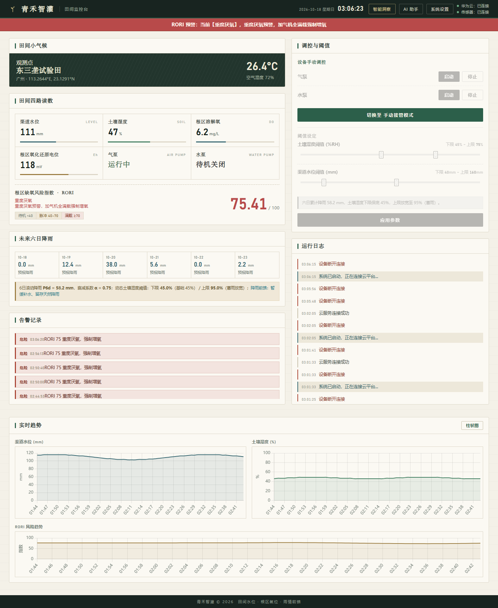
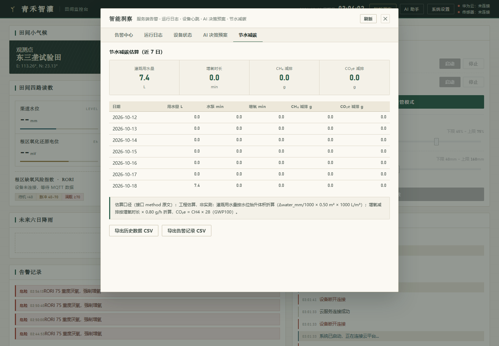
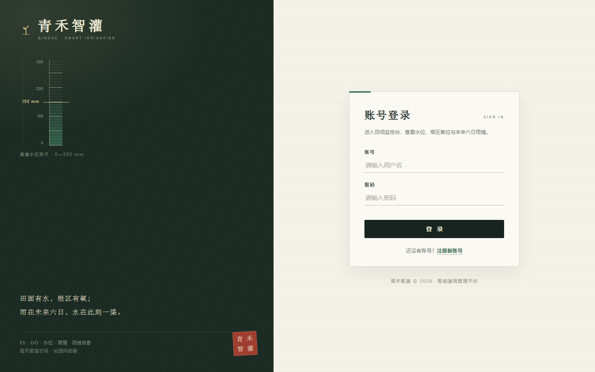

# 青禾智灌智慧灌溉管理平台 · 设计材料

> 这份材料回答四件事：为什么做、做成什么样、哪些地方是我们自己想的、具体怎么实现。
> 公式和参数与代码一一对应，文中数值都可以在 `qinghe/` 与 `static/js/` 里找到出处。

## 一、为什么做这个题目

水稻是用水量最大的作物之一，而稻田的常规灌溉方式是长期保持水层。水层把大气和土壤隔开，根区溶解氧很快被根系呼吸和微生物耗氧吃掉，氧化还原电位跟着往下掉。Eh 一旦降到零以下，产甲烷菌就成了优势菌群，甲烷通过稻株的通气组织排到大气里。加气灌溉用微纳米气泡把溶解氧和电位抬回去，从源头上破坏厌氧环境，是少见的能让"省水"和"减碳"同向成立的一条路。

设备的难点不在增氧泵，而在两个判断：什么时候该增氧，什么时候宁可不补水。

第一个是控制逻辑太被动。本地单片机按固定阈值触发，必须等土壤含水率跌破下限、或者氧环境已经恶化，才启动。它没有趋势预判能力，采样和机电还有时滞，边缘端的算力也处理不了中短期气象预报。也就是说，"提前一步"在原来的架构里根本做不到。

第二个是缺少跟气象预报的联动。装置看到土壤水分低于下限就抽水，经常出现刚灌满、紧接着一场暴雨把水全冲走，多余的水还得开闸排掉，水和电都白费。更糟的是暴雨后长时间深淹，根区氧环境会剧烈恶化，形成一个排碳高峰。省水的动作反而变成增排的动作。

所以这个项目真正想改的，是把"越限后启泵"往前挪成"降雨前控水、缺氧前增氧"；把单指标阈值换成多维风险度量；把不透明的自动控制换成能解释、能追溯、人能随时接管的协同方式。

需要先说清楚边界：我们没有做传感器和阀门的硬件研发，用的是现成的 ESP32-E 开发板加四路模拟量传感器；碳减排是按工程系数折算的估算值，不是实测排放量，不能拿去当碳交易凭证；微信小程序端也还没写，只有后端预留的接口。这三条在后面的"还没做完的事"里会再提一次。

## 二、设计主题与目标

主题可以用一句话概括：以稻田根区氧环境为控制核心，用多维指标的复合风险度量替代单指标阈值，用六日滚动降雨前馈把决策从事后补救挪到事前调蓄，再用人机协同的预案闭环和边缘自治兜底保证执行可靠，让节水、增氧、减碳三件事可以同时算得出来。

主题词：根区氧环境、根区缺氧风险指数（RORI）、降雨前馈、人机协同、边云协同、节水减碳。

目标定了四条，每条都给了量化口径，避免最后只能说"效果良好"：

| # | 目标 | 怎么算 |
|---|---|---|
| 1 | 节水 | 用水量按水位抬升换算成体积：`water_liters = Σ(Δwater_mm / 1000) × CHANNEL_AREA_M2 × 1000`，渠道面积默认 0.5 m²。前馈让触发下限往下调 `α · P_6d / H_root × 100%`，保底 45%；`P_6d ≥ 15 mm` 时上限再放宽 15 |
| 2 | 增氧 | RORI 三档联动气泵：低于 40 低耗待机，40–70 周期性脉冲，70 以上满载。DO 评价上限取 8.0 mg/L，Eh 评价区间取 −150 ~ 300 mV |
| 3 | 减碳 | 增氧时长按 0.8 g/h 折算甲烷减排，再用 GWP100 = 28 折算 CO₂e；前馈缩短暴雨后的深淹时长，抑制排碳高峰 |
| 4 | 可解释可追溯 | 每次自动动作附规则依据；AI 预案保留推理链和上下文快照；告警与日志落服务端并存 7 天，可导出 CSV |

## 三、系统功能

### 3.1 一屏能看到什么

主看板按"田间记录本"的思路排：左边是观测，右边是操作，底下是趋势。

左栏自上而下是区域气象、四路传感器读数（渠道水位 mm、土壤湿度 %、根区溶解氧 mg/L、根区氧化还原电位 mV）、两个泵的运行状态、RORI 风险条、六日降雨和告警记录。右栏是调控区（自动托管/手动接管、双滑块阈值、泵启停）和运行日志。页底三张趋势图，可以切换折线与柱状。

顶栏两个指示点分别表示"华为云连接"和"传感器在线"，这两个状态是分开的：MQTT 连上了不代表设备在传数据，反过来也一样，混在一起会误判。



界面参照田间记录本与水文测站的样子来做：纸色底、墨线框、宋体小标题、水位刻度与朱红印章，不用常见后台模板那种大圆角卡片和渐变按钮。

### 3.2 几个关键功能

**六日降雨前馈的动态阈值。** 把未来六天逐日降雨按衰减权重求和得到 P_6d，再用 10 mm、50 mm 两个界把雨量分三段取 α，算出当天真正生效的灌溉上下限。预测有雨就把触发下限往下调（保底 45%），把"马上补水"改成"等雨再看"；`P_6d ≥ 15 mm` 时上限放宽 15%，把田面库容留给降雨。界面上会把 P_6d、α、生效阈值和基础阈值并排显示，用户能看懂"今天为什么没补水"。

**RORI 分级预警。** 四路子风险因子加权融合成 0–100 的指数，按 70 和 40 切成重度厌氧、中度缺氧、安全三档。界面用红/橙/绿的横条加顶部横幅表达，同时附策略文案。指数越线会同时触发气泵动作和告警落库。

**自动调控。** 气泵按 RORI 档位启停，预测有雨时提前一级增氧，避免雨后的深淹把 Eh 打崩；水泵按水位滞回，低于下限且无雨就开泵，有雨就暂缓并记一条前馈决策，高于上限关泵。目标是状态真正变化才下发，不是每轮判定都发一遍。

**手动接管。** 调控区一键切到手动，两个泵各有启动/停止按钮，指令经 MQTT 下发到物模型的属性设置主题。设备离线时返回"设备未在线，无法发送指令"，模式切换会写日志，接管可追溯。人随时能推开机器的判断，这是设计上故意留的口子。

**AI 助手与预案。** 助手把实时 RORI、四路读数、泵状态、P_6d、α、生效阈值一起塞进 prompt 交给 DeepSeek，回答聚焦补水时机、增氧策略和操作注意事项。更进一步的一步在第四章讲：模型给的不是一段聊天，而是一份可以确认下发或拒绝的预案。

**告警与日志。** 告警按九类类型码区分（土壤与水位越限、RORI 中度/重度、设备离线、预案待确认、自动动作等），同一用户、同一类型码、同一段正文在 60 秒冷却窗内只落一条，随后异步推钉钉机器人，失败退避重试两次。日志分 system/device/auto/manual/plan/config 六类来源，守护线程每 1 秒或攒满 20 条批量落库。

**节水减碳看板。** 把用水量、增氧时长、CH₄ 和 CO₂e 减排量做成四个数字加一张按天的表，下方写明估算口径，并提示这不是实测值。



**数据导出。** 历史遥测和告警都能导出 CSV，带 UTF-8 BOM，Excel 打开中文不乱码。

### 3.3 后来补上的七块后端

做完第一版之后我们逐项对着说明书核对，发现有些能力只存在于前端，或者根本没实现。列在这里，因为它们是这一版实际做的工作。

告警原本只存在浏览器的 localStorage 里，刷新就没了，也没有确认状态。现在判定和落库都在服务端，`push_alert()` 返回是否去重、是否推送成功，界面倒序拉取，可以确认，只限本人。日志同样是散落在各客户端，一次调控的因果链没法跨端复现，现在入队即返回，队列满一千条丢最旧的，每 1 秒或攒满 20 条落库。

设备心跳是补出来的另一个判断。MQTT 连接正常不等于设备在线，断线但会话没断的时候界面还在显示数据，用户会拿着过期数据做决定。现在任何上报都刷新时间戳，静默超过 30 秒判离线，后台每 5 秒扫一遍，转为离线时推前端并落一条告警。数据不新鲜就必须停掉自动调控，否则"智能"会变成误动作。

AI 原来只能问答，模型结论落不到执行机构。现在提出预案、落库待确认、确认后逐条下发、拒绝留痕，超时 600 秒自动过期，白名单只允许气泵/水泵的开关。

"节水减碳"原来只有定性描述，回答不了"这周省了多少水"。现在按泵状态切换累加当日运行秒数，估算接口把用水量、增氧时长、CH₄、CO₂e 一起返回，并带上口径说明字段。

遥测和告警原来只进不出，加两个导出接口后可以交给课题分析用。

最后一件事是把调控逻辑从浏览器搬到服务端。原来策略全在前端 JS 里，页面一关就停摆，多端结果不可复现，也没法写测试。现在服务端有独立的自动调控引擎，默认关闭，需要显式开启，两次动作之间有最小间隔做时间滞回。

## 四、创新点

### 4.1 RORI：把"根区是否缺氧"变成可计算的数

四个子风险因子先各自做有界截断归一化：

```
S_Eh   = clamp(0, 1, (300 − Eh_real) / 450)        Eh 评价区间 −150 ~ 300 mV
S_DO   = clamp(0, 1, (8.0 − DO_real) / 8.0)        DO 评价上限 8.0 mg/L
Risk_water = (Water_A0 − 5) / 100    , Water_A0 > 5；否则 0
Risk_soil  = (2000 − Soil_A2) / 2000 , 0 < Soil_A2 < 2000；否则 0
```

再按复合加权增益方程融合并截断到 0–1：

```
P_risk = min(1.0, ω₁·S_Eh + ω₂·S_DO + ω₃·max(Risk_water, Risk_soil)
                  + γ·Risk_water × Risk_soil)

RORI = ⌊ P_risk × 100 ⌋
```

权重是 ω₁ = ω₂ = 0.35、ω₃ = 0.30、γ = 0.5。

三处取舍是特意定的，也是这个模型跟"几个指标加权平均"的区别所在。

第一，水土侧取 `max(Risk_water, Risk_soil)` 而不是相加。水位和土壤湿度描述的是同一个"水土缺氧载体"，相加等于把同一件物理事实算了两遍。取大者之后，ω₃ 只表达水土侧最坏的那个情况，权重才和 ω₁ + ω₂ + ω₃ = 1.0 自洽。

第二，耦合项 γ·Risk_water × Risk_soil 只在两者同时非零时才起作用。只有"深水层叠加上土壤饱和"这种组合工况才会拿到额外惩罚，而这恰好是排碳风险最高的工况。单独水位高或者单独土壤湿，不触发耦合项。

第三，S_DO 的评价上限用 8.0 mg/L，比传感器量程 20 mg/L 低。8.0 是稻田根区"氧充足"的农学判据，超过 8.0 时 S_DO 直接取 0，量程剩下的一半只用来观测过饱和峰，不参与打分。

分级和执行机构联动如下：

| 级别 | RORI | 界面 | 气泵 |
|---|---|---|---|
| Ⅰ 重度厌氧 | ≥ 70 | 红色高危预警 | 全载强制增氧，同时盯渠道水位 |
| Ⅱ 中度缺氧 | 40 – 70 | 橙色中危预警 | 周期性脉冲加气 |
| Ⅲ 安全 | < 40 | 绿色安全 | 低耗待机，网关照常轮询 |

拿一组现场值验算：Eh = 0 mV、DO = 2.0 mg/L、水位 50 mm、土壤 70% 时，S_Eh = 0.667、S_DO = 0.75、Risk_water = 0.45、Risk_soil = 0.70，代进去 P_risk = 0.233 + 0.263 + 0.210 + 0.158 = 0.863，RORI = 86，判重度厌氧。等 Eh 抬到 200 mV、DO 升到 6.0 mg/L，P_risk 降到 0.353，RORI = 35，回到安全区。

### 4.2 六日降雨前馈：控水等雨 + 蓄雨型控灌

前馈的思路说穿了不复杂，就是把未来六天提前算进今天。

```
P_6d = Σ(t=1..6) ω_t · P_t
ω_t  = [1.0, 0.9, 0.7, 0.5, 0.4, 0.3]

α = 0.95   ,  P_6d ≤ 10 mm
    0.75   ,  10 mm < P_6d ≤ 50 mm
    0.45   ,  P_6d > 50 mm
```

衰减算子是为了压住远期预报的不确定性：第六天报的 1 mm，只按 0.3 mm 计入。α 随雨量增大而减小，因为雨越大，径流和深层渗漏占的比例越高，能留在根区的比例越低。所以不能用"雨大就彻底停灌"这种粗放逻辑。

**策略一，前馈控水等雨**，下调触发下限：

```
Limit_lower = max(45%, Limit_min − (α · P_6d / H_root) × 100%)
H_root = 200 mm   核心活动根系层厚度
45%               防枯萎保底安全线
```

意思就是把预测的有效降雨折算成根系层内的等效含水率增量，再从基础下限里扣掉。举个数：基础下限 60%、P_6d = 40 mm、α = 0.75 时，折算增量是 0.75 × 40 / 200 × 100% = 15%，生效下限降到 45%，正好碰到保底线。45% 是水稻不受旱的生理边界，再往下调就是拿产量换水，所以到此为止。

**策略二，蓄雨型控灌**，放宽蓄水上限：

```
P_6d ≥ 15 mm 时：Limit_upper = min(100%, Limit_max + 15)
P_6d < 15 mm 时：Limit_upper = Limit_max
```

上限放宽相当于把田面当调蓄水库用：降雨前不灌到常规上限，雨后也不急着排，让雨水替代抽水。封顶 100% 是为了不让参数越界。

两条策略在调控里合成三种动作：气泵提前一级增氧、水泵暂缓补水（hold）、水位区间内正常滞回。每个动作都带一句文字依据，例如"水位 12.0 mm < 下限 30 mm，但 P_6d = 22.4 mm，暂缓补水"。用户看到的不只是一个动作，还有做这个动作的理由。

### 4.3 AI 预案：机器提案，人来拍板

问答式的 AI 助手有个问题：结论停在对话框里，落不到执行机构。我们的做法是把它变成一份待确认的预案。

第一步是注入感知。`build_context()` 汇总 RORI、风险等级、水位、土壤、DO、Eh、两个泵的状态、P_6d、α、生效阈值、是否手动、时间戳共十四项，取自遥测缓存、阈值表和最近一次预报。缺的项记成 None，不编造。

第二步强制推理显式化。prompt 要求模型只输出 JSON，字段是 `reasoning` + `actions` + `summary` + `risk`，超时 25 秒。模型必须先说明"为什么此刻不补水"，再给动作，不能只丢一个结论。

第三步落库待确认。结果写进 `plans` 表并置为 pending，界面上把完整推理文本和动作清单（设备、动作、理由）一起显示，人可以确认，也可以填理由拒绝。

第四步才下发。确认时校验归属和 pending 状态，超过 600 秒的置为 expired 并拒绝；真正下发时按白名单过滤，只允许气泵/水泵的 on/off 组合，然后写一条 plan 源日志和一条自动动作告警。

没密钥、调用失败或者返回解析不了的时候怎么办？退化成 `decide_control` 的规则方案，`reasoning` 里写明这是规则依据（RORI 分级 + 水位滞回 + 降雨前馈），并且用 `ai_used = False` 标出来。系统不会因为缺大模型就失去调控能力，也不会把规则算出来的结论伪装成模型推的。

### 4.4 边云协同：红线留在本地

整套判断分三层，越往下越"不讲道理"。

第一层在云端和 Web 端解算 4.1、4.2 的方程，把物理低阶信号变成有农学含义的特征。第二层让 DeepSeek 做长周期的策略推理，输出兼顾节水和低碳的方案。第三层在网关上硬编码两条红线：**Eh ≤ −100 mV 或 DO ≤ 1.5 mg/L**，轮询到就本地直接开气泵全载，不看云端结论，不等网络往返，而且是否决权最高的一层。

红线为什么取这两个值：−100 mV 和 1.5 mg/L 已经越过中度缺氧的农学边界，落在产甲烷菌群活跃的区间里，这时候任何犹豫都会变成实实在在的排放。这一层同时也是断网时的兜底，网络断了、云端不可用，本地仍然能执行最关键的动作。

重计算放在云端和 Web 端，网关只保留阈值比较和继电器/PWM 输出，硬件成本和固件复杂度不会因为算法演进就跟着涨。

需要坦白的是，这一层的固件目前只写在设计里，实测固件还没落地——这是这一版最明显的缺口，第七章会说明。

### 4.5 节水减碳怎么算，以及这个数不能干什么

```
灌溉用水量   water_liters = Σ (Δwater_mm / 1000) × CHANNEL_AREA_M2 × 1000
增氧时长     air_minutes  = 气泵当日累计秒数 / 60
甲烷减排     ch4_saved_g  = air_minutes / 60 × 0.8        （0.8 g/h 为工程系数）
二氧化碳当量 co2e_saved_g = ch4_saved_g × 28              （GWP100 = 28）
```

口径边界必须说清楚，否则容易被当成精确值：用水量是水位抬升的体积换算，不含渠道渗漏和蒸发；甲烷减排是按增氧时长线性折算的工程系数，没有做箱法或涡度相关实测。它能用于同口径的横向比较和过程管理，不能直接当碳交易凭证。这条限制跟着 `method` 字段一起返回，看板上也会写出来。

### 4.6 和传统方案比，差在哪

| | 传统定时/定阈值灌溉 | 这套系统 |
|---|---|---|
| 控制依据 | 单一土壤含水率或定时器 | DO、Eh、水位、土壤四维融合的 RORI |
| 时域 | 纯后馈，越限才动作 | 六日降雨前馈 + 后馈兜底 |
| 气象利用率 | 无，或只用来展示 | P_6d 加权、α 分段、下限下调与上限放宽联动 |
| 可解释性 | 动作和理由不关联 | 动作带依据，预案存推理链，日志可回放 |
| 减碳 | 无度量，深淹导致排放高峰 | 增氧抑制产甲烷 + 前馈削减深淹，CH₄/CO₂e 可量化 |
| 异常兜底 | 断网即失控 | 边缘红线本地强控 + 人可随时接管 |
| 工程质量 | 单文件脚本、无测试、口令写死 | 分包分模块 + 708 例后端用例 + 75 例前端用例 |

## 五、实现思路与技术方法

### 5.1 四阶段闭环

```
① 多源感知   水位(A0, ADC 0–4095 → 0–300mm)、土壤(A2 → 0–100%)、
             DO(A4, 0–20mg/L)、Eh(A6, −150~300mV)，每 3s 上报
             → MQTT → 华为云 IoTDA → 后端
      ↓
② 风险预测   S_Eh / S_DO / Risk_water / Risk_soil → RORI(0–100) → 三档(70/40)
             叠加 P_6d / α → 生效下限 / 生效上限
      ↓
③ 智能决策   DeepSeek 推理 → 预案(pending) → 人工确认/拒绝 → 下发
             无密钥/超时/解析失败 → decide_control 规则回退
      ↓
④ 自动调控   气泵(D5, PWM 5kHz/8bit)：待机 / 脉冲 / 满载
             水泵(D7+D9)：开 / 关 / 暂缓(hold)
             边缘兜底：Eh ≤ −100mV 或 DO ≤ 1.5mg/L → 本地强控
```

闭环上有三条硬约束：状态真正变化才下发；同一设备两次动作之间有最小时间间隔（服务端托管设 60 秒）；人工接管优先于任何自动策略，切换即生效并留痕。

### 5.2 技术栈，以及为什么没选别的

| 选型 | 为什么 | 没选的那个为什么不行 |
|---|---|---|
| Flask + 应用工厂/蓝图 | 轻，十几个 JSON 接口用蓝图装配很清楚 | Django 的 ORM 和 Admin 用不上，迁移成本白付 |
| Flask-SocketIO | 数据是推送型的，服务端主动下发比前端轮询实时 | 原生 WebSocket/SSE 得自己写房间隔离和重连 |
| paho-mqtt | 标准 3.1.1 客户端，支持 VERSION2 回调 | 云厂商 SDK 绑死单一厂商，依赖重，出问题不好查 |
| SQLite（WAL） | 单机、单写入线程、读多写少，零运维；WAL 让读不阻塞写 | MySQL 要多一个服务，还要备份运维 |
| Chart.js | Canvas 渲染，千点级也流畅，自包含 | ECharts 体积和配置复杂度都更高 |
| DeepSeek | 中文农学语境下推理稳，兼容 OpenAI 协议好换模型 | 本地部署算力不够，25 秒内出不了结果 |
| 和风天气 7d | 给逐日降雨量，正好是六日加权求和要的数据形态 | 免费聚合接口字段不稳，容易断 |
| 华为云 IoTDA | 不用自建 Broker，属性设置下行和转发规则开箱可用 | 自建 EMQX 要公网入口、证书和运维 |
| FireBeetle ESP32-E | 12 位 ADC 直采四路模拟量，LEDC 硬件 PWM 调气量 | ESP8266 的 ADC 精度和 PWM 通道都不够 |

### 5.3 几个关键做法

**无量纲化标定。** 四路信号量纲互不相容，先统一到可比区间。DO 按 `adc / 4095 × 20.0` 映射到 0–20 mg/L 并限幅；Eh 按 `−150 + adc / 4095 × 450` 映射到 −150 ~ 300 mV；水位 ADC 0–4095 直接映射 0–300 mm（探针式，ADC 越高水越深）；土壤 ADC 0–4095 映射 0–100%（电容式，ADC 越高越干，所以是 `(4095 − adc) / 4095 × 100`）。土壤这一路是最容易写反的地方，方向一错，整个风险模型的结论都是反的。

**动态阈值的执行顺序。** 先算 P_6d，再按分段取 α，最后修正上下限，三步顺序不能换。下限必须先过 45% 保底，上限必须先过 100% 封顶，顺序颠倒会算出越界的阈值。

**三层滞回去抖。** 目标状态和上一状态相同就不动作；同一设备两次动作之间不小于最小间隔；上下限之间留出区间，区间内不动作。三层叠起来，临界值附近的抖动不会变成频繁启停。

**批量落库。** MQTT 回调线程只做解析和入队，后台线程每 1.0 秒或攒满 200 条做一次 `executemany`，队列上限 2000 条、满了丢最旧。回调路径上不发生磁盘 IO，高频上报不会把实时推送拖住。

**WAL 和连接管理。** 每个连接开 `journal_mode=WAL` 和 `busy_timeout`，读不阻塞写；连接一律用 `with closing(get_db()) as conn:` 关闭，不漏连接。

### 5.4 工程结构

业务包按职责切，单向依赖，不成环：

| 模块 | 职责 |
|---|---|
| `config` | 环境变量、阈值常量、量程标定、模型参数，不导入任何子模块 |
| `db` | 连接管理、建表与增量迁移、各表 DAO |
| `auth` | 登录注册、会话与 JWT、失败限流、密码哈希 |
| `iot` | MQTT 接入、报文解析、指令下发、批量落库队列 |
| `irrigation` | RORI、分级、动态阈值、`decide_control` 策略 |
| `alerts` | 告警判定纯函数、去重冷却、Webhook 推送 |
| `weather` | 预报拉取、逆地理编码与缓存 |
| `ai` | 大模型请求构造与调用 |
| `realtime` | SocketIO 事件注册与按用户房间推送 |
| `routes/` | HTTP 蓝图，按 auth / config / data / ai / app 拆分 |

`irrigation` 和 `alerts` 里不放 IO 和全局状态，输入确定输出就确定，所以 RORI、分级、动态阈值、控制策略都能直接单测。前端的 `computeRori`、`computeDynamicThreshold` 跟后端逐字对应，两边算出来的数必须一样——这一点被做成了回归断言，改参数顺序会立刻让测试红掉。

部署分两种跑法。本地开发直接 `python app.py`；要在校园网里让别人访问，用 `python server.py`，它用 waitress 承载应用、强制 `FARM_DEBUG=0`，启动时把本机的局域网地址打印出来，省得自己算 IP。防火墙放行、停止脚本、`.env.example` 都在仓库里，密钥用 `tools/gen_secret.py` 生成。第一次访问落在登录页：



## 六、做下来踩过的坑

这一节写的是真实修过的问题，放在这里比放在"已完成"里更诚实。

**一是 JWT 能被完全绕过。** 安全体检时发现，如果没有设置 `FARM_SECRET_KEY`，代码回落到一个写死的常量当签名密钥，用它自签一张 token 就能冒充任意用户，实测能直接下发水泵指令。修法是不再让常量参与签名：没配置时用 `secrets.token_urlsafe(48)` 生成进程级随机密钥，重启后登录态失效，生产环境用 `tools/gen_secret.py` 生成后写进 `.env`。

**二是历史曲线上的 RORI 是缺维度的。** 早期 `sensor_history` 只存了水位和土壤两路 ADC，DO 和 Eh 是后来才加的列，所以老数据点算不了四维 RORI，只能退回二维。我们的处理是：库里幂等补列、新数据四维落库、历史段在图上标注"二维近似值"，并在图下统计有多少个点是近似的。宁可显式标出来，也不让近似值看着像真值。

**三是趋势图只有坐标轴没有线。** 图表配置里为了省事加了 `parsing: false`，本意是跳过解析提速，结果 Chart.js v4 拿到的是纯数字数组，取不到每个点的 y 值，整条线全被画到基点，y 轴退化成 0~1。后来删掉这个开关，用 `animation: false` 加 `update('none')` 做无过渡刷新，顺手把 x 轴标签加了自动稀疏。

**四是设备状态面板会说假话。** 从没上报过的设备，面板上面显示"离线"，下面却写"最近上报 --、静默刚刚"，因为静默时长把"没有数据"当成 0 秒处理了。改成未上报时显示 `--`，并提示确认设备是否上电联网。

**五是配置弹窗在笔记本屏幕上放不下。** 十四项配置，1080 高度的屏幕上底部保存按钮和退出按钮都被裁掉，遮罩层也不能滚。改成遮罩可滚、弹窗最大高度等于视口减 48px，超出时弹窗内部自己滚。

这些 bug 有一个共同点：接口测试全绿，页面看着也能开，但只有真的用眼睛看、真的操作一遍才会暴露。所以我们后来补了一层前端结构测试，把模板里的 id、静态资源路径、脚本引用这些约定固化成断言，防止模板和脚本改着改着就失联。

## 七、现在做到哪一步了

### 7.1 已经能跑的

- 风险度量闭环：RORI 四因子融合、70/40 三档分级、气泵三档联动，后端纯函数实现，前端逐字对应，有单测覆盖。
- 前馈策略：P_6d 加权、α 分段、下限保底 45%、上限放宽 15%、`P_6d ≥ 15 mm` 触发蓄雨，与"控水等雨 / hold"联动，动作带文字依据。
- 工程结构：模块分层加蓝图注册，纯函数与 IO 分离；批量落库加 WAL 让高频上报不影响实时推送；告警去重和登录限流就位。
- 可解释链条：告警九类类型码、日志六类来源、AI 预案保留推理文本和上下文快照，数据能导 CSV，形成"显示—判定—动作—留痕"的同源记录。
- 安全方面：密钥环境化，未配置时用进程随机密钥（伪造 token 一律 401）；写接口统一入参校验（类型混淆不再 500）；登录限流不再信任可伪造的 `X-Forwarded-For`。
- 验证方式：后端 708 例 pytest、前端 75 例 node 用例全绿；另在校园网真实 IP 下起服务，用浏览器和脚本各走了一遍注册、登录、遥测、告警、预案、导出。

### 7.2 还没做完的

- **边缘固件自治强控。** 红线判据只写进了设计，固件主循环里还没实现。这是最该补的一块：断网时不经云端直接强控，并把"边缘保底事件"回传平台展示。
- **微信小程序端。** 后端已预留 JWT 登录和指令下发两个接口，客户端一行没写。后续要补实时数据、告警、预报页面，与 Web 端共用同一套服务端判定。
- **碳汇 MRV 数据对接。** 现在的 CH₄ 减排是按增氧时长折算的工程估算，接上实测排放因子之后才能进可测量、可报告、可核查的流程。
- **多地块多设备。** 目前按用户维度组织配置和连接，一个账号对应一块田。要支持多块田、多套网关，需要引入地块与设备两级实体，并把 RORI 和阈值参数下沉到地块粒度。
- **AI 推理的稳定性。** 目前靠"必须输出 JSON"和超时回退来约束，缺少对推理内容的更强校验。模型偶尔会把"建议"写成"立刻执行"，虽然有人工确认这一关兜着，但 prompt 和校验都还可以再收紧。
