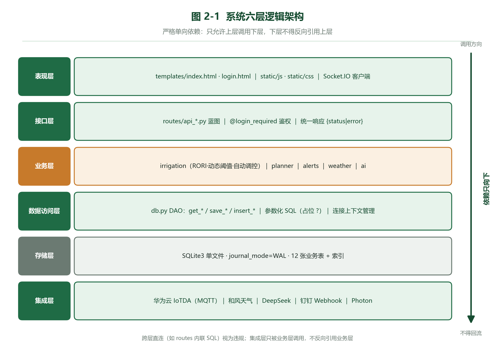

---
title: 测试标题
subtitle: 概要设计说明书
version: V1.0
date: 2026年10月19日
---

# 测试标题 概要设计说明书

## 一、引言

### 1.1 编写目的

本段用于**冒烟测试**，含 `行内代码` 与正常文字。

- 一级条目
  - 二级条目

1. 手工编号一
2. 手工编号二

> 权衡：这是提示框。

表 1-1 测试表

| 列A | 列B |
|---|---|
| a1 | **b1** |
| a2 | `b2` |

```python
def f(x):
    return x + 1
```


