# 一、引言

## 1.1 编写目的

本文给出青禾智灌智慧灌溉管理平台（以下简称本系统）V1.0的总体设计方案：说明需求边界、设计目标与创意取舍，划定模块分层与依赖方向，固化边云职责分工与技术栈选型，作为详细设计、编码实现、测试用例编写和验收评审的共同基线。

本文回答"为什么这样设计"，而不是"某一行怎么写"。凡属实现层面的内容——算法公式的逐项推导、DAO函数行为、路由内部的处理步骤、常量全表——一律下沉到《详细设计说明书》，本文只保留模块名、文件名、接口路径、表单字段与决策依据。文中出现的常量值（如RORI权重0.35/0.35/0.30、耦合系数0.5、分档阈值70与40、P6d衰减权重、保底下限45%）与量化指标均取自当前代码，可直接核对，不用形容词代替数字。

## 1.2 范围

本文覆盖服务端`qinghe`业务包与`qinghe/routes/`蓝图、浏览器端`templates/`与`static/js/`九模块、SQLite数据库（含`farms`地块表共12张）、HTTP与SocketIO接口契约、边云协同分工与两种部署形态。

不在本文范围内：ESP32-E固件内部实现与边缘强控固件代码、微信小程序客户端、碳汇MRV实测对接。上述三项在正文相应位置标注了当前落地状态，不做能力夸大。

## 1.3 术语与缩略语

表 1-1 术语与缩略语
| 术语 | 全称 | 在本系统中的含义 |
|---|---|---|
| RORI | Root-zone Oxygen Risk Index | 根区缺氧风险指数，四因子融合后归一化到0–100，按70与40分三档 |
| DO | Dissolved Oxygen | 根区溶解氧，单位mg/L，量程0–20，农学评价上限取8.0 |
| Eh | Oxidation-Reduction Potential | 根区氧化还原电位，单位mV，量程−150–300 |
| P6d | 6-day Precipitation | 未来6日降雨按衰减权重[1.0,0.9,0.7,0.5,0.4,0.3]加权求和，单位mm |
| α | Alpha Coefficient | 降雨有效利用系数，P6d≤10取0.95、10–50取0.75、>50取0.45 |
| HITL | Human-in-the-Loop | 人在回路，AI只产出待确认预案，人工确认后才下发执行 |
| IoTDA | Huawei Cloud IoT Device Access | 华为云设备接入服务，承载属性上报与属性设置下行 |
| MQTT | Message Queuing Telemetry Transport | 轻量发布/订阅协议，本系统使用1883端口 |
| WAL | Write-Ahead Logging | SQLite日志模式，读不阻塞写 |
| NF1–NF7 | New Feature 1–7 | 第二轮新增功能编号：告警中心、运行日志、设备心跳、决策预案、节水减碳、CSV导出、服务端自动调控 |
| ESP32-E | FireBeetle ESP32-E | 边缘网关，12位ADC采四路模拟量，LEDC硬件PWM调气量 |

## 1.4 参考资料

1. 《青禾智灌智慧灌溉管理平台详细设计说明书》（`docs/30_详细设计说明书.md`）
2. 《青禾智灌智慧灌溉管理平台测试与验收报告》（`docs/40_测试与验收报告.md`）
3. 《智氧青禾—低碳稻作根区氧环境智能预测与加气灌溉调控系统说明书》（`文档/说明书.docx`）
4. 《青禾智灌智慧灌溉管理平台用户手册》（`文档/青禾智灌智慧灌溉管理平台_用户手册.docx`）
5. 《项目设计材料：设计主题、功能与创新点》（`docs/10_项目设计材料_设计主题功能与创新点.md`）
6. 《后端设计事实清单》与《新增功能规格》（`docs/_backend_design_facts.md`、`docs/_new_features_spec.md`）
7. 《AGENTS.md仓库开发契约》与依赖清单`requirements.txt`
8. 华为云IoTDA设备接入文档、和风天气7日预报API、Photon逆地理API、DeepSeek Chat Completions API

# 二、总体设计

## 2.1 需求概述

系统服务于单机部署、校园网小规模接入的稻田灌溉场景，主链路只有一条：遥测进来、判定出去、动作下发、痕迹留下。围绕它拆出10项功能需求。

表 2-1 功能需求与验收要点
| 编号 | 功能 | 验收要点 |
|---|---|---|
| F1 | 多源感知接入 | 水位、土壤湿度、根区DO、Eh四路遥测与双泵状态经IoTDA上送，3秒一帧 |
| F2 | 实时看板 | SocketIO推送后1秒内刷新，统一tick按500毫秒合并刷写 |
| F3 | RORI风险评价 | 四因子融合得0–100分并分三档（≥70重度、40–70中度、<40安全） |
| F4 | 降雨前馈动态阈值 | 由7日预报算P6d与α，输出生效上下限，驱动"控水等雨" |
| F5 | 自动调控 | 气泵按RORI档位、水泵按水位滞回动作，仅状态变化才下发 |
| F6 | 认知推理与人机协同 | AI预案须人工确认后才下发，超时600秒自动过期 |
| F7 | 告警 | 九类类型码，同码同正文60秒内只落一条，异步推送webhook |
| F8 | 运行日志 | 六类来源统一入队，每1秒或攒满20条批量落库 |
| F9 | 历史与导出 | 按账号与地块隔离，升序、上限5000条；CSV上限50000行 |
| F10 | 配置与账户 | 21项配置读写及掩码保护；注册、登录、改密、JWT签发 |

非功能指标同样按可测量口径给定：waitress单进程8线程（`FARM_THREADS`默认8），每用户一条MQTT连接配独立网络线程，足以承载10台设备×3秒上报（约3.3帧/秒）；MQTT收包到浏览器可见≤1.0秒，本地API的P95≤200毫秒；AI对话超时20秒、AI预案超时25秒；遥测保留7天；登录失败5次锁定600秒。

## 2.2 设计目标与原则

表 2-2 设计原则与落地证据
| 原则 | 内涵 | 落地证据 |
|---|---|---|
| 前馈优先 | 能用预测消解的动作不留给越限补救 | `compute_p6d`/`alpha_of`/`compute_dynamic_threshold`串联 |
| 多源融合 | 不用单指标阈值裁决根区状态 | 权重0.35/0.35/0.30，耦合系数γ=0.5 |
| 人机协同 | 机器只提案，执行权在人 | `plans`表pending状态机，下发前过白名单 |
| 边云解耦 | 重计算在云，网关只比较阈值与驱动继电器 | 网关红线Eh≤−100mV或DO≤1.5mg/L，不看云端结论 |
| 低算力约束 | 算法可在浏览器端逐字复算 | `static/js/irrigation.js`与`qinghe/irrigation.py`逐位对齐 |
| 失败不升级 | 外部依赖失灵只降级，不抛给请求栈 | `fetch_forecast`返回`{'code':'ERR'}` |

前两条是立题依据：传统触发条件都落在出问题之后，而稻田缺氧一旦发生，纠正成本远高于预防。

## 2.3 创意设计

四条创意构成从感知到执行的闭环，前三条解决"什么时候动"，第四条解决"凭什么动、谁拍板"。

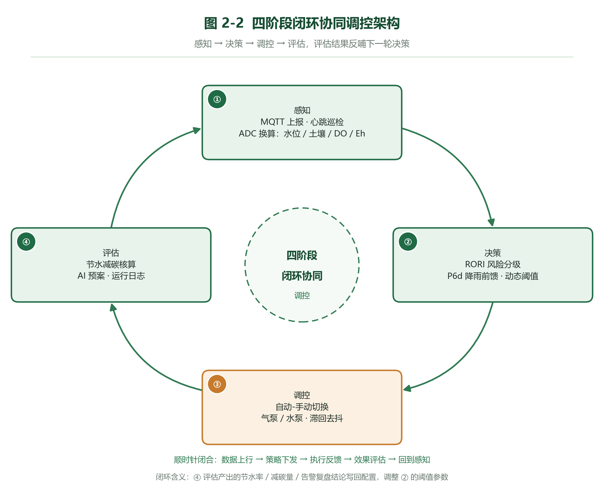

**（1）四阶段闭环协同调控。** 传统做法是本地单片机按固定阈值轮询：等土壤含水率跌破下限或氧环境已恶化才启泵，采样与机电还有时滞，边缘算力也处理不了中短期气象预报，"提前一步"在旧架构里做不到。本系统把调控拆成四段严格串联：多源感知（3秒一帧，四路信号统一无量纲化）→风险预测（RORI三档分级，叠加P6d与α修正生效阈值）→智能决策（AI推理产出预案，规则引擎兜底，人工确认）→自动调控（气泵三档、水泵三态）。链条上压三条硬约束：目标状态与上一状态相同就不下发；同一设备两次动作不小于最小间隔（服务端托管60秒）；人工接管优先于任何自动策略。好处是动作可解释、预案有推理链、日志可回放。

**（2）六天滚动降雨前馈控水。** 传统做法只盯土壤含水率，水分不足就抽水，常刚灌满遇暴雨，水被冲走还得开闸排掉，水电双废；更糟的是暴雨后长时间深淹把Eh压低，形成排碳高峰——省水的动作反而变成增排。本系统把未来六天提前算进今天：按衰减权重ω=[1.0,0.9,0.7,0.5,0.4,0.3]加权得P6d，用10mm与50mm两个界分段取α=0.95/0.75/0.45，再用α·P6d/H_ROOT×100%折算成根系层等效含水率增量下调触发下限，保底45%；P6d≥15mm时上限放宽15并封顶100%。补水决策因此从事后补救变成事前调蓄。一处边界须如实说明：`effLower`实现为`max(45, humi_down−α·P6d/200×100)`，默认下限40时结果恒为45，"下调"只在基础下限调至45以上才体现，属前端既有行为，按要求原样保留。

**（3）RORI多维复合风险度量。** 传统单指标阈值既表达不了"深水层叠土壤饱和"这类组合工况，也给不出连续的风险程度。本系统先做有界截断归一化：S_Eh=(300−Eh)/450、S_DO=(8.0−DO)/8.0、Risk_water=(水位−5)/100、Risk_soil=土壤湿度/100，再按`pRisk=0.35·S_Eh+0.35·S_DO+0.30·max(Risk_water,Risk_soil)+0.5·Risk_water·Risk_soil`融合，`RORI=clamp(pRisk,0,1)×100`。三处取舍是刻意的：水土侧取大者而非相加，因两者描述同一缺氧载体，相加等于把同一物理事实算两遍；耦合项只在两者同时非零时生效，恰好命中排碳最高的工况；S_DO上限取8.0而非量程20，超过按氧充足记零分。验算可复核：Eh=0mV、DO=2.0mg/L、水位50mm、土壤70%时RORI=86判重度厌氧；Eh抬到200mV、DO到6.0mg/L后RORI=35回安全区。

**（4）DeepSeek认知推理与人机协同确认。** 传统问答式AI的结论停在对话框里，落不到执行机构，"建议"与"执行"之间也没有护栏。本系统把助手改造成提案机：先用RORI、风险等级、四路读数、双泵状态、P6d、α、生效阈值、是否手动、时间戳共14项拼成上下文注入，要求模型只输出JSON（reasoning/actions/summary/risk），超时25秒；结果落`plans`表置pending，界面同时显示推理文本与动作清单，人可确认也可填理由拒绝；确认时才按白名单下发，只允许`air_pump`/`water_pump`的`on`/`off`组合，超过600秒置expired。无密钥、超时或解析失败时退化为`decide_control`规则方案，`reasoning`写明规则依据并以`ai_used=False`标出。好处三重：结论可解释、执行有护栏、能力不失守——缺大模型不丢调控能力，也不把规则结论伪装成模型推理。

## 2.4 系统总体结构

系统采用六层结构，依赖方向自上而下严格单向；MQTT数据流反向，从集成层穿回业务层再进接口层。

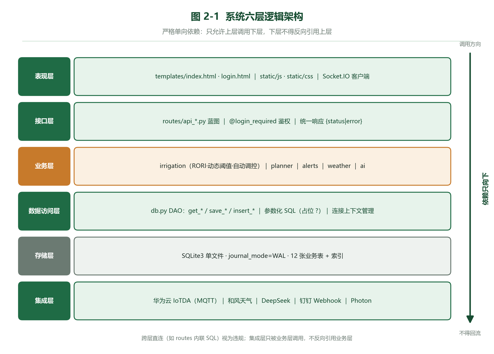

表 2-3 各层职责与依赖约束
| 层 | 主要构成 | 职责 | 关键约束 |
|---|---|---|---|
| 表现层 | `templates/`两模板、`static/js/`九模块 | 展示、交互、图表渲染与DOM节流 | 不拼接未转义数据；定时器统一挂tick |
| 接口层 | `qinghe/routes/`十一个蓝图、`qinghe/realtime.py` | 路由注册、入参校验、鉴权、响应组装 | 不含业务算法，不直接写SQL |
| 业务层 | `auth`/`iot`/`irrigation`/`alerts`/`weather`/`ai`及NF1–NF7七模块 | 算法、协议适配、状态机、外部调用 | 不反向import接口层；异常不外抛 |
| 数据访问层 | `qinghe/db.py` | 连接管理、幂等迁移、DAO | 唯一SQL出口，参数化占位 |
| 集成层 | IoTDA、和风天气、Photon、DeepSeek、webhook | 外部协议适配 | 全部带超时，失败降级 |
| 边缘层 | FireBeetle ESP32-E、四路传感器、双泵 | 采集、执行、断网本地兜底 | 不在平台代码范围内，只固化Topic与指令语义 |

分层的收益是改动局部化：`qinghe/config.py`只`import os`、被全员依赖却永不参与循环；`qinghe/irrigation.py`无IO、无全局状态，可脱离Flask单测。

## 2.5 边云协同与边缘自治

整套判断分三层，越往下越"不讲道理"，也越不依赖网络。第一层在云端与浏览器端解算2.3节的方程，把ADC原始值变成有农学含义的特征；第二层交给DeepSeek做长周期策略推理，失败即退化为规则引擎；第三层在网关硬编码两条红线：Eh≤−100mV或DO≤1.5mg/L，命中就本地开气泵全载，不等云端结论与网络往返，否决权最高。

红线取这两个值有农学依据：两者都已越过中度缺氧边界，落在产甲烷菌群活跃区间，此时任何犹豫都会变成实际排放，这一层同时是断网兜底。

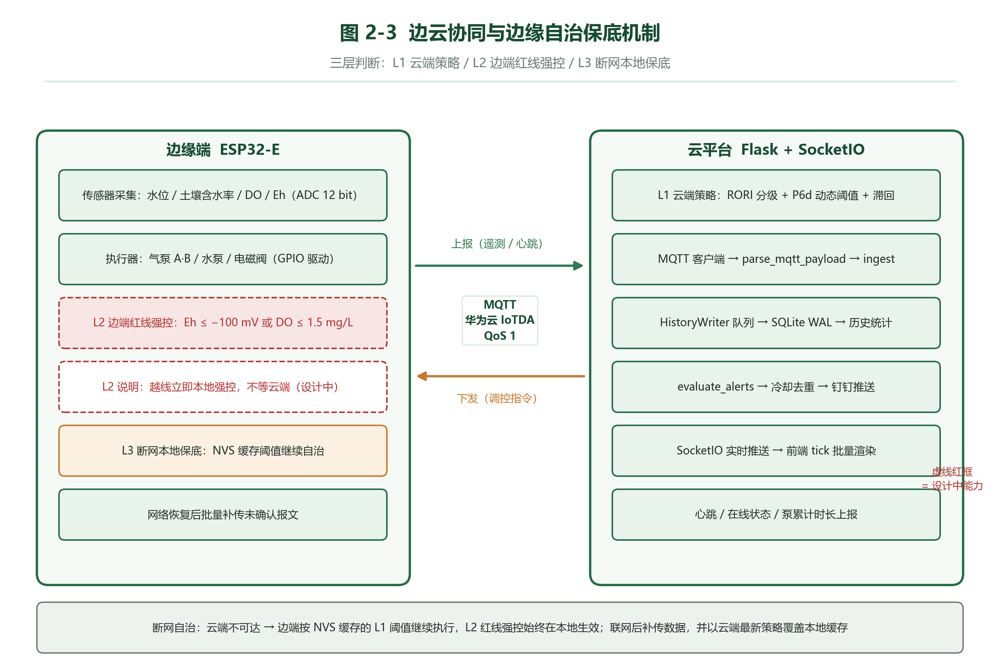

重计算留在云端，网关只保留阈值比较与继电器/PWM输出，硬件与固件复杂度不随算法演进上涨。当前状态须如实标注：平台侧已固化上行`/esp32e/data`、下行`/esp32e/cmd`与`$oc/devices/<device_id>/user/#`反馈三个Topic，网关固件里的红线强控仍停留在设计，是本版本最明显的缺口。

## 2.6 技术栈选型

表 2-4 技术栈选型
| 层次 | 选型 | 版本 | 选它的理由 |
|---|---|---|---|
| 运行时 | Python | 3.10+ | 标准库自带SQLite，校园机安装成本低 |
| Web框架 | Flask（应用工厂+蓝图） | ≥3.0 | 十几个JSON接口装配边界清晰，不白付ORM与Admin成本 |
| 实时推送 | Flask-SocketIO / python-socketio / engineio | ≥5.3 / ≥5.10 / ≥4.8 | 数据是推送型的，复用HTTP端口，长轮询自动降级 |
| WSGI服务器 | waitress | ≥3.0 | 纯Python、Windows友好、多线程，不与paho后台线程冲突 |
| 令牌 | PyJWT | ≥2.8 | HS256无状态签名，移动端不必维护会话表 |
| 物联网接入 | paho-mqtt | ≥2.0 | 标准3.1.1客户端，不绑死单一云厂商 |
| 持久化 | SQLite（标准库） | 3.x | 单写多读，WAL下读不阻塞写，单文件拷贝即备份 |
| 天气预报 | 和风天气7日预报 | v7/weather/7d | 直接给逐日降雨量，正是P6d所需形态 |
| 认知推理 | DeepSeek Chat Completions | `deepseek-chat` | 中文农学语境推理稳定，兼容OpenAI协议 |
| 外部调用 | requests | ≥2.31 | 超时参数简单可控，与Flask生态一致 |
| 图表 | Chart.js | 4.4.1（本地vendor） | Canvas渲染，抽样300点后流畅，不依赖CDN |
| 地图 | Leaflet | 1.9.4（本地vendor） | 选点与圈地，脚本样式同源，仅底图走公网 |
| 测试 | pytest / node --test | ≥8.0 / v22 | 前端纯函数可用node与后端逐位对齐 |

选型有一条共同取向：能用标准库与本地静态资源解决的不引入外部服务，由此换来零运维部署。

# 三、模块设计

## 3.1 模块划分总表

系统按"一个文件一类职责"拆分，后端 19 个业务模块 + 10 个路由蓝图，单文件均不超过 600 行。模块清单见表 3-1。

表 3-1 模块划分总表
| 模块 | 职责 | 关键文件（行数） | 主要对外函数 |
|---|---|---|---|
| 配置常量 | 全局常量唯一来源，只 import os，不依赖任何业务模块 | `qinghe/config.py`（153） | `THRESH_DEFAULTS`、`CSP_POLICY`、各类阈值与超时常量 |
| 数据访问 | SQLite 连接、建表、幂等迁移、各表 DAO | `qinghe/db.py`（549） | `get_db()`、`init_db()`、`save_config()`、`query_history()`、`load_iot_config()` |
| 认证与安全 | 注册/登录/改密、PBKDF2 哈希、JWT、登录限流 | `qinghe/auth.py`（155） | `hash_password()`、`verify_password()`、`issue_token()`、`require_token` |
| 入参校验 | 统一类型/范围/长度校验，失败抛 `ValidationError` | `qinghe/validators.py`（188） | `as_int()`、`get_json_object()`、`parse_int_range()`、`parse_bool_strict()` |
| 设备接入 | 华为云 IoTDA MQTT 接入、报文解析、遥测落库 | `qinghe/iot.py`（494） | `connect_huawei_iot()`、`parse_mqtt_payload()`、`ingest_telemetry()`、`send_property_command()` |
| 实时通道 | SocketIO 按用户分房推送、上行指令白名单 | `qinghe/realtime.py`（81） | `emit_hw_data()`、`register_events()`、`start_device_watcher()` |
| 灌溉决策 | RORI 计算、动态阈值、自动调控（全部纯函数） | `qinghe/irrigation.py`（194） | `compute_rori()`、`classify_rori()`、`compute_p6d()`、`decide_control()` |
| 告警判定 | 5 条阈值规则判定、60 秒冷却去重、Webhook 推送 | `qinghe/alerts.py`（74） | `evaluate_alerts()`、`AlertDeduper`、`notify_webhook()` |
| 告警中心 | 告警落库、查询、确认、保留期清理 | `qinghe/alert_center.py`（304） | `push_alert()`、`list_alerts()`、`ack_alert()`、`prune_alerts()` |
| 运行日志 | 有界队列 + 批量落库的异步日志 | `qinghe/logbook.py`（310） | `add_log()`、`query_logs()`、`flush_logs()` |
| 设备心跳 | 上报时间戳登记、离线巡检、状态翻转推送 | `qinghe/heartbeat.py`（271） | `mark_seen()`、`get_status()`、`sweep_offline()`、`start_watcher()` |
| AI 决策预案 | 上下文快照、AI 生成、规则回退、人工确认闭环 | `qinghe/planner.py`（599） | `build_context()`、`propose_plan()`、`confirm_plan()` |
| 节水减碳 | 泵运行时长结算、用水量与减排量折算 | `qinghe/metrics.py`（288） | `note_pump_state()`、`overview()` |
| 自动调控 | 服务端保底控制引擎（默认关闭） | `qinghe/autocontrol.py`（254） | `is_enabled()`、`tick()` |
| 天气与地理 | 和风天气代理、Photon 逆地理与缓存 | `qinghe/weather.py`（84） | `fetch_forecast()`、`geo_lookup()` |
| AI 助手 | 实时快照拼装、DeepSeek 对话代理、SSRF 防护 | `qinghe/ai.py`（227） | `build_snapshot()`、`chat()`、`is_public_http_url()` |
| 日历建议 | 未来 7 日雨情与灌溉建议分档 | `qinghe/advice.py`（110） | `build_calendar()` |
| 外部自检 | 四类外部接入的只读连通性探测 | `qinghe/diag.py`（176） | `probe()`、`TARGETS` |
| 设备模拟 | 四种场景的遥测数据生成（供演示与测试） | `qinghe/simulate.py`（146） | `generate()`、`SCENARIOS` |
| 路由蓝图 | 10 个蓝图文件按域拆分，只做校验与响应组装 | `qinghe/routes/*.py`（共 1232） | 见 3.2 节 |

## 3.2 后端模块逐一说明

**数据与配置层。** `config.py` 是整棵依赖树的叶子，只 import 标准库，因此任何模块都能安全引用它而不产生循环依赖。`db.py` 是全系统唯一直接持有 SQLite 连接的文件，向上暴露"一表一动作"的 DAO 函数，向下负责建表与幂等迁移：启动时用 `PRAGMA table_info` 判断列是否存在，缺列才 `ALTER TABLE`，重复启动不会报错，老库自动补齐 `do_mgl`、`eh_mv`、`farm_id` 等后加字段。`validators.py` 把入参校验从业务代码里剥离出来，任何写接口都要先过它一遍，不合格立即返回 4xx。

**接入与实时层。** `iot.py` 承担最重的一段：维护按用户隔离的 MQTT 客户端注册表，解析三种报文格式（华为云 M2M、自定义 JSON、纯文本数值），把读数写进 `HistoryWriter` 的有界队列，再由独立线程批量落库。选择"队列 + 批量"而不是逐条写库，是因为 MQTT 回调线程一旦阻塞，整个 broker 心跳都会超时断连；队列满时丢弃最旧数据，用丢弃换连接稳定性。`realtime.py` 是薄薄一层，只做分房推送与上行指令白名单，把 SocketIO 的细节与业务隔开。

**算法与决策层。** `irrigation.py` 里全是纯函数——同样输入永远得到同样输出，不碰数据库、不发网络请求。这条纪律的直接收益是算法可以被单元测试覆盖到边界（`compute_rori(1500, 2200, 6.0, 120)` 期望 75.89），也可以被前端 `static/js/irrigation.js` 一比一移植，保证前后端算出的 RORI 一致。`planner.py` 是最大的业务文件，它把"AI 生成 + 人工确认"串成一条有状态机的闭环，AI 不可用时自动落到规则预案。

**告警与日志层。** `alerts.py` 只做纯判定与推送，`alert_center.py` 负责落库与查询，两者分开是为了让判定规则可以被反复调用而不产生副作用（判定每秒都在跑，落库只在新告警出现时发生）。`heartbeat.py` 用"向上取整的静默秒数"做离线判定，避免 29.6 秒这类边界抖动导致状态反复翻转。

**外部集成层。** `weather.py`、`ai.py`、`diag.py` 三个模块对外部世界负责，共同纪律是：所有出网调用都带超时，所有异常都被吞掉并转换成结构化的错误字典或中文提示，绝不向上抛到请求栈。这样天气接口挂了、AI 配额用尽、钉钉机器人失效，都只表现为某一处降级，而不是整页 500。`simulate.py` 与 `advice.py` 是两个轻量模块，前者为无硬件演示提供四种场景数据，后者为界面提供未来七天的建议分档。

## 3.3 前端模块

前端不使用构建工具，`static/js/` 下的 15 个文件按依赖顺序串行加载，顺序不可重排（`templates/index.html` 中固定为：vendor 的 socket.io → chart.umd → leaflet，然后是 core → store → charts → irrigation → config → ai → weather → realtime → app；`login.html` 只加载 login.js）。

| 文件 | 行数 | 职责 |
|---|---|---|
| `core.js` | 288 | 统一 tick 调度、批量 DOM 更新、`esc()` 转义、站内弹窗等基础设施 |
| `store.js` | 168 | 全局状态与本地持久化读写 |
| `charts.js` | 290 | Chart.js 封装、降采样、脏标记节流 |
| `irrigation.js` | 129 | 与后端同构的 RORI 计算与分级 |
| `config.js` | 353 | 系统设置弹窗表单与保存 |
| `ai.js` | 50 | AI 助手对话窗 |
| `weather.js` | 221 | 天气预报拉取与七日卡片渲染 |
| `realtime.js` | 448 | SocketIO 连接、心跳看门狗、读数分发 |
| `app.js` | 238 | 主监控台装配与各区块刷新逻辑 |
| `login.js` | 288 | 登录页交互 |
| `farm.js` | 486 | 地块管理与 Leaflet 圈地（含球面面积计算） |
| `insight.js` | 688 | 智能洞察五个标签页 |
| `advice.js` | 147 | 未来七日灌溉建议 |
| `diag.js` | 80 | 设置页"测试连接"按钮 |
| `knowledge.js` | 328 | 知识库页面 |

## 3.4 模块依赖关系

依赖关系遵守一条硬规则：**箭头只向下，不出现反向**。`config` 在最低层，`routes/*` 在最高层，`db` 与 `validators` 被业务层广泛复用但也从不反向依赖业务逻辑。这套约束让每个模块都能被单独替换或测试，也是"新增功能不改老文件"这一增量策略能够成立的前提。

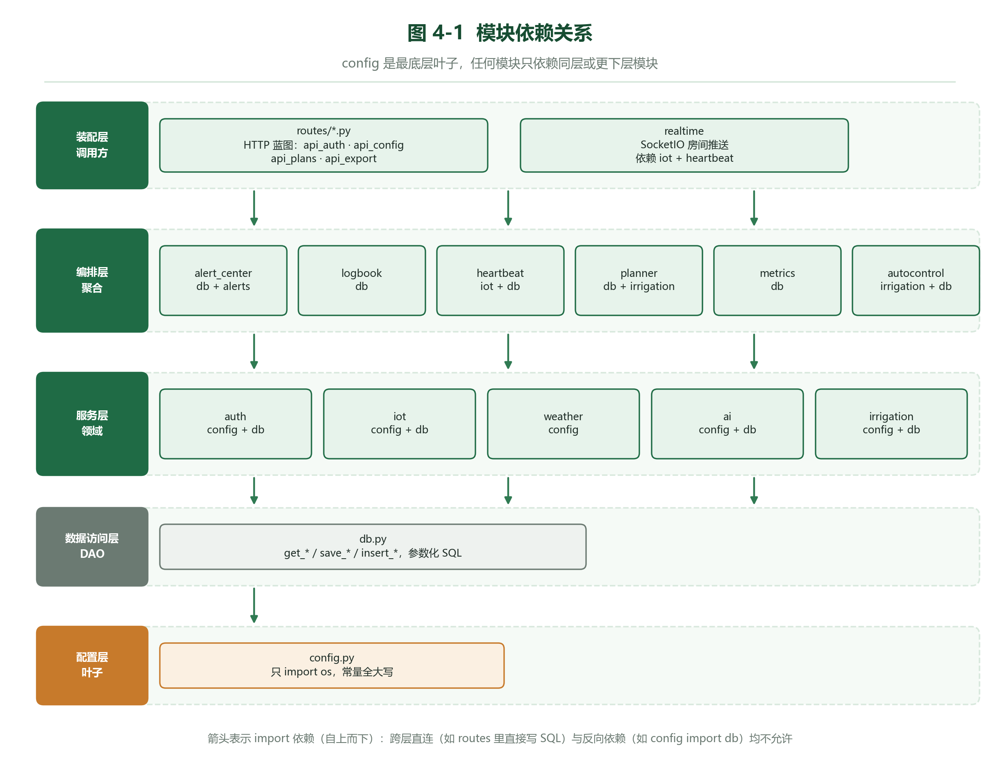

# 四、接口设计

## 4.1 接口约定

系统对外只暴露一个 HTTP 端与一条 WebSocket 通道，全部由服务端渲染的单页应用与移动 App 共用。

**鉴权分两套轨道，互不替代。** 浏览器页面用 Flask Session（会话 Cookie），移动 App 用 JWT（HS256 签名、7 天有效期、`Authorization: Bearer <token>`）。之所以分开，是因为浏览器需要服务端可主动失效、需要天然防 CSRF，Session 满足；而 App 没有 Cookie 容器，反复登录体验差，因此发长效 JWT。JWT 载荷只含 `user_id` 与 `exp`，不放任何可被改写的业务字段。

**响应形状统一。** 成功返回 `{'status': 'success', ...}` 或直接返回数据体；失败返回 `{'error': '<中文原因>'}` 并配以恰当的 4xx / 5xx。所有面向用户的原因文本都是中文，前端可直接渲染，不必维护错误码映射表。

**校验前置。** 所有写接口先用 `validators.py` 做类型、范围、长度校验，不合格立即返回 4xx，不进入业务逻辑。这一约定把"非法入参造成 500"这类故障从架构层面消除。

## 4.2 HTTP 接口清单

系统共 41 条路由，其中业务 API 26 条路径、28 个方法。清单见表 4-1。

表 4-1 HTTP 路由清单
| 方法 | 路径 | 说明 | 鉴权 |
|---|---|---|---|
| GET | `/` | 未登录跳转登录页，已登录渲染主监控台 | 无 |
| GET | `/index` | 主监控台别名入口 | 无 |
| GET | `/knowledge` | 知识库页面 | 无 |
| GET | `/static/**` | 静态资源（第三方库已本地化） | 无 |
| POST | `/api/register` | 注册账号（按来源 IP 限流） | 无 |
| POST | `/api/login` | 登录（按用户名限流） | 无 |
| GET | `/api/logout` | 退出登录 | Session |
| POST | `/api/change_password` | 修改密码 | Session |
| POST | `/api/app_login` | App 登录，返回 JWT 并异步建连 MQTT | 无 |
| POST | `/api/app_send_command` | App 下发控制指令 | JWT |
| GET | `/api/get_config` | 读配置（敏感字段打码） | Session |
| POST | `/api/save_config` | 存配置（掩码即保留原值） | Session |
| POST | `/api/diag/{target}` | 外部接入连通性自检 | Session |
| GET | `/api/thresh_settings` | 读阈值设定 | Session |
| POST | `/api/thresh_settings` | 存阈值设定 | Session |
| GET | `/api/history` | 历史采样（按当前地块） | Session |
| GET | `/api/forecast` | 7 日天气预报代理 | Session |
| GET | `/api/reverse_geocode` | 逆地理（带缓存） | Session |
| POST | `/api/notify_alert` | 手动触发告警推送 | Session |
| POST | `/api/ai_chat` | AI 问答（带实时快照） | Session |
| GET | `/api/alerts` | 告警列表 | Session |
| POST | `/api/alerts/ack` | 确认单条告警 | Session |
| POST | `/api/alerts/ack_all` | 一键确认全部告警 | Session |
| GET | `/api/logs` | 运行日志列表 | Session |
| GET | `/api/device_status` | 设备在线状态 | Session |
| GET | `/api/telemetry` | 最新遥测快照（刷新恢复） | Session |
| POST | `/api/plan/propose` | 生成 AI 决策预案 | Session |
| POST | `/api/plan/confirm` | 人工确认并逐条下发 | Session |
| POST | `/api/plan/reject` | 人工拒绝预案 | Session |
| GET | `/api/plans` | 预案列表 | Session |
| GET | `/api/metrics` | 节水减碳指标 | Session |
| GET | `/api/auto_control` | 读自动调控开关 | Session |
| POST | `/api/auto_control` | 切换自动调控开关 | Session |
| GET | `/api/advice/calendar` | 未来 7 日雨情与灌溉建议 | Session |
| GET | `/api/export/history.csv` | 导出历史采样 CSV | Session |
| GET | `/api/export/alerts.csv` | 导出告警 CSV | Session |
| GET | `/api/farms` | 地块列表 | Session |
| POST | `/api/farms` | 新建地块 | Session |
| POST | `/api/farms/switch` | 切换当前地块 | Session |
| POST | `/api/farms/update` | 更新地块信息 | Session |
| POST | `/api/farms/delete` | 删除地块 | Session |

接口按业务域拆分到 10 个蓝图文件中，注册在应用工厂 `qinghe.create_app()` 内：`app_api`、`auth_api`、`config_api`、`data_api`、`ai_api`、`monitor`、`insight`、`export`、`farm`、`advice`。蓝图拆分的收益是每个文件只处理一类资源，也是"新增功能不改老文件"这一增量策略的前提。

## 4.3 SocketIO 事件

实时通道只有三个事件，契约见表 4-2。

表 4-2 SocketIO 事件契约
| 事件 | 方向 | 载荷 | 说明 |
|---|---|---|---|
| `connect` | 前端→服务端 | 无（依赖会话 Cookie） | 建连时读 `session['user_id']`，取不到即拒绝握手；成功后 `join_room(str(uid))` 并尝试建连该用户的 MQTT |
| `hw_data` | 服务端→前端 | `type=data` 时附各传感读数；`type=device_status` 时含 `status`、`last_seen_ts`、`silent_seconds`、`ts` | 唯一的下行通道，读数与设备状态靠 `type` 区分 |
| `send_command` | 前端→服务端 | `device`（water_pump / air_pump）+ `action`（on / off） | 设备手动调控的启动与停止；设备名必须命中白名单，否则静默丢弃 |

**房间模型是本系统的多租户隔离手段。** 房间名就是登录用户 ID 的字符串形式，`emit_hw_data(uid, payload)` 内部固定按 `room=str(uid)` 推送，因此每个账号只能收到自己地块的数据，多账号同时在线也不会串台。

## 4.4 外部接口

系统依赖四类外部服务，全部由服务端代理调用，统一带超时与降级，见表 4-3。

表 4-3 外部接口清单
| 接口 | 协议 | 用途 | 超时 | 容错策略 |
|---|---|---|---|---|
| 华为云 IoTDA | MQTT | 设备遥测上行与指令下行 | 无固定超时（长连接） | 断线自动重连；回调线程内不阻塞，落库走有界队列 |
| 和风天气 7 日预报 | HTTP | 未来 6 日降雨，驱动动态阈值 | 8 秒 | 失败返回 `code=ERR` 错误字典，前端显示"暂时无法获取预报" |
| DeepSeek 对话 | HTTP | AI 助手与 AI 决策预案 | 20 秒 | 失败包装成与成功同构的 `choices` 响应；域名做 SSRF 校验，禁止指向内网 |
| 钉钉机器人 Webhook | HTTP | 告警推送到群 | 3 秒 | 失败返回 `sent=false`，但站内接口仍返回 200 |
| Photon 逆地理 | HTTP | 坐标转地名 | 6 秒 | 失败用 `E: 经度°, N: 纬度°` 坐标文本兜底；成功结果缓存到本地 |

外部调用一律不进请求栈抛异常，是这套接口设计的核心约束：天气接口挂掉、AI 配额用尽、钉钉机器人失效，都只表现为某一处功能降级，而不是整页崩溃。这四类接口的具体实现见详细设计说明书第十章。

# 五、主要流程设计

本章按「数据往哪走、谁在做判断、失败怎么办」三条线索串起系统主流程。所有流程共享同一个运行前提：单进程多线程——MQTT回调线程只做解析与入队，HistoryWriter单写线程负责落库，SocketIO以`str(uid)`为房间名推送。由此得出两条贯穿全章的硬约束：上行数据永不阻塞回调线程；下行指令永远收敛到`iot.send_property_command`一个出口。

## 5.1 遥测上报到前端展示

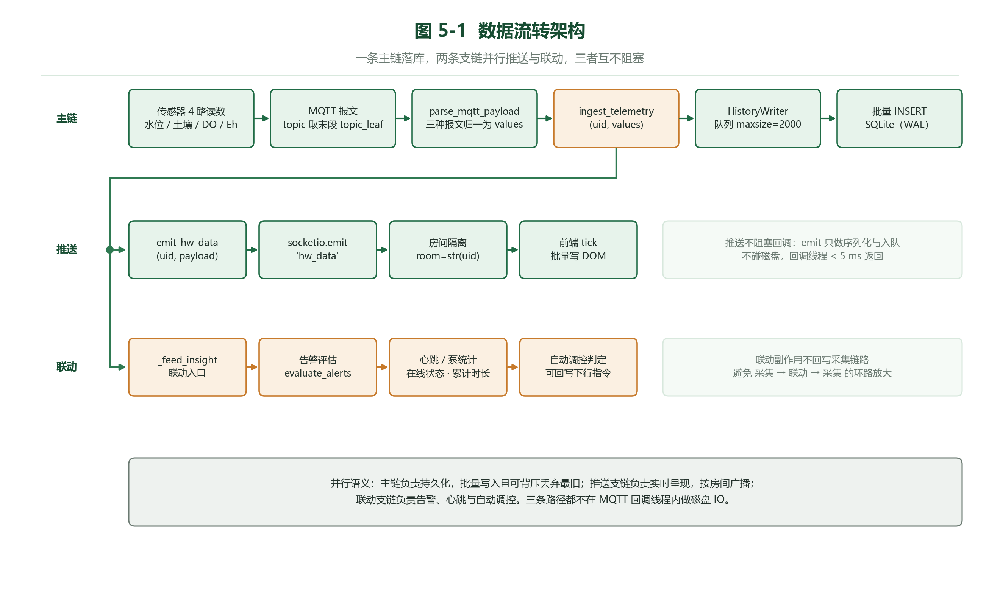

1. 采集与转发：ESP32-E每3s上报一帧属性数据，经华为云IoTDA的「数据转发规则」转发到自定义Topic `/esp32e/data`（取自`configs.iot_m2m_topic`）。

2. 接入：paho回调`on_mqtt_message`取`msg.payload.decode('utf-8', errors='replace')`，解码失败以替换符兜底而不抛异常，随后转入`iot.handle_mqtt_message(uid, topic, content)`。

3. 解析：`parse_mqtt_payload(topic, content)`返回三元组`(topic_leaf, values, messages)`，三种分支并行——含`services`的华为云物模型报文逐属性展开；自定义JSON对象直接收`int/float/str/bool`标量；非JSON一律降级为纯文本单条消息。JSON解析失败不中止流程，直接落到第三分支，保证设备发半包或乱码时仍能看到原始内容。

4. 推送：逐条`emit_hw_data(uid, {'type':'data','topic':k,'payload':str(v)})`，最终`socketio.emit('hw_data', payload, room=str(uid))`。`payload`统一为字符串，数值由前端`parseFloat`还原，日志类纯文本因此可复用同一结构。

5. 旁路分发：`_feed_insight`按序做五件事——`heartbeat.mark_seen`、`planner.update_telemetry`、`metrics.note_pump_state`、`autocontrol.evaluate`（默认关闭）、`alert_center.evaluate_and_push`。每个子系统独立`try/except`，任一失败不影响其余；仅告警评估做10.0s/用户的限频，避免每条上报都查一次库。

6. 落库：`history_writer.enqueue`只入队不写盘，队列上限2000，满则丢最旧。后台线程每1.0s或攒够200条执行`flush_once()`，用`insert_history_rows`的`executemany`一次提交。落库条件严格：`values`同时含`waterlevel`与`humidity`才写`sensor_history`，值取`int(float(x))`，`ts`为毫秒整数；只报DO/Eh的帧不落库，不污染历史曲线。

7. 展示：前端`realtime.js`的`on('hw_data')`不直接写DOM，先更新内存态`S`并`enqueueField/enqueuePump/enqueueFlag`入队；统一tick每500ms执行`flushDom()`批量写DOM，写前比对旧值、值未变不写，随后`updateRori()`，图表2s、心跳与告警5s。

失败时的处置：入队满丢最旧而非阻塞；`flush_once`失败整批重新入队，不丢数据点；SocketIO推送失败不影响落库，两条链路互不拖累；浏览器断线由Socket.IO指数退避自动重连，`disconnect`把`cloudConnected`与`deviceOnline`同时置`false`并使面板进入`panel-disabled`。

## 5.2 控制指令下发

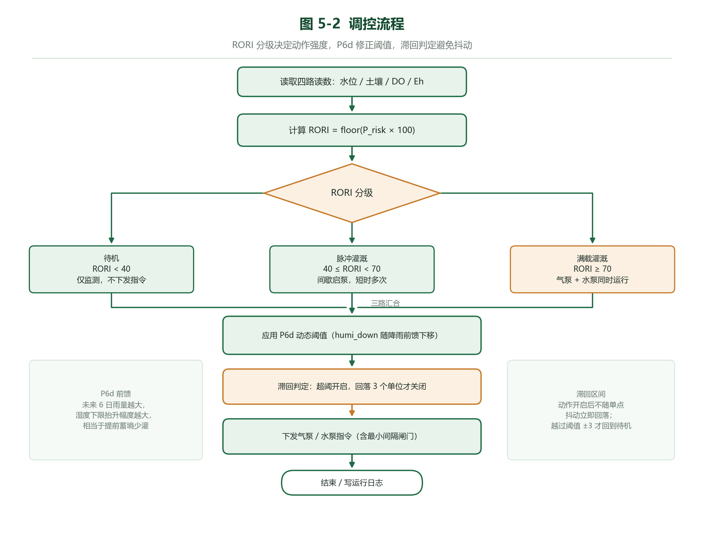

指令有三个来源：手动按钮（WebSocket`send_command`）、移动端`POST /api/app_send_command`（JWT鉴权）、服务端自主（`planner.confirm_plan`与`autocontrol.evaluate`）。三者最终都调用`iot.send_property_command(uid, props)`，因此「是否连接」「设备是否合法」只在一处校验。

1. 发起：前端`sendManualCommand()`执行`socket.emit('send_command', {device, action})`。

2. 身份：服务端`on_ws_command`取`session['user_id']`，缺失即静默丢弃，不返回错误。

3. 白名单：`PROP_MAP = {'water_pump': 'water_pump', 'air_pump': 'air_pump'}`命中才继续，未命中静默丢弃。这道校验不是为改名，而是拒绝任意属性透传——否则攻击者可通过WebSocket下发篡改阈值等越权属性。

4. 动作归一：`action == 'on'`精确匹配才下发`on`，其余一律归一为`off`。

5. 出口：`send_property_command`取`device, action = next(iter(props.items()))`（只支持单属性单值），客户端未连接直接返回`False`。

6. 发布：`json.dumps({'device': device, 'action': action}, ensure_ascii=False)`后publish到`cmd_topic`（默认`/esp32e/cmd`）。

7. 闭环：华为云规则把该Topic消息转发到ESP32-E，设备执行后把状态回传上行Topic，再经5.1链路以`hw_data`推回页面。

两个必须写清的约束：下行Topic必须是**非`$oc`的自定义Topic**，走平台内置命令Topic会报`IOTDA.017004 Invalid topic`；应用侧必须以client身份连接，不能抢占ESP32-E的设备身份，否则设备会被踢下线。

失败时的处置：`publish`为QoS 0、不等PUBACK，返回`True`只代表「已交给paho发送缓冲」，不代表设备已执行，因此页面状态只认设备真实回传，不做任何模拟回执；客户端未连接时`/api/app_send_command`返回200加`'设备未连接'`（业务结论而非HTTP错误），未知设备返回400加`'未知设备'`。

## 5.3 数据流转总览

表 5-1 各类数据从采集到前端挂载的完整路径
| 数据 | 采集与接入 | 处理模块（关键函数） | 落库或驻留 | 推送时机与前端挂载 |
|---|---|---|---|---|
| 水位/土壤ADC | ESP32-E每3s上传，经IoTDA转发到`/esp32e/data` | `iot.handle_mqtt_message`→`parse_mqtt_payload`→`extract_history_sample` | `sensor_history`表（批量落库1.0s/200条） | 收到即推`hw_data`；`waterDisplay`/`soilDisplay`，`waterChart`/`soilChart`按2s刷新 |
| DO/Eh | 同上，属性键`do`/`eh` | `parse_mqtt_payload`逐属性拆分 | 不落库，仅内存与推送 | 收到即推；`doDisplay`/`ehDisplay` |
| 泵状态回执 | 设备上行`water_pump`/`air_pump` | `parse_mqtt_payload`+`metrics.note_pump_state` | `pump_runtime`表（状态翻转时结算秒数） | 收到即推；`deviceStatus`/`waterPumpStatus` |
| RORI与分级 | 前端tick内由内存遥测复算 | `irrigation.compute_rori`/`classify_rori`（服务端同式，供测试与预案用） | 内存`S.roriTrendData`+`localStorage`的`farmTrendRori`（tick 30s落盘） | tick 500ms写数值、2s写图表；`roriDisplay`/`roriStatus`/`roriChart` |
| 历史回填 | 浏览器请求`GET /api/history?limit=`（clamp 1~5000） | `data_routes`→`db.query_history` | 读`sensor_history`，升序返回 | 页面加载与刷新恢复各一次；`charts.js`重建趋势图 |
| 告警 | 遥测帧旁路进入`alert_center.evaluate_and_push` | `alerts.evaluate_alerts`→`AlertDeduper`→`push_alert` | `alerts`表 | 推送线程即时发webhook；前端tick 5s增量拉`/api/alerts`；`alertList`/`ongoingAlertBanner`/`toastContainer` |
| 运行日志 | 各模块调用`logbook.add_log(source=...)` | `_LogWriter`批量写 | `logs`表（1.0s或20条） | 前端tick 5s拉`/api/logs`；`logList` |
| 设备在线态 | 上行帧触发`heartbeat.mark_seen`，巡检`sweep_offline` | `heartbeat`+`realtime.start_device_watcher` | `device_status`表 | 状态翻转时推`{'type':'device_status'}`；`cloudStatus`/`deviceStatusPill`/`sensorPanel` |

## 5.4 RORI计算与分级

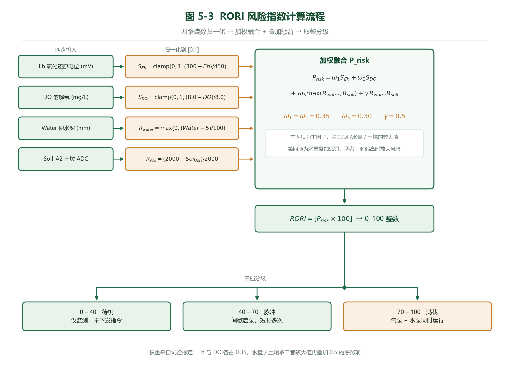

RORI（根区缺氧风险指数）把四路性质不同的观测压到一个0~100的标量上，取值与`qinghe/config.py`逐项对齐。

表 5-2 RORI四因子归一化与融合权重
| 因子 | 归一化公式 | 权重 | 设计口径 |
|---|---|---|---|
| 氧化还原电位 | `sEh = clamp((300 − Eh)/450, 0, 1)` | `W_EH = 0.35` | `EH_SAFE_MV=300`、`EH_SPAN_MV=450`（300与−150之差）；Eh=300mV为0，−150mV为1 |
| 溶解氧 | `sDo = clamp((8.0 − DO)/8.0, 0, 1)` | `W_DO = 0.35` | 分母刻意用`DO_SAFE_MGL=8.0`而非量程上限20：8mg/L以上即视为充分供氧，DO>8.0得负值被clamp吸收 |
| 水位与土壤取大 | `Rw = 水位≤5mm ? 0 : clamp((W−5)/100, 0, 1)`；`Rs = clamp(%RH/100, 0, 1)` | `W_WATER_SOIL = 0.30` | 渍水与湿土只要其一成立即构成缺氧，取大不重复计罚；5mm死区避免边界噪声 |
| 水位×土壤耦合 | `Rw · Rs` | `GAMMA = 0.5` | 「既渍水又高湿」的乘性恶化，是唯一能把P推过0.7的耦合来源 |

融合与输出：`P = 0.35·sEh + 0.35·sDo + 0.30·max(Rw, Rs) + 0.5·Rw·Rs`，`RORI = clamp(P, 0, 1) × 100`。四个系数之和为1.5，P必然饱和，末尾的`clamp`是必需动作而非装饰。

分级由`classify_rori(rori)`完成，判定顺序先`>= RORI_HEAVY`再`>= RORI_MODERATE`再兜底，因此70与40两个边界都归入上档：RORI≥70为`code=2`重度厌氧，策略「重度厌氧预警，加气机全满载强制增氧」；40≤RORI<70为`code=1`中度缺氧，策略「根区微量缺氧，周期性脉冲加气补氧」；RORI<40为`code=0`安全运行，策略「根区有氧环境优良，加气机低耗待机」。

一次完整计算：前端tick内用`computeRori(waterAdc, soilAdc, do, eh)`逐字复刻同一公式，`classifyRori`得`code`，渲染数值、颜色与预警条，非手动模式下随即进入5.6的决策。以`water_adc=1500`、`soil_adc=2200`、`DO=6.0`、`Eh=120`为例：换算得109.89mm与46.28%，`sEh=0.4`、`sDo=0.25`、`Rw=1.0`、`Rs=0.4628`，加权项相加得`P=0.7589`，即`RORI=75.89`，落入重度厌氧档。

失败时的处置：入参为`None`/`''`/`'abc'`时量程换算返回0.0而不抛异常；超量程被clamp截断（`water_adc=9000`得300.0mm）；前端与服务端必须保持同一口径，任何一侧改动都要同步另一侧，否则同一帧数据会算出两个RORI。

## 5.5 六日降雨前馈动态阈值

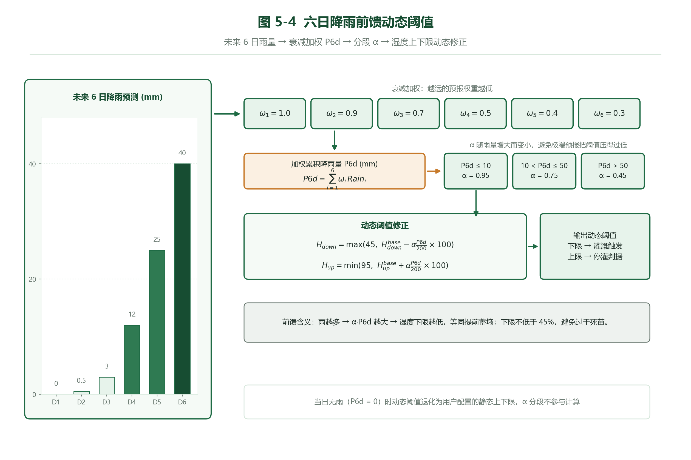

1. 取数：`GET /api/forecast`代理和风天气7日预报，从`daily[]`逐日取降水量，只取未来6日——第1日权重最高，之后按天衰减。

2. 计算P6d：`compute_p6d(daily_precips)`按`RAIN_WEIGHTS = [1.0, 0.9, 0.7, 0.5, 0.4, 0.3]`做时间衰减加权，`P6d = Σ ω_t · P_t`；索引`i >= 6`立即break；单项脏数据`except`跳过而不整体失败。

3. 分档α：`alpha_of(p6d)`三档阶梯——`P6d ≤ 10.0`取`ALPHA_LOW = 0.95`，`10.0 < P6d ≤ 50.0`取`ALPHA_MID = 0.75`，`P6d > 50.0`取`ALPHA_HIGH = 0.45`。物理含义是雨越大土壤越接近持水饱和，后续降雨中能被作物真正利用的比例越低。

4. 下限修正：`effLower = max(45.0, humi_down − (alpha·P6d/200)×100)`，200为`H_ROOT = 200.0`mm的核心活动根系层厚度。

5. 上限修正：`P6d ≥ 15.0`时`effUpper = min(100.0, humi_up + 15.0)`，否则`effUpper = humi_up`（对应`EFF_UPPER_RAIN = 15.0`、`EFF_UPPER_BONUS = 15.0`、`EFF_UPPER_CAP = 100.0`）。

6. 标志位：`hasForecast = len(fc) > 0`，`rainComing = P6d > 0`。两者阈值不同是刻意的——毛毛雨也要触发5.6的水泵`hold`（暂缓补水），而蓄雨上限只在≥15mm时才放宽，避免小雨就蓄成内涝。

7. 输出：固定8个键`P6d`、`alpha`、`effLower`、`effUpper`、`baseLower`、`baseUpper`、`hasForecast`、`rainComing`，其中`baseLower`/`baseUpper`为用户原始设定，原样透传供前端对比展示。

算例：6日降雨`[0, 8, 20, 5, 12, 3]`、`humi_down=40`、`humi_up=80`，加权合计`P6d=29.40mm`；`10 < 29.40 ≤ 50`故`alpha=0.75`；`effLower = max(45, 40 − 11.025) = 45.00`；`effUpper = min(100, 95) = 95.00`；`rainComing = True`。

必须点明的易误读处：`EFF_LOWER_FLOOR = 45.0`是无条件保底，默认`humi_down = 40`时`effLower`反而被抬到45，比用户设定还高5个百分点，只有`humi_down > 45`时降雨前馈才真正下调灌溉触发线。这是前端既有行为，重构时必须保留，不是缺陷。

失败时的处置：未配Key、上游异常或上游非JSON，`/api/forecast`统一返回`{'code':'ERR','error':...}`加502，前端降级为「无预报」；`compute_dynamic_threshold`收到空列表则`P6d=0`、`alpha=0.95`、`rainComing=False`，阈值自动退化为用户原始设定，前馈失效但基本灌溉不中断。

## 5.6 自动调控决策（含滞回去抖）

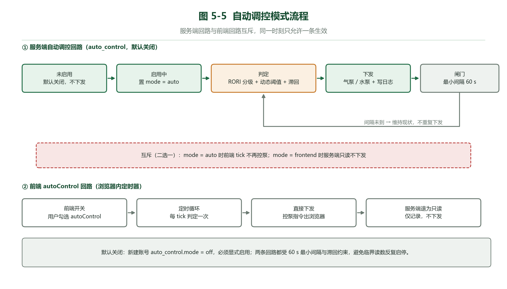

1. 前置门禁：服务端只认`auto_control`表的`enabled`，默认`0`（关闭），必须`POST /api/auto_control {'enabled': true}`显式开启。`manual_mode`由前端把关——`realtime.js`的`if (!S.manualMode) autoControl(cmdCode)`决定浏览器侧是否决策，`autocontrol.evaluate`本身不读`manual_mode`，这一不对称属既有行为，已在第八章登记。

2. 气泵档位：`effCmd = classify_rori(rori)['code']`；若`dt.rainComing`为真且`effCmd < 2`则`effCmd += 1`，即按降雨前馈提前一级增氧；`air = 'ON'`当且仅当`effCmd >= 1`。

3. 气泵去抖：仅当`state['air']`与目标值不同才下发，未变则`changed=False`、不下发。

4. 水泵滞回：`water < waterlevel_down`时，`rainComing`为真则`state='hold'`、`command=''`（控水等雨，记录「暂缓补水」日志但不下发），否则`state='on'`、`command='ON'`；`water > waterlevel_up`则`state='off'`、`command='OFF'`；落在`[waterlevel_down, waterlevel_up]`区间则`state='ok'`、不产生指令。

5. 指令去抖：`state['pump']`未变时把`command`强制置空，即使同一档位反复成立，MQTT也不会被刷屏。

6. 时间维滞回：服务端`autocontrol.evaluate`对同一设备两次动作间隔不足`AUTO_MIN_INTERVAL_SECONDS = 60`秒直接跳过，防止水位在阈值附近抖动引发指令风暴。

7. 下发：真正产生指令的动作仍走5.2的`send_property_command`，与手动指令共用同一出口。

三层去抖各有分工：气泵靠「目标状态是否变化」，水泵靠「决策是否产生指令」，服务端再叠一层「动作间隔是否够长」。默认阈值下`waterlevel_down=30`、`waterlevel_up=150`，二者之间构成120mm宽的死区。

失败时的处置：`thresholds`缺键时回退`THRESH_DEFAULTS`（水位30/150、湿度40/80）；`dt`为`None`时不做降雨前馈，退化为纯RORI分级决策；下发失败不更新`state_json`，下一帧自动重试。已知重叠：前端`realtime.js`的`autoControl()`在浏览器内做同一套决策，与服务端自动调控同时开启会互相打架（前端下发`on`、服务端下发`off`），故服务端默认关闭，这一重叠已在第八章登记。

## 5.7 AI预案闭环（HITL）

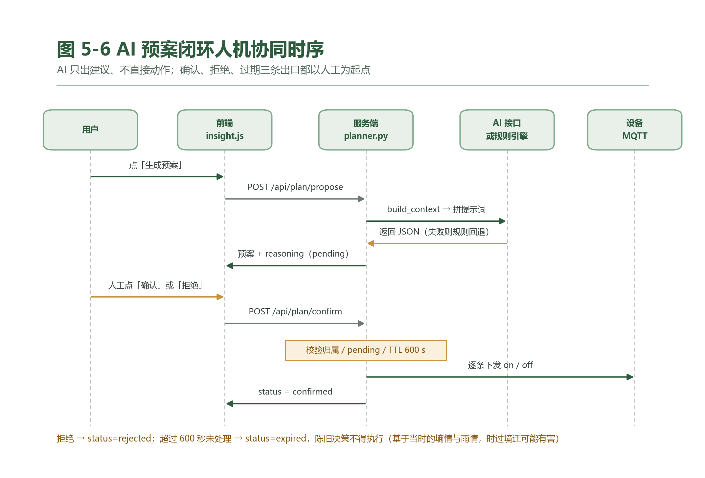

1. 生成：`POST /api/plan/propose`（`question`≤500字符）转入`planner.propose_plan(uid, question)`。

2. 感知：`build_context(uid)`汇总`rori`、`rori_level`、`water_mm`、`soil_pct`、`do_mgl`、`eh_mv`、`air_pump`、`water_pump`、`p6d`、`alpha`、`eff_lower`、`eff_upper`、`manual_mode`、`ts`；实时值取自`_latest[uid]`，由5.1第5步的`update_telemetry`持续覆盖写。

3. 推理：配了`ai_key`就把上下文序列化进prompt，要求模型只输出JSON（`reasoning`+`actions`+`summary`+`risk`），`timeout=25`秒；无Key、调用异常、返回非JSON或缺`actions`任一情况都回退`_rule_based_plan`，按RORI档位与水位直接给出`air_pump`/`water_pump`动作，`reasoning`写明规则依据。

4. 过滤：`actions`逐条校验，只有`device ∈ ('air_pump','water_pump')`且`action ∈ ('on','off')`的条目保留，非法项直接丢弃，杜绝AI生成越权动作。

5. 落库：写入`plans`表，`status='pending'`，`context_json`与`reasoning`独立存储以保留推理链供审计。

6. 提示：前端预案面板展示`summary`、`reasoning`与`actions[]`，此阶段不产生任何下发，`pending`是唯一人工介入点。

7. 确认：`POST /api/plan/confirm {id}`进入`confirm_plan`，做三重校验——归属`user_id`、`status == 'pending'`、`now − plans.ts <= PLAN_TTL_SECONDS`；通过后逐条`iot.send_property_command`，同时`logbook.add_log(source='plan')`与`push_alert(code='auto_action')`，写`apply_result`，状态置`confirmed`，任一动作失败则置`failed`。

8. 拒绝与过期：`POST /api/plan/reject {id, reason}`只允许`pending`，置`rejected`；超过TTL未处置自动置`expired`。

预案TTL为`PLAN_TTL_SECONDS = 600`秒（10分钟），从`plans.ts`起算而非决策时刻，防止「昨天生成的预案今天被误确认」。四个终态`confirmed`/`rejected`/`expired`/`failed`均不可逆，再次确认返回「状态不允许」。

失败时的处置：AI调用超过25秒即按失败计，不阻塞请求线程，用户仍能拿到规则方案；`confirm_plan`在下发中途失败时保留已成功的`applied`列表并附`failed`明细，便于人工补救。

## 5.8 告警产生、去重与推送

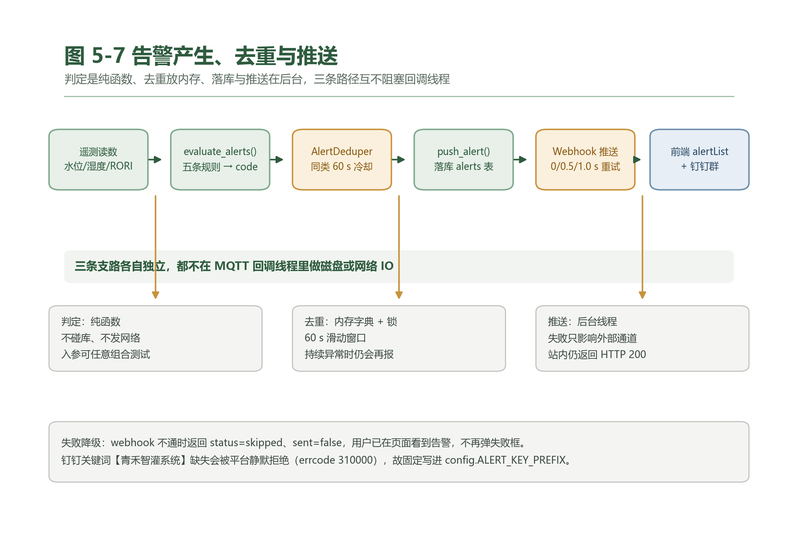

1. 判定：遥测帧进入`alert_center.evaluate_and_push`（受10.0s/用户限频），内部调用纯函数`alerts.evaluate_alerts(soil_pct, water_mm, humi_lower, humi_upper, water_upper, rori)`，返回`[{'level','msg'}]`。五条规则：`soil_pct < humi_lower`→`warn`；`elif soil_pct > humi_upper`→`warn`（与上一条互斥）；`water_mm > water_upper`→`warn`（独立`if`，可与土壤告警并存）；`rori >= 70`→`danger`；`elif rori >= 40`→`warn`。系统刻意不产生「水位过低」告警——低水位由自动调控开泵处理，不打扰用户。

2. 码映射：`evaluate_alerts`只给文案不给类型码，`_code_for_message()`按正文前缀反推`soil_low`/`soil_high`/`water_high`/`rori_high`/`rori_medium`。

3. 归一与截断：`push_alert`先把level归一（`warn`→`warning`、`critical`/`fatal`/`error`→`danger`、未知→`info`），code为空则记`auto_action`，正文超过`CONTENT_MAX_LEN = 500`截断。

4. 去重：键为`'%d|%s|%s' % (uid, code, content)`，`AlertDeduper.should_emit`按`ALERT_COOLDOWN_SECONDS = 60`秒冷却判定，放行时立即刷新时间戳。语义是同一句话60秒内只产生一条记录与一次推送，且持续存在的告警每60秒最多提醒一次，不会因为被忽略而静默。

5. 落库：`INSERT INTO alerts`写`level`/`code`/`content`/`acked`；命中冷却则回填上次的`id`并标`deduped=True`，不重复入库。

6. 推送：起daemon线程`alert-push`，按`PUSH_RETRY_DELAYS = (0.0, 0.5, 1.0)`做首次加两次重试；`notify_webhook`组装`{'msgtype':'text','text':{'content':'【青禾智灌系统】' + title + '\n' + content}}`，`timeout=6`秒，`status_code in (200, 201)`才算成功。正文固定前置`【青禾智灌系统】`是为满足钉钉机器人「自定义关键词」安全设置。

7. 展示：前端tick每5秒执行`checkAlerts()`，以`GET /api/alerts?since_ts=`（`ts`严格大于）增量拉取，追加到`alertList`、弹`toast`、刷新`ongoingAlertBanner`；人工确认走`POST /api/alerts/ack`，用`rowcount`校验归属。

失败时的处置：落库抛`sqlite3.Error`时返回`{'id':0,...}`而非阻断上报链路；webhook失败只让推送线程返回`False`，`push_alert`仍视为已落库成功；未配webhook时`/api/notify_alert`返回`{'status':'skipped','sent':false}`且HTTP仍为200。

离线判定与告警的关系需要一并交代：设备在线有两条判定链路——前端`heartbeatMissLimit = 4`次乘5秒即20秒无数据判离线，服务端`heartbeat.DEVICE_OFFLINE_SECONDS = 30`秒、巡检周期`WATCH_INTERVAL = 5.0`秒，故前端会先报离线。`sweep_offline`只在「在线转离线」翻转时写`last_reason='silent_timeout'`并推一条`device_offline`告警，持续离线不会每5秒刷一条。

# 六、数据结构设计

## 6.1 数据库选型与总体设计

系统落SQLite单文件，开WAL日志模式。选它不是"够用就行"的将就，而是三条约束共同指向的唯一解：一是零运维，数据库就是一个`qinghe.db`文件，拷贝即备份，答辩现场换个U盘就能跑；二是规模匹配，单机、单写多读的校园网小场景，写只来自遥测落库线程与用户保存配置，读来自页面轮询与历史回填，WAL下读不阻塞写、写不阻塞读，足以吸收瞬时冲突；三是无外部依赖，与Python标准库一体，不需要为演示搭MySQL或PostgreSQL服务。

WAL的落地是两条PRAGMA加一条纪律。连接建立时统一设`PRAGMA journal_mode=WAL`与`PRAGMA busy_timeout=10000`，`sqlite3.connect`带`timeout=10`，且全仓只有`get_db()`一处建连接，调用方一律`with closing(get_db()) as conn:`关闭。纪律是WAL仍只支持单写者，因此高频写一律不直接落盘：遥测进`HistoryWriter`队列、日志进`_LogWriter`队列，后台线程批量提交，把写事务压到每秒一次量级。

数据量按最坏情况估过：单账号单设备3秒一帧，一天28800行，保留7天约20万行；`(user_id, ts)`与`(user_id, farm_id, ts)`两个复合索引覆盖历史曲线的全部查询形态，单账号7天区间查询稳定在毫秒级。代价是没有跨机共享与高并发写，这点在设计权衡里如实记录，不用"未来可扩展"掩盖。

## 6.2 数据表汇总

全部业务表12张，按建成时机分三批：`init_db()`一次建成的既有5张、`init_geo_cache()`单独建的反查缓存1张、六个模块各自懒建的6张。`sqlite_sequence`是SQLite内部表，不计入。

表 6-1 数据表汇总
| 表名 | 用途 | 关键字段 | 保留策略 |
|---|---|---|---|
| `users` | 账户 | `id`、`username`、`password` | 永久，无删除接口 |
| `configs` | 账号级设备与第三方配置（23列） | `user_id`、`iot_*`、`*_key`、`active_farm_id` | 一账号一行，保存即整行覆盖 |
| `farms` | 地块档案与地块级物联网接入（17列） | `id`、`user_id`、`polygon`、`iot_*` | 永久，单账号上限12块 |
| `sensor_history` | 遥测历史 | `user_id`、`ts`、`water_adc`、`soil_adc`、`farm_id` | 滚动保留7天，启动时清理 |
| `thresh_settings` | 阈值与手动模式 | `user_id`、`humi_down`、`humi_up`、`waterlevel_up` | 一账号一行，UPSERT覆盖 |
| `geo_cache` | 逆地理结果缓存 | `key`（四位小数坐标）、`name` | 永久，同坐标只调一次外部接口 |
| `alerts` | 告警持久化 | `id`、`user_id`、`ts`、`level`、`code`、`acked` | 无自动清理，`prune_alerts()`可按天删 |
| `logs` | 运行日志 | `id`、`user_id`、`ts`、`level`、`source`、`message` | 无自动清理，`prune_logs()`可按天删 |
| `device_status` | 设备在线状态 | `user_id`、`last_seen_ts`、`online`、`last_reason` | 一账号一行，每次上报覆盖 |
| `plans` | AI调控预案 | `id`、`user_id`、`ts`、`status`、`proposal_json` | 长期留存，靠600秒TTL判过期 |
| `pump_runtime` | 泵运行时长按日累计 | `(user_id, device, day)`、`seconds` | 按日成行，只增不改 |
| `auto_control` | 服务端自动调控开关与状态 | `user_id`、`enabled`、`last_action_ts`、`state_json` | 一账号一行 |

这里必须澄清一处口径：概要与早期文档写"`prune_alerts`/`prune_logs`启动清理"，实际代码里这两个函数只有测试在调用，`init_db()`启动路径**只**删`sensor_history`早于7天的行。告警与日志当前不自动清理，不能把未挂载的函数当成已生效的策略。

索引共7个：`idx_history_user_ts`、`idx_history_user_farm_ts`、`idx_farms_user`、`idx_alerts_user_ts`、`idx_logs_user_ts`、`idx_plans_user_ts`、`idx_pump_runtime_user_day`；另`users.username`唯一约束、`geo_cache.key`主键、`pump_runtime`复合主键各带自动索引。SQLite默认不强制外键，多账号隔离全靠每条SQL带`WHERE user_id=?`。

## 6.3 核心表结构

`users`是聚合根，其余表除`geo_cache`外都以`user_id`挂靠。口令列存派生串而非明文，形如`scrypt:32768:8:1$<盐>$<摘要>`。

表 6-2 users表字段
| 字段 | 类型 | 说明 | 约束 |
|---|---|---|---|
| `id` | INTEGER | 账户主键 | PRIMARY KEY AUTOINCREMENT |
| `username` | TEXT | 登录名 | UNIQUE NOT NULL，3–20字符 |
| `password` | TEXT | 口令派生串（Werkzeug默认scrypt） | NOT NULL，读取不回显 |

表 6-3 sensor_history表字段
| 字段 | 类型 | 说明 | 约束 |
|---|---|---|---|
| `id` | INTEGER | 采样行主键 | PRIMARY KEY AUTOINCREMENT |
| `user_id` | INTEGER | 所属账号 | NOT NULL，查询必带 |
| `ts` | INTEGER | 采样时刻，毫秒 | NOT NULL |
| `water_adc` | INTEGER | 水位ADC原始值0–4095 | 可空 |
| `soil_adc` | INTEGER | 土壤ADC原始值0–4095 | 可空 |
| `do_mgl` | REAL | 根区溶解氧mg/L | 可空，幂等迁移新增 |
| `eh_mv` | REAL | 氧化还原电位mV | 可空，幂等迁移新增 |
| `farm_id` | INTEGER | 落库时该账号的当前地块 | DEFAULT 0，迁移新增，0表示未归属 |

`farm_id`是地块隔离的关键。写入端在`HistoryWriter.flush_once()`里解析账号当前地块，解析放后台线程做，MQTT回调线程仍只做非阻塞入队；读取端查`farm_id=? OR farm_id=0`，0这一支专门兜住升级前无法追溯地块的旧行，否则一换地块历史曲线就整段消失。

表 6-4 configs表字段（23列，节选分组）
| 字段 | 类型 | 说明 | 约束 |
|---|---|---|---|
| `user_id` | INTEGER | 账号主键，一账号一行 | PRIMARY KEY |
| `farm_name`、`farm_lat`、`farm_lng` | TEXT | 当前地块名称与经纬度 | DEFAULT ''，与`farms`镜像 |
| `pump_port`、`air_pump_port` | TEXT | 水泵、气泵GPIO口 | DEFAULT 'D9'、'D5' |
| `water_sensor_port`、`soil_sensor_port` | TEXT | 水位、土壤ADC通道 | DEFAULT 'A0'、'A2' |
| `weather_domain`、`weather_key`、`ai_domain`、`ai_key` | TEXT | 天气与AI接入 | 密钥读取时按`MASK`掩码 |
| `iot_host`、`iot_port`、`iot_client_id`、`iot_user`、`iot_pass`、`iot_device_id` | TEXT/INTEGER | 物联网接入根配置 | `iot_port` DEFAULT 1883 |
| `iot_target_device_id`、`iot_m2m_topic`、`iot_cmd_topic` | TEXT | 转发目标设备与收发Topic | DEFAULT ''、'/esp32e/data'、'/esp32e/cmd' |
| `webhook_url` | TEXT | 告警推送地址 | DEFAULT '' |
| `active_farm_id` | INTEGER | 当前生效地块 | DEFAULT 0，由地块切换单独写 |

21个配置列由`save_config()`按`CONFIG_COLUMNS`常量整行覆盖，`active_farm_id`不在其中——它属于"当前选中哪块地"的运行态，和"配置成什么样"分开写，避免保存一次设置就把地块切走。端口类字段只有`iot_port`是INTEGER，其余是TEXT，因为`D9`/`A0`这类固件引脚名不是数字。

表 6-5 plans表字段
| 字段 | 类型 | 说明 | 约束 |
|---|---|---|---|
| `id` | INTEGER | 预案主键 | PRIMARY KEY AUTOINCREMENT |
| `user_id`、`ts` | INTEGER | 归属账号与生成时刻（毫秒） | NOT NULL |
| `status` | TEXT | `pending`/`confirmed`/`rejected`/`expired`/`failed` | DEFAULT 'pending' |
| `context_json` | TEXT | 生成预案时的遥测快照 | 可空 |
| `reasoning` | TEXT | AI推理过程 | 可空 |
| `proposal_json` | TEXT | `{'actions','summary','risk'}` | 可空 |
| `decided_ts`、`apply_result` | INTEGER/TEXT | 人工决策时刻与下发结果 | 可空 |

表 6-6 device_status表字段
| 字段 | 类型 | 说明 | 约束 |
|---|---|---|---|
| `user_id` | INTEGER | 账号主键 | PRIMARY KEY |
| `last_seen_ts` | INTEGER | 最近收包时刻，毫秒 | DEFAULT 0 |
| `online` | INTEGER | 0离线/1在线 | DEFAULT 0 |
| `last_reason` | TEXT | 变更原因，供页面解释 | DEFAULT '' |

`device_status`一行一账号，由5秒周期的巡检线程写：静默超过30秒判离线，判离线时写warning日志并推`device_offline`告警（走冷却去重），恢复上报由`mark_seen()`直接置在线。把在线态落库而不是只放内存，是为了服务重启后页面一进来就能看到真实的最后收包时间，而不是等30秒才显示离线。

## 6.4 实体关系

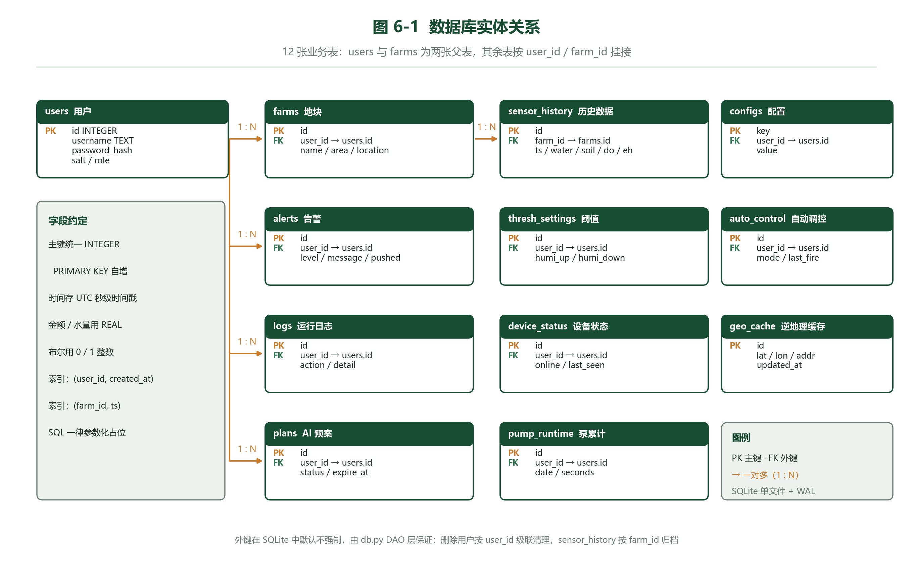

以`users.id`为聚合根，1对多扇出到`configs`、`thresh_settings`、`farms`、`sensor_history`、`alerts`、`logs`、`device_status`、`plans`、`pump_runtime`、`auto_control`；`farms.id`与`sensor_history.farm_id`构成地块维度的从属关系，一个地块下挂多条历史采样，切换地块只影响读哪一支。两条关联里真正承担隔离作用的是`user_id`：所有读写都带`WHERE user_id=?`，跨账号拿不到对方任何一行。`geo_cache`刻意不设`user_id`，它是纯地理名称缓存，同一坐标对所有账号结果相同，共享反而省外部调用。

## 6.5 关键内存数据结构

单进程多线程的部署形态决定一批运行态只能放内存。这些结构不进数据库，但它们的上限与生命周期直接决定系统在长时间运行和异常场景下的行为。

表 6-7 关键内存数据结构
| 结构 | 位置 | 形态与上限 | 生命周期与并发保护 |
|---|---|---|---|
| `mqtt_clients` | `qinghe/iot.py` | `{uid: {'client','device_id','cmd_topic','connected'}}`，上限即账号数 | 连接建立时写入、断连或重连时`pop`；`mqtt_lock`（RLock）全覆盖 |
| 历史落库队列 | `HistoryWriter.queue` | 有界`queue.Queue`，容量2000 | 进程启动建线程、常驻；满则丢最旧并累加`dropped` |
| 日志落库队列 | `logbook._writer.queue` | 有界队列，容量1000 | 同上，每1.0秒或攒满20条批量写 |
| 告警冷却表 | `alert_center._deduper._last`与`_last_ids` | `{(uid, code, 正文指纹): 时间戳/告警id}` | 冷却60秒，窗口内同键不落库不推送；`_dedupe_lock`串行化 |
| 遥测快照 | `planner._latest` | `{uid: {水位/土壤/DO/Eh/RORI/双泵/ts}}` | 每帧`update_telemetry()`增量更新，切地块时`reset_telemetry()`整条清空 |
| SocketIO房间 | `qinghe/realtime.py` | 房间名即`str(uid)` | 握手时校验session并`join_room`，断线由框架回收 |
| 登录限流表 | `auth._login_fail` | `{'用户名:IP': (失败次数, 时刻)}`，5次锁600秒 | 成功登录或超窗即删；`_login_lock`保护 |
| 泵状态缓存 | `metrics._last` | `{(uid, device): (状态, 时刻)}` | 只在状态翻转时结算上一段时长，同状态重复上报不重复计时 |

两处设计最容易被问。一是`_latest`为什么切地块要整条清空：遥测属于上一块地，留着会让看板和AI上下文串地块，宁可空也不给错数。二是落库队列为什么丢最旧而不是丢最新：设备上报是时序数据，最新样本对当前判定价值最高，队列满说明下游慢，此时保住近端、牺牲远端是正确取舍，`dropped`计数让这种牺牲可观测而不是静默发生。

这些内存态也划死了部署边界：系统必须单进程运行，不能横向扩成多进程——多进程下限流次数按进程各自计数、告警冷却每进程一份、同一设备的MQTT连接会重复建立，行为都会失真。当前`server.py`用waitress单进程多线程，`app.py`用Werkzeug开发服务器，都是单进程，故这套内存态自洽。将来若确要多进程，须把限流、冷却、连接表迁到Redis一类共享存储，并按`uid`分片保证同一账号的连接只落在一个进程。

# 七、非功能设计

## 7.1 性能设计

性能手段全部落在"合并"与"限量"两件事上：能合并的定时器合并、能合并的写事务合并、能限量的地方给硬上限。指标口径按可测量给定，不用"流畅""快速"这类无法验收的词。

表 7-1 性能手段与目标值
| 手段 | 实现 | 目标值 |
|---|---|---|
| 统一tick | `static/js/core.js:273`单主循环`TICK_MS=500`，任务按时钟1秒、DOM刷写500毫秒、图表2秒、心跳5秒、告警5秒、趋势落盘30秒分频 | 全页定时器1个，单帧最多一次布局 |
| DOM批量刷写 | `pending`队列（`fields`/`pumps`/`flags`/`sliders`）+`flushDom()`，写前比对旧值 | 值未变不写，3秒一帧×10设备下重排降为2次/秒 |
| 图表节流 | `static/js/charts.js:17`的`CHART_LIMIT=300`，超限等步长抽样 | 单图点数≤300 |
| 批量落库 | `HistoryWriter`队列2000，每1.0秒或攒够200条`executemany`一次提交 | 写事务≤1次/秒 |
| 日志批量 | `logbook._writer`队列1000，每1.0秒或20条 | 同上 |
| WAL+复合索引 | `journal_mode=WAL`、`busy_timeout=10000`、`idx_history_user_ts` | 单账号7天区间查询毫秒级 |
| 查询限量 | history 1–5000默认1000；alerts 1–500默认100；logs 1–1000默认200；plans 1–100默认20；metrics `days` 1–90默认7 | 单次响应≤5000行 |
| 列表渲染上限 | `static/js/app.js:33`日志`LOG_RENDER_MAX=60`、`app.js:119`告警`ALERT_RENDER_MAX=30`，首次全量、之后增量prepend并裁尾 | DOM节点数恒定 |
| 服务端线程 | waitress单进程`threads=FARM_THREADS`默认8；SocketIO`async_mode='threading'` | 每用户一条MQTT连接，回调走paho独立线程 |
| 告警评估限频 | `qinghe/iot.py:294`的`_ALERT_EVAL_INTERVAL=10.0`，每用户10秒最多一次 | 避免每帧都查库 |
| 反查缓存 | `geo_cache`按四位小数坐标缓存，同坐标只调一次外部接口 | 地图拖动不重复计费 |
| 导出上限 | `DEFAULT_EXPORT_ROWS=5000`、`MAX_EXPORT_ROWS=50000`，CSV带UTF-8 BOM | 单次导出≤5万行 |

几个数字为什么这么定，需要说清。`TICK_MS=500`是"人手感觉不到延迟"与"合并收益最大化"的平衡点：设备3秒一帧，500毫秒一跳意味着最多攒6帧一起刷，重排次数降一个量级，而用户感知仍是"实时"。`CHART_LIMIT=300`是因为Chart.js在超过500点时折线密度已超像素，再多的点看不出差异，只是白烧CPU。队列2000条按最坏速率算约能缓冲1.7小时的上报量，足以覆盖一次数据库维护或磁盘抖动。

## 7.2 安全设计

威胁逐项对应措施，不留"内网所以不用管"这类侥幸。

表 7-2 威胁与对策
| 威胁 | 措施 | 实现要点 |
|---|---|---|
| 口令泄露 | 不可逆派生 | Werkzeug 3.1.8默认`scrypt:32768:8:1`（n=32768、r=8、p=1、16字符盐）；兼容旧库`pbkdf2:`前缀校验，明文口令登录成功后透明升级 |
| 暴力破解 | 登录限流 | `LOGIN_MAX_FAIL=5`次失败锁`LOGIN_LOCK_SECONDS=600`秒，键为`用户名:IP`；注册按IP限`REGISTER_MAX_ATTEMPTS=10` |
| 会话劫持 | Cookie属性 | `SESSION_COOKIE_HTTPONLY=True`、`SESSION_COOKIE_SAMESITE='Lax'`；`FARM_COOKIE_SECURE=1`才加`Secure`（校内http部署不能强制） |
| 令牌伪造 | HS256签名 | 密钥取`FARM_SECRET_KEY`；未配置时启动生成进程级随机`secrets.token_urlsafe(48)`（fail-closed，重启即失效登录态），不再用固定兜底串签名 |
| 越权访问 | 双通道鉴权 | 网页走`session['user_id']`，移动端走`Authorization: Bearer`的JWT（`user_id`+`exp`，默认7天）；每个数据接口按账号过滤 |
| XSS | 输出转义 | 前端统一`esc()`或`textContent`，全仓`innerHTML`赋值0处；设备上报的原始文本不做HTML解析 |
| SQL注入 | 参数化 | 全量`?`占位；`save_config`的列名来自`CONFIG_COLUMNS`常量元组，不接受外部列名 |
| 点击劫持与嗅探 | 安全响应头 | `after_request`以`setdefault`注入`X-Content-Type-Options: nosniff`、`X-Frame-Options: SAMEORIGIN`、`Referrer-Policy: no-referrer`、CSP |
| 密钥外泄 | 掩码+环境变量 | 读配置时密钥字段置`MASK`（`••••••••`），回写掩码保留旧值；密钥只从环境变量或数据库读，不硬编码 |
| 报文膨胀 | 请求体上限 | `MAX_CONTENT_LENGTH=512KB`，超限由框架直接413 |
| 伪造回执 | 只认真实回传 | 页面状态只取设备上行数据，服务端不生成模拟执行结果 |

CSP全文：`default-src 'self'; script-src 'self' 'unsafe-inline'; style-src 'self' 'unsafe-inline'; img-src 'self' data: https:; connect-src 'self' https:; font-src 'self' data:; object-src 'none'; base-uri 'self';`。

这里有一条踩过坑才定下的策略：第三方库全部本地化到`static/vendor/`，CSP不再放行cdnjs与jsdelivr。原因是实测校园网对`cdn.jsdelivr.net`会`ERR_CONNECTION_RESET`，Chart.js与Leaflet静默加载失败，趋势图与地图一起白屏且控制台没有明显报错。代价是仓库体积增加约400KB，换来的是断网环境下界面依然完整。

反向代理信任也刻意默认关闭：`trust_proxy()`只在`FARM_TRUST_PROXY=1`时才取`X-Forwarded-For`首跳，否则一律用`remote_addr`。否则任何人都能伪造XFF头绕过按IP的登录限流。

## 7.3 可靠性设计

可靠性按"外部依赖一定会坏"来设计，原则是失败只降级、不升级成请求崩溃。

表 7-3 故障场景与处置
| 场景 | 机制 |
|---|---|
| MQTT断线 | `on_mqtt_disconnect`置`connected=False`并推送offline；重连前先`_stop_client`再重建，避免连接泄漏；保存接入参数与切换地块都走`reconnect_async()`后台线程，不卡HTTP请求 |
| 报文解析失败 | `json.loads`失败退化为整段字符串；`decode('utf-8', errors='replace')`保证不抛；三种报文分支并行，半包与乱码仍有原始文本可看 |
| 落库背压 | 队列满丢最旧并累加`dropped`，绝不阻塞MQTT回调线程；`flush_once()`失败整批重新入队，下轮重试，不丢数据点 |
| 日志队列满 | 丢最新并计数，日志价值低于遥测，取舍方向相反 |
| 外部调用失败 | 天气返回`{'code':'ERR'}`；AI返回提示文案；webhook返回`False`并重试两次；逆地理由`geo_fallback_text`按坐标兜底 |
| 超时控制 | 逆地理6秒、webhook 3秒、天气8秒、AI对话20秒、AI预案25秒，全部显式传`timeout` |
| 边缘自治 | 网关本地红线Eh≤−100mV或DO≤1.5mg/L直接驱动继电器，不看云端结论，断网仍能保底强控 |
| 数据库迁移 | `init_db()`用`PRAGMA table_info`比对后`ALTER TABLE ADD COLUMN`，重复执行无副作用；旧历史行按当前地块回填`farm_id`，无地块账号保持0 |
| 初始化失败 | 启动钩子各自`try/except`，单项失败只告警，不阻断服务启动 |
| 历史膨胀 | 启动时删`sensor_history`早于`HISTORY_KEEP_DAYS=7`天的行 |
| 设备离线判定 | 5秒巡检，静默超`DEVICE_OFFLINE_SECONDS=30`秒判离线；心跳用墙钟而非报文时间戳，补录与模拟数据不会一进来就被判离线 |
| 告警风暴 | 同`(uid, code, 正文指纹)`在`ALERT_COOLDOWN_SECONDS=60`秒内只落一条；正文指纹把数字抹成`#`，避免数值抖动刷屏 |
| 预案过期 | `PLAN_TTL_SECONDS=600`，超时确认返回"预案已过期"，不允许下发陈旧决策 |

两处值得单独说明。一是落库队列丢最旧：时序数据最新样本对当前判定价值最高，队列满说明下游慢，保住近端牺牲远端是正确取舍，`dropped`计数让牺牲可观测。二是心跳不用报文里的`ts`：模拟器与补录会带历史时间戳，若按报文时间判定会被立刻打成离线，用收包时刻才符合"此刻确实收到过包"的语义。

系统还有一条硬边界必须写明：全部运行态（限流计数、MQTT连接表、去重冷却、预案快照、泵状态缓存）都在进程内存，因此**只能单进程运行**。多进程部署下限流按进程各算、冷却各一份、同一设备连接重复建立，行为全失真。当前waitress与Werkzeug均为单进程多线程，故自洽；将来若要横向扩展，须把这些状态迁到Redis一类共享存储并按`uid`分片。

## 7.4 可维护性与可测试性

可维护性的核心是让"改一处"有明确边界。后端按职责拆成`config`/`db`/`auth`/`iot`/`irrigation`/`alerts`/`weather`/`ai`八个业务模块加`routes`蓝图，`db.py`是SQL的唯一出口，不在路由里拼SQL；决策层`irrigation.py`无IO、无全局状态，`compute_rori`、`compute_p6d`、`compute_dynamic_threshold`、`decide_control`可脱离Flask直接断言；前端按`core`/`store`/`realtime`/`charts`/`insight`等拆分，每个文件一个职责，不互相直接调用内部函数。

可测试性体现在三层组织。后端`python -m pytest tests -q`当前收集955个用例，`tests/conftest.py`为每个用例建独立临时库（`FARM_DB_PATH`），前后调用`auth.reset_login_failures()`与`iot.clear_clients()`隔离全局态，避免用例间互相污染；前端`node --test`跑`tests/js`下9个`.test.mjs`，实跑144例全绿，把`computeRori`、动态阈值等公式与后端逐位对齐固化——同一公式两份实现，靠测试保证不漂移；浏览器层用`tools/visual_check.py`以CDP驱动headless Edge逐页断言，`tools/selftest_no_hardware.py`在无实物硬件时灌数自检，`tools/check_bat.py`静态体检四个`.bat`的编码、行尾与命令解析。

回归用例的取向是"把出过的bug钉住"，不追求数量。曾真实发生过的典型问题——`/api/telemetry`无缓存时反算0冒充读数、切换地块未清遥测导致首屏串数据、心跳按报文时间戳判定使模拟数据被判离线、非字符串JSON字段直接500——每一条都有对应断言守着。这样重构才敢动，`grep`一次改一处不会被静默回归打脸。

一处遗留风险如实记下：告警与日志目前没有自动清理，长期运行会让`alerts`/`logs`无界增长。`prune_alerts(keep_days=7)`与`prune_logs(keep_days=7)`已实现且有测试，但未挂到启动路径，交付部署时应显式调度或补一个低频清理任务，否则数据量在第3至6个月会开始拖慢分页查询。

# 八、设计权衡与风险

## 8.1 关键权衡

本节只记录本来可以走另一条路的决策。每条按备选方案A、备选方案B、最终选择、选择理由四段写，理由落在运维成本、校园网环境、算力约束与可测试性上。

**（1）数据库选型。** 备选方案A：PostgreSQL或MySQL，需常驻服务进程、独立账号与专门备份流程。备选方案B：Python标准库自带的SQLite，开WAL模式，单文件即整库。最终选择B。选择理由：单机部署下零运维的价值高于并发上限，备份只是复制`qinghe.db`与`-wal`、`-shm`三件套，换机不必重装服务。SQLite只允许单写者，该限制在落库队列串行化后不构成瓶颈；代价是`database is locked`只能靠单实例运行规避，故全部SQL收敛到`qinghe/db.py`一个出口，将来换库只改DAO层。

**（2）WSGI服务器。** 备选方案A：沿用`app.py`的`socketio.run(..., allow_unsafe_werkzeug=True)`一套入口通吃。备选方案B：另写`server.py`用waitress多线程托管，开发与生产分离。最终选择B，`app.py`只供本机调试，对外开放一律走`server.py`。选择理由：Werkzeug调试器可远程执行任意代码，对外即最高危的口子，故`is_debug()`默认返回`'0'`；waitress纯Python，Windows上不需编译扩展，也不与paho-mqtt后台线程抢事件循环，线程数由`FARM_THREADS`控制、默认8。

**（3）实时通道与异步模式。** 备选方案A：3秒一次的AJAX轮询。备选方案B：SocketIO长连接，并在`threading`与`eventlet`/`gevent`之间选异步模式。最终选择B，且固定`threading`。选择理由：3秒一帧的推送频率下轮询浪费带宽且延迟不可控，SocketIO自带长轮询降级；而MQTT回调在后台线程里调用`socketio.emit`，`threading`与paho-mqtt线程模型兼容，eventlet/gevent的monkey-patch会与之冲突，属高风险改动。

**（4）前端形态。** 备选方案A：引入Vue/React与打包工具链。备选方案B：原生JS，`static/js/`按职责拆成独立文件，按依赖顺序以`defer`装配。最终选择B。选择理由：校园网部署要求整站可离线，第三方库全部本地化到`static/vendor/`，无构建步骤就没有Node工具链与产物同步问题；性能上用一个`setInterval(500ms)`的tick合并刷DOM，图表另有2秒节流与300点抽样。代价是没有组件化与类型检查，改由`node --test`的前端用例锁定纯函数口径。

**（5）物联网接入路径。** 备选方案A：自建MQTT broker，设备直连平台。备选方案B：设备经华为云IoTDA上送，平台订阅数据转发Topic。最终选择B。选择理由：自建broker需要固定公网入口与证书，校园网没有公网IP，学生机也不该对外开端口；走IoTDA后设备侧只需填Host、设备ID、ClientID与口令，平台侧固化`/esp32e/data`与`/esp32e/cmd`两个Topic即可。代价是多一跳转发，云侧不可用时设备侧完全失联。

**（6）历史落库方式。** 备选方案A：在`handle_mqtt_message`里直接INSERT。备选方案B：投递到`HistoryWriter`队列，由单后台线程批量提交。最终选择B，队列上限`HISTORY_QUEUE_MAX=2000`，每`HISTORY_FLUSH_INTERVAL=1.0`秒或攒满`HISTORY_FLUSH_BATCH=200`条落库，满则丢最旧。选择理由：MQTT回调必须非阻塞，同步写库会让一条慢SQL拖住整条上报链路；批量提交也把单写者限制摊薄成一次事务。代价是极端拥塞时丢最旧的采样点。

**（7）RORI放在哪算。** 备选方案A：只留服务端`qinghe/irrigation.py`单实现，前端每次刷新都等接口。备选方案B：前后端各实现一份，前端`static/js/irrigation.js`逐位复算。最终选择B，控制权威留在服务端。选择理由：前端要按RORI实时改颜色与状态说明，等一次往返会让风险提示滞后一帧；双实现的风险是口径漂移，故两侧参数顺序已逐位对齐，并用前端用例的锚点断言锁死。算法一律写成无IO、无全局状态的纯函数，可脱离Flask单测。

## 8.2 已知限制与后续演进

以下限制均已实测确认，每条给出当前影响与演进方向，不写没有落地路径的设想。

表 8-1 已知限制与演进方向
| 限制 | 现状与影响 | 演进方向 |
|---|---|---|
| 仅支持单进程多线程 | 限流计数、MQTT客户端表、落库队列、告警去重冷却、预案缓存均存进程内存，多进程下阈值翻倍、冷却失效 | 迁移到Redis等共享存储，同一账号的连接按一致性哈希分片 |
| 边缘固件红线强控未实现 | 网关侧Eh≤−100mV或DO≤1.5mg/L的本地兜底仍停留在设计，断网时无自治 | 固件迭代补齐；平台侧Topic与指令语义已固化，不需返工 |
| HTTP明文，未内置TLS | 校园网内登录口令与MQTT凭据可被嗅探 | 对外时前置Caddy/Nginx终止TLS，waitress本身不支持HTTPS |
| 无CSRF Token | 依赖同源策略、`SameSite=Lax`与写接口强制`application/json` | 公网部署前补Token；当前为单机校园网的有意取舍 |
| MQTT连接数随用户线性增长 | 每个登录账号一套客户端与网络线程，用户上百时开销显著 | 引入共享连接与设备级订阅 |
| 微信小程序未落地 | 移动端只有H5，小程序仅有口头规划 | 独立立项，直接复用已签发的JWT接口 |

> 设计要点：以上取舍的共同取向是「能用标准库与本地静态资源解决的，不引入外部服务」。它换来除出网调用外不需第二个常驻进程的部署形态，代价是并发上限与多实例能力被主动放弃，已在表8-1中逐条登记。

# 九、界面设计

## 9.1 设计语言

界面取「田间纸质记录本」的视觉取向，而不是常见的浅色管理后台：底色是米白纸感`#F4F1E8`，卡片是纸白`#FBF9F3`，全部用1px描边`#DCD6C6`分隔，不用投影。主色墨绿`#2C5F4A`（深一档`#1E4635`）承担顶栏、主按钮与强调，浅绿`#E6EDE6`只做底衬，水系青`#33646E`作次级强调色，朱红`#A8402F`专职危险动作与告警。

状态色按语义固定为三档，与数值文字、进度条、状态点共用同一套取值：正常绿`#6FAE85`、预警金`#9A7B3F`、告警朱红`#A8402F`。顶栏两枚状态点只有三种形态——`dot-green`表示已连接、`dot-red`表示断开、`dot-gray`表示尚未取到数据，且都配文字，不靠颜色单独传达信息。风险等级另有独立口径：RORI小于40为待机绿、40至70为脉冲金、不低于70为满载红，与三档状态色一一对应。

字体分三族：正文用`Microsoft YaHei`优先的中文无衬线族，标题与关键数值用宋体族（`STSong`/`SimSun`）取碑刻感，数字用`Bahnschrift`/`DIN`并启用`tabular-nums`，让跳动的小数不左右抖位。圆角统一3px，接近印刷裁切；区块标题一律用左侧墨绿竖条加粗体标出，不叠图标。

表 9-1 色彩与字体令牌
| 令牌 | 取值 | 用途 |
|---|---|---|
| `--paper` / `--paper-2` | `#F4F1E8` / `#FBF9F3` | 页面底 / 卡片底 |
| `--jade` / `--jade-pale` | `#2C5F4A` / `#E6EDE6` | 主色 / 浅绿底衬 |
| `--water` | `#33646E` | 次级强调，用于水系相关读数 |
| `--gold` / `--seal` | `#9A7B3F` / `#A8402F` | 预警 / 告警与危险动作 |
| `--font-serif` | `STSong`,`SimSun` | 标题、关键数值 |
| `--font-num` | `Bahnschrift`,`DIN Alternate` | 全部读数，等宽数字 |

## 9.2 主监控台布局

主监控台是单页三带结构：顶栏、概览带、主体双列，底部再横跨两栏放实时趋势。窄屏时双列自然退化为单列，区块顺序不变，用户不必重新建立空间记忆。

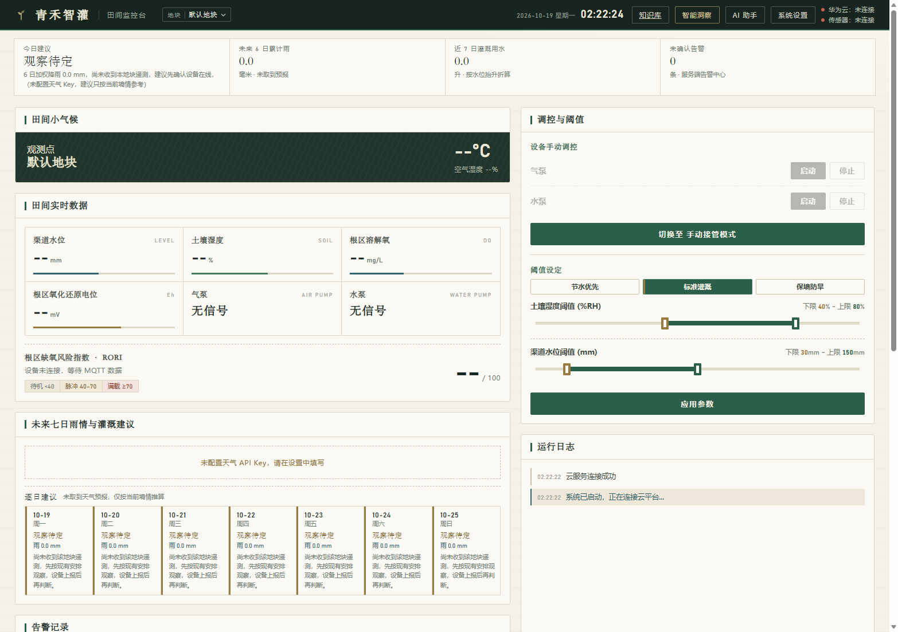

表 9-2 主监控台分区与职责
| 区带 | 组成 | 说明 |
|---|---|---|
| 顶栏 | 品牌、田间监控台、地块切换、日期与时钟、知识库/智能洞察/AI助手/系统设置四入口、华为云与传感器两枚状态点 | 全局导航与链路健康，地块切换决定看板、AI快照与灌溉建议的口径 |
| 概览带 | 今日建议、未来6日累计雨、近7日灌溉用水、未确认告警 | 四卡各由一个异步请求回填，副文案固定两行高度，避免数据到达时页面顶部跳动 |
| 左列 | 田间小气候、田间实时数据六卡、RORI横条、未来七日雨情与灌溉建议、告警记录 | 从「现在什么样」到「接下来该怎么动」的阅读顺序 |
| 右列 | 设备手动调控、模式切换、阈值三档预设与双滑块、运行日志 | 所有写操作集中在一列，与左列只读区物理隔开 |
| 底部 | 渠道水位、土壤湿度、RORI三张趋势图与图表类型切换 | 横跨两栏，用时间维度收束全页 |

田间实时数据六卡为渠道水位(mm)、土壤湿度(%RH)、根区溶解氧(mg/L)、根区氧化还原电位(mV)、气泵、水泵，前三行两列；前四卡数值下带细进度条表示量程位置，泵卡显示运行状态。设备离线时整个读数区与调控区进入`panel-disabled`态置灰，RORI条显示「设备未连接，等待MQTT数据」，读数显示为短横线而不是0，避免把「没有数据」误读成「读数为零」。

## 9.3 智能洞察面板

智能洞察是一个居中大弹窗，把分散在服务端的五类运维信息收在一处，顶栏右侧按钮打开，右上角提供刷新与关闭。标题下有一行副题说明内容范围，五个Tab以墨绿下划线表示选中态。

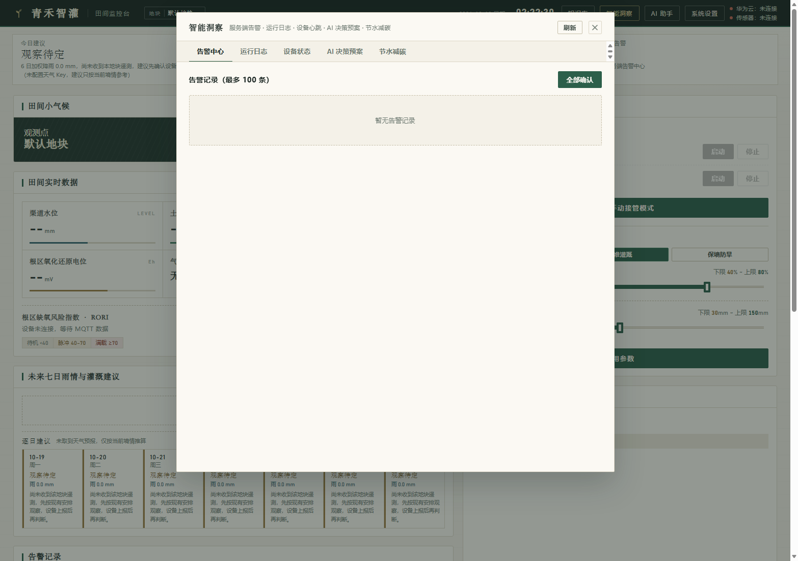

- **告警中心**：列最近告警（最多100条），工具条右侧「全部确认」一次清空未确认计数，无数据时显示虚线空态框而不是空白。
- **运行日志**：列服务端运行日志（最多200条），按时间倒序，与右列前端日志互补——前者可跨会话回溯，后者只反映本页。
- **设备状态**：显示设备在线状态与最后心跳时间，来源是服务端`device_status`表而非浏览器内存。
- **AI决策预案**：「生成预案」产出待确认方案，同屏展示推理文本与动作清单，人工确认后才按白名单下发；下方「历史预案」按时间列出已处理记录。
- **节水减碳**：近7日的节水与甲烷减排估算，含渠道面积与减排系数两个可配置口径。

面板宽度在窄屏下改为`calc(100vw - 24px)`、高度88vh，五个Tab在900px以下允许横向滚动而不换行。

## 9.4 登录页与系统设置、知识库

登录页是左右分栏的独立页面：左侧深绿品牌栏放静态水尺（刻度0—300mm，标尺读数标注300上限、200适灌、100下限、0渠底，并明写「图示为标尺示意，非实时水位」），配一句「田面有水，根区有氧；雨在未来六日，水在此刻一渠」，右下角压一枚朱红四字印章；右侧米白底上居中放登录卡。卡内三块面板互斥切换：账号登录、账号注册、登录成功后的地块选择（多地块账号先选田块再进监控台）。所有提示走卡上方的站内提示条（`role="status"`），不用原生弹窗。

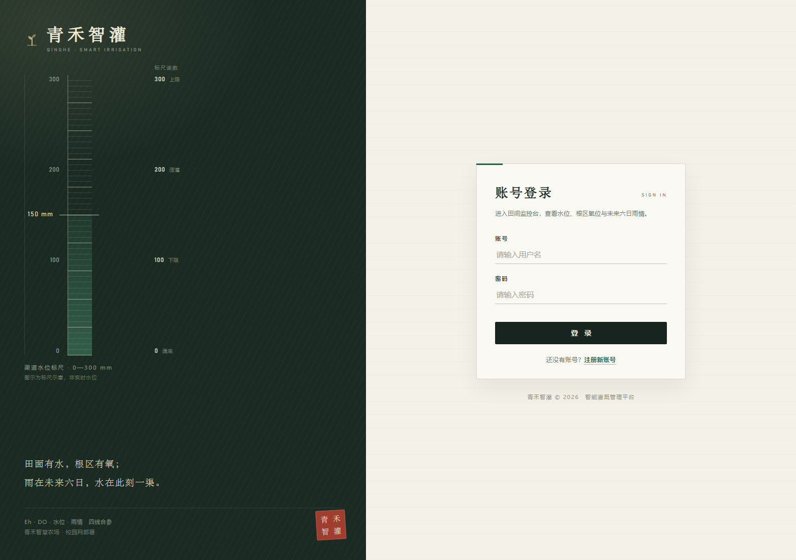

系统设置是纵向分区的宽弹窗，七块依次为账户、地块与位置、地块管理、物联网接入、气象与降雨预测、AI助手、告警推送。账户区块的登录身份只读，改口令另开小窗；地块管理内嵌地图，用于点选气象监测点或逐点圈出田界，底图不可达时自动降级为手填经纬度并给出说明；后四块各带「测试连接」按钮，结论以墨绿或朱红就地显示，不必先保存再试。底部是吸附操作条，「保存设置」与朱红「退出登录」始终可见。

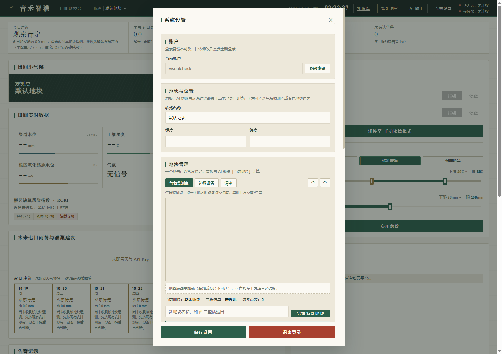

知识库是独立页，取手册版式：左栏章节目录带搜索框与「按标题筛选，清空即恢复全部」提示，右栏米白正文含表格与绿底提示框，右上角朱红印章作版面收束，顶栏提供五个章锚点与「返回看板」。正文标注数值口径来自`qinghe/config.py`，并声明页面本身不参与任何控制。样式表另带`@media print`，打印时隐藏目录与导航。

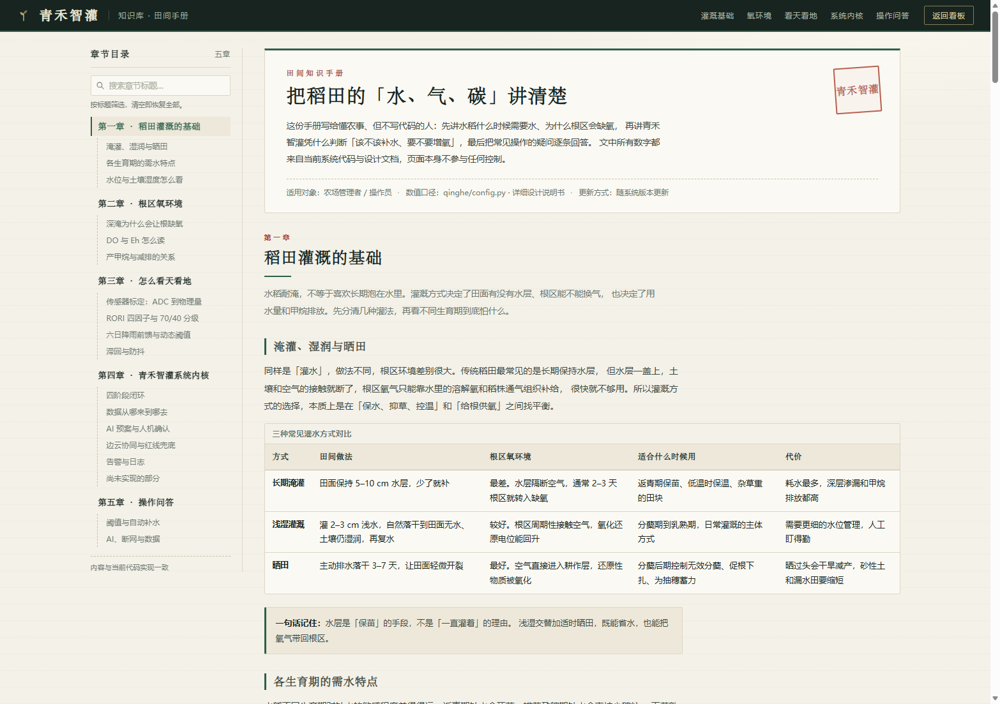

## 9.5 响应式与窄屏

断点分三档。1180px以下概览带由四列变两列，实时数据六卡由三列变两列，逐日建议由七列变四列，底部三图由并排改单列；900px以下读数与风险标尺字号收缩，图表高度降到180px；720px以下概览带与逐日建议固定两列，地块标签限宽96px防止顶栏撑破。手机竖屏即落在最窄一档，顶栏收起时钟与状态点，四个功能入口压成一行，其余区块依次单列堆叠，不需要横向滚动。

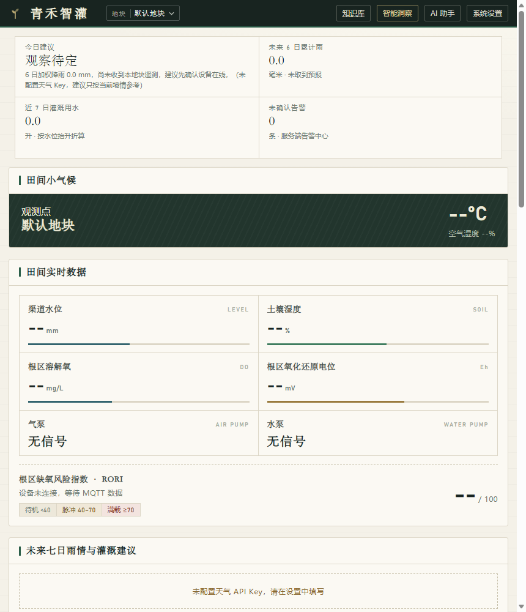

> 设计要点：全站不用阴影与渐变，靠描边、竖条与三档语义色建立层次；所有读数与状态都同时给文字，颜色只作辅助。这样在校园机常见的低色域屏与投影仪上仍然可读。

# 十、附录

## 10.1 项目目录结构

以下为交付时的仓库实际结构，省略`__pycache__`、`.pytest_cache`等生成目录。`qinghe/`下20个模块按职责分包，HTTP层集中在`routes/`，前端资源集中在`static/`，业务代码不直接写SQL。

```text
D:\AI\Farm\
├─ app.py                开发入口：create_app + socketio.run
├─ server.py             生产入口：waitress 托管 + 校园网地址横幅
├─ qinghe\               业务包（20 个模块）
│  ├─ __init__.py        create_app 工厂、socketio 单例、安全头
│  ├─ config.py          常量与环境变量读取
│  ├─ db.py              SQLite 连接、建表迁移、DAO
│  ├─ auth.py            口令哈希、登录限流、JWT
│  ├─ iot.py             MQTT 连接、解析、HistoryWriter、指令下发
│  ├─ irrigation.py      RORI / P6d / 动态阈值 / decide_control
│  ├─ alerts.py          告警判定与 webhook 推送
│  ├─ weather.py         七日预报、逆地理、缓存
│  ├─ ai.py              DeepSeek 代理与降级
│  ├─ realtime.py        SocketIO 事件与房间推送
│  └─ routes\            11 个蓝图模块
├─ templates\            index.html / knowledge.html / login.html
├─ static\
│  ├─ css\               6 份样式表
│  ├─ js\                15 个前端模块
│  └─ vendor\            chart.umd.min.js / socket.io.min.js / leaflet\
├─ tests\                conftest.py、helpers.py、37 个 test_*.py
│  └─ js\                9 个 *.test.mjs 前端用例
├─ tools\                gen_secret.py、simulate_device.py 等辅助脚本
├─ docs\                 设计文档与部署说明
├─ .env.example          环境变量样例
├─ requirements.txt      Python 依赖
└─ run.bat / start_server.bat / stop_server.bat / firewall_allow.bat
```

## 10.2 环境变量清单

表 10-1 环境变量清单
| 变量 | 默认值 | 说明 |
|---|---|---|
| `FARM_SECRET_KEY` | 无（进程内随机生成） | 会话与 JWT 签名密钥。未配置时每次启动生成新密钥，重启后所有登录态失效，生产必须显式配置 |
| `FARM_DB_PATH` | `qinghe.db` | SQLite 文件路径，相对路径以项目根为基准 |
| `HOST` | `0.0.0.0` | 监听地址。`127.0.0.1` 仅本机可访问，同学连不上 |
| `PORT` | `5000` | 监听端口，非数字或越出 1–65535 时回退 5000 并打印警告 |
| `FARM_DEBUG` | `0` | 取值 `1` 时开 Werkzeug 调试器，对外开放必须为 0 |
| `FARM_THREADS` | `8` | waitress 工作线程数，仅 `server.py` 读取 |
| `FARM_TRUST_PROXY` | `0` | 是否信任 `X-Forwarded-For`。直连部署必须保持 0，否则可换头绕过登录限流 |
| `FARM_COOKIE_SECURE` | 未设置 | 取值 `1` 时才给会话 Cookie 加 `Secure`，仅前置 HTTPS 时开启 |
| `FARM_CHANNEL_AREA_M2` | `0.5` | 核算节水量的渠道面积（平方米） |
| `FARM_CH4_SAVED_G_PER_HOUR` | `0.8` | 加气替代的甲烷减排系数（克每小时） |

`.env.example` 只列前六项中最常用的几项并附注释，其余变量按需在系统环境里设置即可，不设置即取上表默认值。注意两点：`FARM_SECRET_KEY` 的兜底常量仅用于判断「是否已配置」，绝不作为签名密钥；`FARM_TRUST_PROXY` 在反向代理场景之外开启会削弱限流效果。

## 10.3 启动与部署命令

以下命令均在项目根目录`D:\AI\Farm`下执行。安装依赖可加国内源`-i https://pypi.tuna.tsinghua.edu.cn/simple`。

```bat
:: 1) 安装依赖
python -m pip install -r requirements.txt

:: 2) 生成密钥（基于 .env.example 写入 .env；已存在则需 --force）
python tools/gen_secret.py

:: 3) 开发模式（仅本机，会暴露调试器，禁止对外开放）
set FARM_DEBUG=1
python app.py

:: 4) 生产模式（校园网对外开放）
set HOST=0.0.0.0
set PORT=5000
set FARM_DEBUG=0
python server.py

:: 5) 放行防火墙（管理员权限）
firewall_allow.bat

:: 6) 停止服务
stop_server.bat
```

四支批处理脚本与上述命令等价：`run.bat`对应第3步，`start_server.bat`串起第1、2、4步并检查依赖与防火墙规则，`firewall_allow.bat`等价于`netsh advfirewall firewall add rule name="青禾智灌 5000" dir=in action=allow protocol=TCP localport=5000`，`stop_server.bat`先打印占用端口的PID与进程名、确认后才结束进程。启动后`server.py`会打印本机与校园网两组访问地址，校园网那一条可直接发给同学。若要停止，在服务窗口按`Ctrl+C`，或运行`stop_server.bat`；关掉窗口同样会停服。

确认监听正常：`netstat -ano | findstr :5000`应显示本地地址`0.0.0.0:5000`；若为`127.0.0.1:5000`说明只绑定了本机，需把`HOST`改回`0.0.0.0`后重启。备份只需复制`qinghe.db`及其`-wal`、`-shm`两个伴生文件，复制前必须先停服，避免拷到写了一半的库。

## 10.4 测试命令与通过标准

后端用例在`tests/`下，用pytest运行；前端纯函数用例在`tests/js/`下，用Node内置测试运行器。仓库当前没有`package.json`，故不能使用`npm run test:js`，须直接指定文件通配。

```bat
:: 后端全量（约 3 分钟）
python -m pytest tests -q

:: 前端纯函数用例（Node 18+，实测 v22）
node --test tests/js/*.test.mjs
```

通过标准：两条命令退出码为0，且汇总行无失败项——后端应输出`955 passed`，前端应输出`144 passed`、`0 failed`。pytest的85条warning均为第三方库的弃用提示，不影响判定。修改任何接口、算法、控制策略或数据表后必须补对应用例；不得用`skip`或注释断言来让测试变绿。

测试与开发库分离：用例通过`FARM_DB_PATH`指向临时文件，不触碰仓库里的`qinghe.db`；`create_app()`不启动后台线程，`start_history_writer()`与`start_device_watcher()`只在进程入口调用一次，避免每个用例多起线程。无实物主板时用`python tools/selftest_no_hardware.py`，它以Flask测试客户端加临时数据库把注册、上报、落库、RORI、建议、告警、导出、多地块整条链路跑一遍并逐项打印PASS/FAIL，退出码0为全通过；`python tools/simulate_device.py --scenario anaerobic --samples 24`则模拟一台持续上报的ESP32-E网关，走与真实设备完全相同的`qinghe.iot.ingest_telemetry()`链路。

> 设计要点：附录里的每条命令都在交付前实跑过，通过数以实测为准而非引自旧报告。部署相关的坑集中在三处——密钥没生成导致重启掉登录态、`HOST`误设成`127.0.0.1`导致同学连不上、端口被上次没退干净的进程占用，三者都已写进10.3的确认步骤。
