# 一、引言

## 1.1 编写目的

本文件是《青禾智灌智慧灌溉管理平台概要设计说明书》的下游文档，读者是后续开发者、测试人员与答辩评审。概要书回答「系统分成哪些模块、为什么这样分」，本文回答「每个模块内部究竟怎么实现」——函数签名与调用方向、常量的真实取值、数据结构的逐字段构成、算法的公式与算例、接口在成功与失败两种情形下的响应。

全文口径是可验证：凡给出公式的必给出算例，凡引用常量的必标明其在`qinghe/config.py`中的位置，凡给出接口的必给出正常与异常返回。标识符（函数名、表名、字段名、常量名、路由路径）与源码逐字一致，不做意译，便于用`grep`定位。文档与代码冲突时以代码为准，冲突项统一登记在第十六章，本文不擅自改写代码去迁就文档。

## 1.2 与其他文档的关系

表 1-1 详细设计说明书与上下游文档的分工
| 文档 | 回答的问题 | 本文的处理方式 |
|---|---|---|
| 概要设计说明书 | 分哪些模块、为什么这样分、部署成什么形态 | 沿用其模块边界与部署形态，不重复架构选型论证 |
| 详细设计说明书（本文） | 每个模块内部怎么做、失败时返回什么 | 逐函数、逐字段、逐常量展开，给出边界用例 |
| 用户手册 | 界面上怎么操作、按钮在哪 | 不重复操作步骤，仅在前端行为相关处引用事件契约 |
| 测试与验收报告 | 验收到什么程度、实测数据是多少 | 只给用例设计依据（边界与异常总表），不复述结论数据 |

章节分工也是按这个层次切的：第一章至第三章是全书公共约定（分层命名、响应与错误码、线程模型、常量全表），读一次即可套用到后面每章；第四章至第十五章按「数据访问层→算法→认证→设备接入→告警→实时通道→外部服务→HTTP 接口→新增功能→前端→部署→测试」逐层展开；第十六章集中登记已知缺口。

四份文档引用同一批源材料，但取值优先级不同：**源码 > 概要书 > 材料汇编**。概要书中与代码不符处，本文按代码写并登记差异。

## 1.3 术语

与概要书重复的术语（RORI、DO、Eh、P6d、α、IoTDA、MQTT、WAL、HITL、NF）不再重复，此处只列详细设计新增符号。

表 1-2 详细设计阶段新增符号
| 符号 | 含义 | 取值/落点 |
|---|---|---|
| S_Eh | 氧化还原电位风险因子，0–1 | `risk_eh()`，分母`EH_SPAN_MV` |
| S_DO | 溶解氧风险因子，0–1 | `risk_do()`，基准`DO_SAFE_MGL` |
| R_water / R_soil | 水位风险因子、土壤湿润风险因子，0–1 | `risk_water()` / `risk_soil()` |
| effLower / effUpper | 降雨前馈修正后的土壤湿度上下限，%RH | `compute_dynamic_threshold()` |
| TTL | 决策预案自生成起可确认的有效期 | `planner.PLAN_TTL_SECONDS = 600` 秒 |
| 背压 | 队列满时丢最旧数据而非阻塞生产者的降级策略 | `HistoryWriter.enqueue()` |
| DAO | Data Access Object，一表一动作的单表读写函数 | `qinghe/db.py` |
| 房间 | SocketIO 定向推送分组，本系统以`str(uid)`命名 | `qinghe/realtime.py` |

# 二、设计约定

本章是后面各章共用的公共约定。读一次即可套用到每个模块，后面不再逐章重复。

## 2.1 命名与分层约定

后端按三层组织，调用方向严格单向向下，不允许出现反向依赖或跨层跳跃。

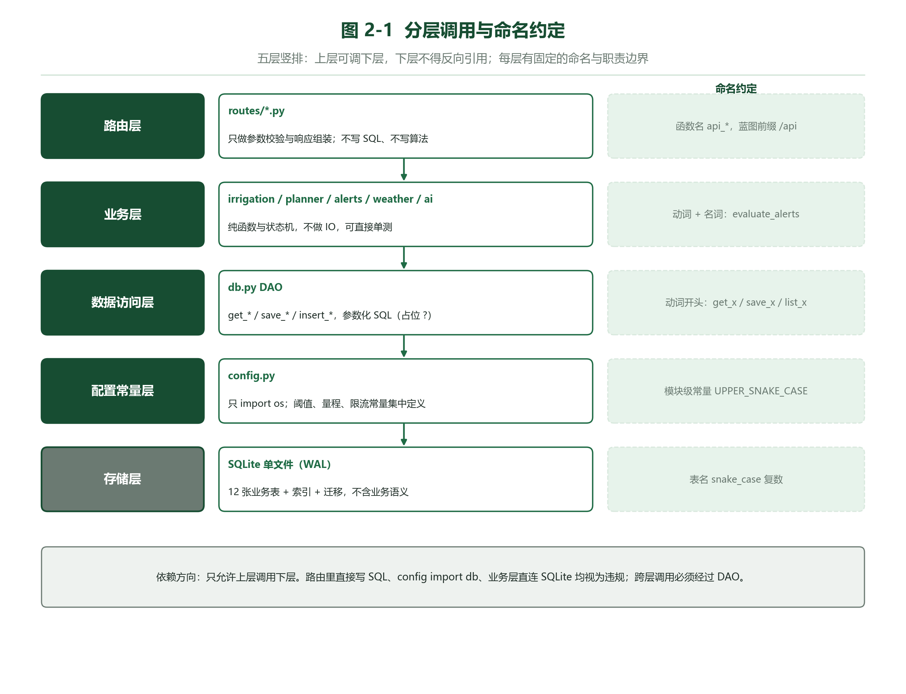

第一层是接口层`qinghe/routes/*`，10 个蓝图文件（`app_routes`、`auth_routes`、`config_routes`、`data_routes`、`ai_routes`、`insight_routes`、`export_routes`、`monitor_routes`、`farm_routes`、`advice_routes`）由`qinghe/__init__.py`的`_register_blueprints()`统一注册。这一层只做三件事：从`session`取`user_id`做鉴权、用`qinghe/validators.py`校验入参、把结果组装成 JSON 响应。**接口层不写业务判断，也不写 SQL。**

第二层是领域层，每个模块一个关注点：`irrigation.py`是纯函数（RORI 融合、动态阈值、调控决策，模块内不导入`db`也不碰全局状态），`auth.py`管口令与会话，`iot.py`管 MQTT 接入与批量落库，`alerts.py`是告警判定纯函数，`weather.py`/`ai.py`是外部服务代理，`planner.py`/`metrics.py`/`autocontrol.py`/`heartbeat.py`/`alert_center.py`/`logbook.py`各自维护一块进程内运行态。

第三层是数据访问层`qinghe/db.py`，一表一动作的 DAO 函数，对外只暴露`get_db()`与形如`insert_history_rows()`、`save_thresholds()`的具名函数。所有 SQL 集中在这一层。

命名规范四条：模块与包全小写、多词用下划线（`alert_center.py`）；函数与变量 snake_case；常量全大写并用下划线分词（`HISTORY_FLUSH_BATCH`）；表名用复数（`users`、`configs`、`sensor_history`、`thresh_settings`、`farms`、`geo_cache`）。私有成员加单下划线前缀（`_login_fail`、`_RUNTIME_SECRET_KEY`），表示仅进程内使用。

依赖方向还有一条硬约束：`qinghe/config.py`只导入标准库`os`、`secrets`、`threading`，不导入任何`qinghe`子模块，因此它是整个包的最底层，任何模块都可以安全导入它而不形成循环依赖。

## 2.2 统一响应格式与错误码

系统在演进中形成了四种响应形态，本文如实记录而不假装统一，因为前端已按实际形态取值。

表 2-1 四种响应形态及其出现范围
| 形态 | 示例 | 出现范围 |
|---|---|---|
| 结果直出 | `{'data': [...]}`、`{'status': 'success', 'message': '设定已保存'}` | 多数查询与保存类接口 |
| 错误对象 | `{'error': '未授权'}` | 参数错误、鉴权失败、资源不存在 |
| 带状态错误 | `{'status': 'error', 'message': '未授权'}` | `advice_routes.py`、`farm_routes.py` |
| 上游错误透传 | `{'code': 'ERR', 'error': '未配置天气 API Key'}` | `/api/forecast` 失败分支 |

前端读取时按接口分别处理：读`body.error`或`body.message`，不假定统一键名。这一现状已登记为待改进项，不在本轮重构范围内改动，以免破坏既有前端。

表 2-2 状态码使用约定
| 码 | 语义 | 触发条件 |
|---|---|---|
| 200 | 成功 | 正常返回；**设备未连接、诊断探测失败也返回 200**，业务结果放`ok`/`message`字段 |
| 400 | 参数错误 | 类型不符、超范围、超长、JSON 体不是对象 |
| 401 | 未鉴权 | `session`中无`user_id` |
| 404 | 未找到 | 配置/告警/预案不存在，或不属于当前用户 |
| 405 | 方法不允许 | 蓝图未注册该 HTTP 方法，由全局处理器兜底 |
| 413 | 请求体过大 | 超过`MAX_CONTENT_LENGTH = 512 * 1024`字节 |
| 415 | 类型不符 | 请求体不是 JSON |
| 429 | 触发限流 | 登录失败达`LOGIN_MAX_FAIL = 5`次，锁定`LOGIN_LOCK_SECONDS = 600`秒 |
| 500 | 服务端错误 | 未预期异常；`/api/insight/plan`的`'预案生成失败'`是唯一主动返回 500 的业务分支 |
| 502 | 上游失败 | `/api/forecast`未配 Key 或上游返回异常 |

`404`/`405`/`400`/`413`/`415`由`_register_error_handlers()`全局兜底注册，返回`{'error': '未找到资源'}`这类固定文案，避免 Flask 默认返回 HTML 页面导致前端`JSON.parse`报错。

## 2.3 并发与线程模型

进程是多线程单进程，不做多进程横向扩展。这个假设贯穿全文：限流计数、`mqtt_clients`、历史与日志队列、告警去重时间戳全部是进程内存态，一旦起多个 worker 就会各自为政。

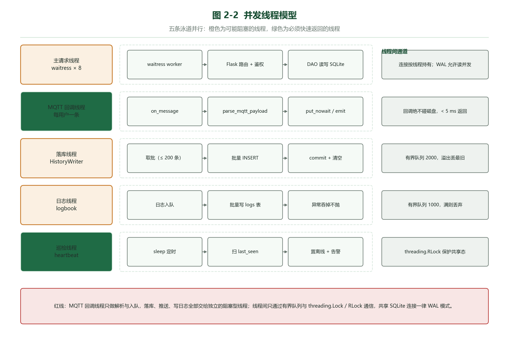

表 2-3 进程内线程清单
| 线程 | 启动点 | 节奏 | 约束 |
|---|---|---|---|
| HTTP 工作线程 | `server.py`的`serve(..., threads=int(os.environ.get("FARM_THREADS", "8")))` | 请求驱动 | 默认 8 个，可在环境变量覆盖 |
| MQTT 回调线程 | paho 的`loop_start()` | 事件驱动 | **必须非阻塞**，回调里不做长耗时操作 |
| 历史落库线程 | `iot.history_writer.start()` | 每`HISTORY_FLUSH_INTERVAL = 1.0`秒或凑满`HISTORY_FLUSH_BATCH = 200`条 | 单写线程，批量`executemany` |
| 日志落库线程 | `logbook`写线程 | 每 1.0 秒或 20 条 | 与历史落库同理 |
| 设备离线巡检线程 | `realtime.start_device_watcher()`→`heartbeat.start_watcher(_device_uids, _emit_device_status)` | 每`WATCH_INTERVAL = 5.0`秒 | 静默超过`DEVICE_OFFLINE_SECONDS = 30`秒判离线；幂等，已在跑则复用 |
| 告警推送线程 | `alert_center.push_alert()`内`threading.Thread` | 每条告警一线程 | 按`PUSH_RETRY_DELAYS = (0.0, 0.5, 1.0)`重试三次，线程句柄登记在`_PUSH_THREADS` |

SocketIO 固定用`async_mode='threading'`（`server.py`的`SOCKETIO_ASYNC_MODE`），原因写在注释里：MQTT 后台线程要调`emit`，而 eventlet/gevent 的 monkey-patch 会与 paho 自带的线程冲突。**不要**改成 eventlet/gevent。

表 2-4 共享状态与保护手段
| 共享状态 | 位置 | 保护 |
|---|---|---|
| `mqtt_clients` | `iot.py:32` | `mqtt_lock = threading.RLock()`，读写全部`with mqtt_lock:` |
| 历史队列 | `HistoryWriter.queue` | `queue.Queue(maxsize=2000)`自带锁，另配`_lock`保护计数器 |
| 日志写线程 | `logbook._DB_LOCK` | `threading.Lock()`，队列`QUEUE_MAX = 1000`、批量`BATCH_SIZE = 20` |
| 登录失败计数 | `auth.py:19` | `_login_lock = threading.Lock()` |
| 告警限频时间戳 | `iot.py:296` | `_alert_eval_lock` |
| 告警去重时间戳 | `alerts.AlertDeduper._lock` | `threading.Lock()` |
| 设备在线状态 | `heartbeat._STATUS_LOCK` | `threading.RLock()` |
| 进程级随机密钥 | `config.py:205` | `_SECRET_LOCK`，惰性创建一次 |

队列的降级策略是丢最旧而不阻塞：`HistoryWriter.enqueue()`先`put_nowait()`，抛`queue.Full`时`get_nowait()`丢掉一条最旧数据再重试，从而保证 MQTT 回调线程永远不会被落库拖住。

两条启动纪律：`start_history_writer()`与`start_device_watcher()`只在进程入口`server.py`的`main()`/`app.py`的`__main__`调用一次，**不进`create_app()`**，否则每个测试用例都会多起一个线程且无法回收。

## 2.4 防御式编程约定

表 2-5 防御式编程约定逐条
| 约定 | 做法 | 依据 |
|---|---|---|
| 外部调用必设超时 | `TIMEOUT_PHOTON = 6`、`TIMEOUT_WEBHOOK = 3`、`TIMEOUT_WEATHER = 8`、`TIMEOUT_AI = 20`，全部显式传 `timeout=` | 防上游挂死拖垮工作线程 |
| 外部异常不上抛 | 天气/AI/逆地理/webhook 失败均就地降级返回默认值或`None`，不抛到请求栈 | 单点外部故障不应变成 500 |
| 入参校验三要素 | 类型、范围、长度；非法入参返回 4xx | `validators.py`把`AttributeError`转成 400 |
| SQL 参数化 | 一律`?`占位，禁止 f-string 拼用户输入 | 唯一例外是`db.save_config()`按`CONFIG_COLUMNS`常量元组拼列名 |
| 连接不泄漏 | 所有连接`with closing(get_db()) as conn:` | 40 余处统一写法 |
| 队列不阻塞 | 满则丢最旧，记录`dropped`计数 | 保护 MQTT 回调实时性 |
| 告警判定用类型码 | `evaluate_alerts()`返回`code`（`soil_low`等），不解析中文文案 | 改文案不影响告警分类 |
| 前端不拼未转义数据 | 用户/设备数据一律走`esc()`或`textContent`，不用`innerHTML` | 防存储型 XSS |
| 敏感字段不回显 | `GET /api/get_config`把已配置的 Key 替换为`config.MASK`（`'••••••••'`） | 响应体泄漏口令 |
| 密钥不回落到硬编码 | 未配`FARM_SECRET_KEY`时生成进程级随机密钥（`secrets.token_urlsafe(48)`） | 硬编码常量可被用于自签 JWT 冒充任意用户，属 fail-open |

# 三、配置与常量设计

## 3.1 运行期配置函数

`qinghe/config.py`是整个包的配置中心：常量以模块级赋值集中定义，运行期可变项用函数读取。它只导入`os`、`secrets`、`threading`三个标准库，**不导入任何`qinghe`子模块**，因此是全包最底层，任何模块导入它都不会形成循环依赖。模块顶层除`DB_PATH`一处读环境变量外无任何副作用（不打日志、不开连接、不起线程）。

表 3-1 运行期配置函数
| 函数 | 返回值 | 读取的环境变量 | 默认行为 |
|---|---|---|---|
| `is_debug()` | `bool` | `FARM_DEBUG` | 仅当值为`'1'`时为真，默认关闭，生产安全 |
| `trust_proxy()` | `bool` | `FARM_TRUST_PROXY` | 默认`False`。直连部署时客户端可伪造`X-Forwarded-For`，若据此限流等于把开关交给攻击者，故仅在反向代理之后才开 |
| `secret_key_is_configured()` | `bool` | `FARM_SECRET_KEY` | 只判断是否显式配置，用于启动告警 |
| `get_secret_key()` | `str` | `FARM_SECRET_KEY` | 未配置时惰性生成`secrets.token_urlsafe(48)`进程级随机密钥并在进程内复用（`_RUNTIME_SECRET_KEY`+`_SECRET_LOCK` 保护） |
| `reset_runtime_secret_key()` | `None` | — | 清空随机密钥，仅供测试模拟进程重启 |
| `get_db_path()` | `str` | `FARM_DB_PATH` | **每次调用都重读环境变量**，测试可在运行中切库而无需重启 |

密钥不回落到硬编码常量是刻意的 fail-closed 选择：旧实现用`FALLBACK_SECRET_KEY`作兜底，任何人可借这个公开常量自签 JWT 冒充任意`user_id`下发真实设备指令。改用随机密钥后无法预知，代价是未配置时重启后既有登录态失效，生产须显式配置。`FALLBACK_SECRET_KEY`保留下来只作为「是否显式配置」的哨兵字符串，不参与签名计算。

`PORT`不在本模块读取：`app.py:20`与`server.py:63`各自读`PORT`，缺失时回落到`config.DEFAULT_PORT`。`FARM_THREADS`与`FARM_COOKIE_SECURE`也在各自的调用点读取，不集中于`config.py`。

## 3.2 常量全表

**所有阈值、量程、超时、限流参数只在这里定义，业务代码只引用不复制。** 需要调整控制策略或标定参数时只改`qinghe/config.py`一处，`irrigation.py`与前端的判定逻辑均从同一批常量出发，避免同一阈值在多处出现不同副本。

表 3-2 常量全表（按代码中的分组顺序）
| 常量名 | 值 | 单位 | 含义 |
|---|---|---|---|
| `APP_NAME` | `'青禾智灌智慧灌溉管理平台'` | — | 产品名，用于页面标题与日志 |
| `DB_PATH` | `os.environ.get('FARM_DB_PATH','qinghe.db')` | — | 默认库文件路径，`get_db_path()`兜底 |
| `FALLBACK_SECRET_KEY` | `'smart_irrigation_secret_2026'` | — | 哨兵值，仅判断是否显式配置，不作签名密钥 |
| `DEFAULT_PORT` | `5000` | 端口 | 默认监听端口 |
| `DB_TIMEOUT` | `10` | 秒 | SQLite 连接超时，同时用于`busy_timeout` |
| `HISTORY_KEEP_DAYS` | `7` | 天 | 启动时清理超过该天数的历史数据 |
| `HISTORY_DEFAULT_LIMIT` | `1000` | 条 | 历史查询默认条数 |
| `HISTORY_MIN_LIMIT` | `1` | 条 | 历史查询下限 |
| `HISTORY_MAX_LIMIT` | `5000` | 条 | 历史查询上限，也是导出默认行数 |
| `CSP_POLICY` | 见 3.3 | — | 内容安全策略串 |
| `SECURITY_HEADERS` | 4 项字典 | — | 统一安全响应头 |
| `LOGIN_MAX_FAIL` | `5` | 次 | 允许连续登录失败次数 |
| `LOGIN_LOCK_SECONDS` | `600` | 秒 | 锁定窗口，同时也是注册限流窗口 |
| `REGISTER_MAX_ATTEMPTS` | `10` | 次 | 同一来源 IP 在窗口内最多注册次数 |
| `MAX_CONTENT_LENGTH` | `512 * 1024` | 字节 | 请求体上限，超限返回 413 |
| `MASK` | `'••••••••'` | — | 敏感字段回显掩码 |
| `ALERT_CONTENT_MAX_LEN` | `500` | 字符 | 告警文案截断长度 |
| `ALERT_LEVEL_MAX_LEN` | `20` | 字符 | 告警级别字段截断长度 |
| `IOT_PORT_MIN` | `1` | 端口 | `iot_port`校验下限 |
| `IOT_PORT_MAX` | `65535` | 端口 | `iot_port`校验上限 |
| `IOT_PORT_DEFAULT` | `1883` | 端口 | MQTT 默认端口 |
| `HUMI_MIN` / `HUMI_MAX` | `0` / `100` | %RH | 土壤湿度阈值合法范围 |
| `WATERLEVEL_MIN` / `WATERLEVEL_MAX` | `0` / `300` | mm | 渠道水位阈值合法范围 |
| `THRESH_DEFAULTS` | `humi_down=40, humi_up=80, waterlevel_down=30, waterlevel_up=150, manual_mode=0` | %RH / mm / — | 阈值默认值，无记录时返回、非法入参回退 |
| `USERNAME_MIN_LEN` / `USERNAME_MAX_LEN` | `3` / `20` | 字符 | 用户名长度 |
| `PASSWORD_MIN_LEN` / `PASSWORD_MAX_LEN` | `6` / `64` | 字符 | 密码长度 |
| `DEFAULT_M2M_TOPIC` | `'/esp32e/data'` | — | 上行数据转发 Topic |
| `DEFAULT_CMD_TOPIC` | `'/esp32e/cmd'` | — | 下行命令 Topic |
| `DEFAULT_WEATHER_DOMAIN` | `'m767cfpjh7.re.qweatherapi.com'` | — | 和风天气专属域名 |
| `DEFAULT_AI_DOMAIN` | `'https://api.deepseek.com'` | — | AI 接口基址 |
| `DEFAULT_AI_MODEL` | `'deepseek-chat'` | — | 请求体`model`字段 |
| `AI_MSG_MAX_LEN` | `2000` | 字符 | 单次提问上限，超长直接 400 |
| `TIMEOUT_PHOTON` | `6` | 秒 | 逆地理编码超时 |
| `TIMEOUT_WEBHOOK` | `3` | 秒 | webhook 推送超时 |
| `TIMEOUT_WEATHER` | `8` | 秒 | 天气接口超时 |
| `TIMEOUT_AI` | `20` | 秒 | AI 接口超时 |
| `FARM_NAME_MIN_LEN` / `FARM_NAME_MAX_LEN` | `1` / `20` | 字符 | 地块名称长度 |
| `FARM_MAX_COUNT` | `12` | 块 | 单账号地块数上限 |
| `FARM_AREA_MAX_M2` | `1000000.0` | m² | 单块地上限（100 公顷） |
| `FARM_POLYGON_MAX_POINTS` | `200` | 点 | 圈地边界点数上限 |
| `FARM_POLYGON_MAX_LEN` | `20000` | 字符 | 边界 JSON 串长度上限 |
| `FARM_LAT_RANGE` / `FARM_LON_RANGE` | `(-90.0, 90.0)` / `(-180.0, 180.0)` | 度 | 经纬度合法范围 |
| `ADC_MAX` | `4095.0` | 码值 | 12 位 ADC 满量程 |
| `WATER_FS_MM` | `300.0` | mm | 探针式水位满量程，Adc 4095 对应 300mm |
| `DO_MIN_MGL` / `DO_MAX_MGL` | `0.0` / `20.0` | mg/L | 根区溶解氧量程 |
| `EH_MIN_MV` / `EH_MAX_MV` | `-150.0` / `300.0` | mV | 氧化还原电位量程 |
| `W_EH` | `0.35` | 无量纲 | 氧化还原电位风险权重 |
| `W_DO` | `0.35` | 无量纲 | 溶解氧风险权重 |
| `W_WATER_SOIL` | `0.30` | 无量纲 | `max(R_water,R_soil)`权重 |
| `GAMMA` | `0.5` | 无量纲 | 水位×土壤耦合惩罚系数 |
| `EH_SAFE_MV` | `300.0` | mV | `S_Eh`中的`Ehmax` |
| `EH_SPAN_MV` | `450.0` | mV | `S_Eh`分母，即`300-(-150)` |
| `DO_SAFE_MGL` | `8.0` | mg/L | `S_DO`中的`DOmax`，超过即无缺氧风险 |
| `WATER_DEADBAND_MM` | `5.0` | mm | 水位风险死区 |
| `WATER_RISK_SPAN_MM` | `100.0` | mm | 水位风险归一化跨度 |
| `RORI_HEAVY` | `70` | 分 | 重度厌氧分档阈值，`≥70` |
| `RORI_MODERATE` | `40` | 分 | 中度缺氧分档阈值，`40~70` |
| `RAIN_WEIGHTS` | `[1.0, 0.9, 0.7, 0.5, 0.4, 0.3]` | 无量纲 | 未来 6 日降雨时间衰减权重`ω_t` |
| `H_ROOT` | `200.0` | mm | 核心活动根系层厚度，`effLower`分母 |
| `ALPHA_LOW` | `0.95` | 无量纲 | `P6d ≤ 10mm`的降雨有效利用系数 |
| `ALPHA_MID` | `0.75` | 无量纲 | `10 < P6d ≤ 50mm` |
| `ALPHA_HIGH` | `0.45` | 无量纲 | `P6d > 50mm` |
| `ALPHA_LOW_MAX` | `10.0` | mm | α 第一档上界 |
| `ALPHA_MID_MAX` | `50.0` | mm | α 第二档上界 |
| `EFF_LOWER_FLOOR` | `45.0` | %RH | 前馈控水等雨的湿度下限保底，防枯萎 |
| `EFF_UPPER_RAIN` | `15.0` | mm | 触发蓄雨型控灌的`P6d`门槛 |
| `EFF_UPPER_BONUS` | `15.0` | %RH | 蓄雨时湿度上限放宽幅度 |
| `EFF_UPPER_CAP` | `100.0` | %RH | 湿度上限封顶 |
| `ALERT_COOLDOWN_SECONDS` | `60` | 秒 | 同一告警内容最小推送间隔 |
| `LOG_COOLDOWN_SECONDS` | `30` | 秒 | 同一内容运行日志最小落库间隔，抑制刷屏 |
| `ALERT_KEY_PREFIX` | `'【青禾智灌系统】'` | — | 钉钉关键字前缀 |
| `HISTORY_QUEUE_MAX` | `2000` | 条 | 落库队列上限，满则丢最旧，不阻塞 MQTT 回调 |
| `HISTORY_FLUSH_INTERVAL` | `1.0` | 秒 | 后台落库线程 flush 周期 |
| `HISTORY_FLUSH_BATCH` | `200` | 条 | 单次 flush 最多写入行数 |

上表共 82 个公开常量，另有 2 个模块级私有状态`_RUNTIME_SECRET_KEY`（进程级随机密钥缓存）与`_SECRET_LOCK`（保护前者的锁），一并计入总数 84 项。

两点易误读处需明确。其一，`EFF_LOWER_FLOOR`是无条件保底：`effLower = max(45.0, humi_down - α*P6d/H_ROOT*100)`，默认`humi_down = 40`时无论降雨多少，`effLower`恒为 45.0，反而比基础下限高 5 个百分点；只有用户把`humi_down`调到 45 以上，降雨前馈才真正下调阈值。这是前端既有行为，属设计现状而非缺陷。其二，`HISTORY_FLUSH_INTERVAL`与`HISTORY_FLUSH_BATCH`是「或」关系——后台线程每 1.0 秒醒来一次，单次最多取 200 条，因此实际写入频率由到达速率决定，不是固定批量。

## 3.3 安全响应头逐项

`qinghe/__init__.py:43-50`的`_register_security_headers(app)`用`@app.after_request`注册，遍历`config.SECURITY_HEADERS`逐项`resp.headers.setdefault(key, value)`。用`setdefault`而非赋值是刻意为之：视图函数可覆盖单个头（例如 CSV 导出需要在`Content-Disposition`上另写字样），而未被覆盖的项仍由全局兜底。

表 3-3 安全响应头
| Header 名 | 值 | 作用 |
|---|---|---|
| `X-Content-Type-Options` | `nosniff` | 禁止浏览器嗅探 MIME 类型，缓解上传型 XSS |
| `X-Frame-Options` | `SAMEORIGIN` | 禁止第三方站点用`iframe`嵌入（防点击劫持） |
| `Referrer-Policy` | `no-referrer` | 跨站跳转不泄露完整 URL |
| `Content-Security-Policy` | 见下 | 只允许同源资源，禁用`object`与`base`劫持 |

`CSP_POLICY`共 8 条指令，含义逐条如下。`default-src 'self'`是兜底，未单独声明的资源类型一律只认同源。`script-src 'self' 'unsafe-inline'`与`style-src 'self' 'unsafe-inline'`放行同源脚本与内联，这是为兼容模板里既有`onclick`与内联样式保留的妥协；若后续把事件全部改为`addEventListener`，应移除`'unsafe-inline'`。`img-src 'self' data: https:`中的`https:`只为放行高德地图瓦片与`data:`内联图标。`connect-src 'self' https:`允许`XHR`/`WebSocket`访问同源与外部天气接口。`font-src 'self' data:`。`object-src 'none'`禁用`<object>`/`<embed>`，切断 Flash 类插件入口。`base-uri 'self'`防攻击者用`<base>`标签重定向相对路径。

需要说明的是，`socket.io`、`Chart.js`、`Leaflet`均已随包放在`static/vendor`，因此`script-src`与`style-src`不再放行任何外网 CDN，这是本系统与常见 Web 应用在 CSP 上最大的差别。

# 四、数据访问层详细设计

数据访问层由`qinghe/db.py`单模块承担（674行），是全系统唯一的SQLite入口。全仓库`sqlite3.connect`只出现两次——`qinghe/db.py:20`定义、`qinghe/db.py:25`调用——这条约束让连接生命期、PRAGMA设置与行工厂无法被调用方绕过。全库12张表：6张由本层建立（见4.3），6张由新增功能模块懒建（见4.5）。

## 4.1 连接管理

`get_db() -> sqlite3.Connection`每次调用新建连接，固定做三件事：

```python
def get_db() -> sqlite3.Connection:
    conn = sqlite3.connect(config.get_db_path(), timeout=config.DB_TIMEOUT)
    conn.row_factory = sqlite3.Row
    try:
        conn.execute('PRAGMA journal_mode=WAL')
        conn.execute('PRAGMA busy_timeout=%d' % int(config.DB_TIMEOUT * 1000))
    except sqlite3.Error:
        pass
    return conn
```

- 路径每次动态取：`config.get_db_path()`体内是`os.environ.get('FARM_DB_PATH', DB_PATH)`，测试切临时库不需重启进程。
- `row_factory = sqlite3.Row`：DAO返回可按列名取值的行，路由层写`row['ts']`而非下标，后续增删列不会让取值错位。
- `journal_mode=WAL`：读不阻塞写、写不阻塞读，是遥测落库线程与HTTP请求并发读写同一文件的前提。
- `busy_timeout`取`int(DB_TIMEOUT * 1000)`即10000毫秒（`DB_TIMEOUT = 10`），把瞬时锁冲突从「立刻抛`database is locked`」变成「最多等10秒」。两条PRAGMA包在`try/except sqlite3.Error: pass`内，只读介质或不支持WAL的编译版本退化为回滚日志模式即可。

**所有权约定**：函数不缓存连接、不设单例，拿到连接的一方负责关闭，统一写法`with closing(get_db()) as conn:`——`closing`保证正常返回与异常抛出两条路径都`close()`；需多条语句共享事务时改`try/finally`。写操作一律紧跟`conn.commit()`，即「函数边界就是事务边界」。

**为什么这样能避免跨线程共享连接**：`sqlite3.Connection`默认`check_same_thread=True`，同一连接对象被另一线程使用会直接抛`ProgrammingError`。本设计不给它这个机会——无连接池、无模块级连接变量，`init_db()`、遥测落库线程与每个HTTP请求各自取连接、用完即关；多连接并发写同一文件由WAL与`busy_timeout`协调，而不是由一条共享连接加锁协调。

## 4.2 幂等迁移

`init_db(force: bool = False) -> None`负责建表与老库升级，每次执行都可安全重复，也可安全地跑在一台两年未更新的老库上。

```
1. with _init_lock:                        # 模块级 threading.Lock
2.   if _initialized and not force: return
3.   CREATE TABLE IF NOT EXISTS users / configs
4.   PRAGMA table_info(configs) → 现有列名集合 cols
5.   for (col, ddl) in _CONFIG_MIGRATIONS: col 不在 cols 才执行该 ALTER TABLE
6.   CREATE TABLE IF NOT EXISTS sensor_history（新建即含 farm_id）
7.   同理补 do_mgl / eh_mv / farm_id；仅当补的是 farm_id 才回填历史行
8.   CREATE INDEX IF NOT EXISTS idx_history_user_ts / idx_history_user_farm_ts
9.   DELETE FROM sensor_history WHERE ts < now_ms − 7×86400000
10.  CREATE TABLE IF NOT EXISTS thresh_settings / farms，farms 同样按列补 9 个 iot_* 列
11.  _initialized = True
```

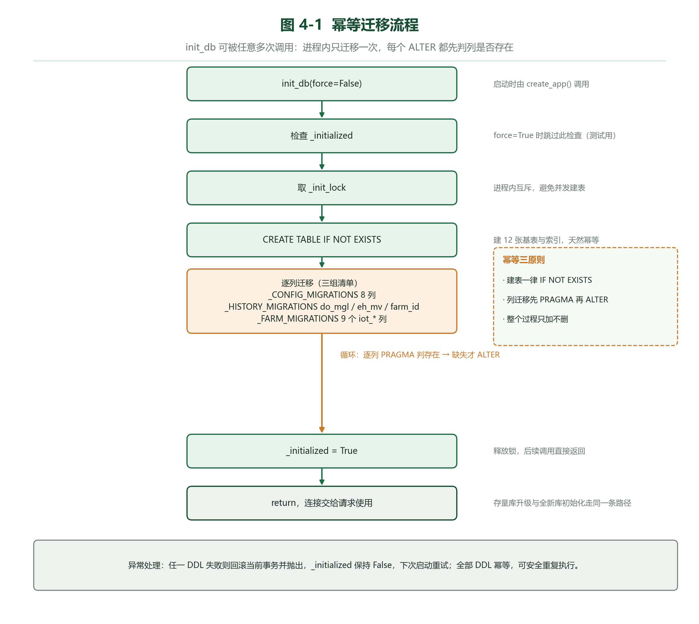

**这是可重复执行的幂等设计**，由三层机制共同保证，缺一层都不成立：

表 4-1 幂等迁移的三层机制
| 机制 | 实现 | 作用 |
|---|---|---|
| 建表 | 全部`CREATE TABLE IF NOT EXISTS` | 重复执行不报错，不覆盖既有数据 |
| 补列 | 先`PRAGMA table_info(表)`取现有列名，`col not in cols`才执行`ALTER TABLE ... ADD COLUMN` | SQLite的`ADD COLUMN`重复执行会报duplicate column，必须先探测后执行 |
| 迁移状态 | 不建`migrations`版本表，**列本身即「已应用」标记** | 少一张表、少一次状态不一致的风险；列在则跳过 |

唯一不能靠列存在性表达的是数据回填——`sensor_history.farm_id`补列成功后要按账号当前生效地块回填历史行：

```python
cursor.execute(
    'UPDATE sensor_history SET farm_id = COALESCE('
    '(SELECT c.active_farm_id FROM configs c'
    ' WHERE c.user_id = sensor_history.user_id), 0) WHERE farm_id = 0'
)
```

这条`UPDATE`只在`farm_id_added`为真时执行，即「本次刚补上这一列」的那一次，后续启动不会把用户新产生的`farm_id = 0`行改写掉，因此流程仍然幂等。回填语义：升级前的历史行无法追溯真实地块，统一归到当前生效地块，避免切换地块后旧曲线从图表消失。

**老库升级不丢数据**的三条依据：`ADD COLUMN`只追加列、不动既有行；新列在旧行上取默认值或`NULL`（`do_mgl`/`eh_mv`迁移后旧行为`NULL`而非0，前端据此区分「未采集」与「真的测到0」）；建表建索引均带`IF NOT EXISTS`，不会重建表。

表 4-2 增量迁移清单
| 清单 | 项数 | 内容 |
|---|---|---|
| `_CONFIG_MIGRATIONS` | 8 | `farm_lng`、`farm_lat`、`iot_target_device_id`、`farm_name`、`webhook_url`（`TEXT DEFAULT ''`）；`iot_m2m_topic`（`'/esp32e/data'`）、`iot_cmd_topic`（`'/esp32e/cmd'`）、`active_farm_id`（`INTEGER DEFAULT 0`） |
| `_HISTORY_MIGRATIONS` | 3 | `do_mgl REAL`、`eh_mv REAL`、`farm_id INTEGER DEFAULT 0` |
| `_FARM_MIGRATIONS` | 9 | `iot_host`~`iot_cmd_topic`等8列`TEXT DEFAULT ""`、`iot_port INTEGER DEFAULT 0`（0=未设置，回落账号级） |

`geo_cache`不在这条链上，由独立函数`init_geo_cache() -> None`建表、应用工厂启动时调用一次。`force=True`供测试切库后重新建表；`_init_lock`与`_initialized`解决首请求并发——十个线程同时进来只建一次表，不会两个线程同时执行`ALTER TABLE`。

> 设计权衡：以列存在性代替版本表，代价是无法表达「删列、改类型、拆表」这类需要版本号的演进。本系统只做加法迁移，故取舍成立；若要支持破坏性变更，需补`schema_migrations`表。

## 4.3 表结构

以下逐字段对照`qinghe/db.py`实际DDL，默认值即建表语句中的默认值。

表 4-3 数据访问层建立的6张表字段结构
| 表名 | 字段 | 类型 | 说明 | 约束 |
|---|---|---|---|---|
| `users` | `id` | INTEGER | 账号ID | PRIMARY KEY AUTOINCREMENT |
| `users` | `username` | TEXT | 登录名 | UNIQUE NOT NULL |
| `users` | `password` | TEXT | 口令哈希，不存明文 | NOT NULL |
| `configs` | `user_id` | INTEGER | 账号ID，一账号一行 | PRIMARY KEY，外键→`users(id)` |
| `configs` | `farm_name`、`farm_lng`、`farm_lat` | TEXT | 当前地块名与经纬度，镜像自`farms` | DEFAULT '' |
| `configs` | `pump_port`、`air_pump_port`、`water_sensor_port`、`soil_sensor_port` | TEXT | 水泵、气泵、水位、土壤引脚名 | DEFAULT 'D9'/'D5'/'A0'/'A2' |
| `configs` | `weather_domain`、`weather_key`、`ai_domain`、`ai_key` | TEXT | 天气与AI服务地址、密钥 | 无默认（NULL） |
| `configs` | `iot_host`、`iot_client_id`、`iot_user`、`iot_pass`、`iot_device_id` | TEXT | 账号级接入凭据 | 无默认（NULL） |
| `configs` | `iot_port` | INTEGER | broker端口 | DEFAULT 1883 |
| `configs` | `iot_target_device_id`、`iot_m2m_topic`、`iot_cmd_topic` | TEXT | 被控设备ID与收/发Topic | DEFAULT ''/'/esp32e/data'/'/esp32e/cmd' |
| `configs` | `webhook_url` | TEXT | 告警推送地址 | DEFAULT '' |
| `configs` | `active_farm_id` | INTEGER | 当前生效地块，0为未设置 | DEFAULT 0，**仅由迁移添加** |
| `sensor_history` | `id`、`user_id`、`ts` | INTEGER | 行ID、账号ID、采样毫秒时间戳 | 主键自增；`user_id`、`ts`均NOT NULL |
| `sensor_history` | `water_adc`、`soil_adc` | INTEGER | 水位、土壤ADC原始值 | 可空 |
| `sensor_history` | `do_mgl`、`eh_mv` | REAL | 溶解氧mg/L、氧化还原电位mV | 可空，迁移新增，旧行为NULL |
| `sensor_history` | `farm_id` | INTEGER | 写入时的当前地块，0为未归属 | DEFAULT 0 |
| `thresh_settings` | `user_id` | INTEGER | 账号ID | PRIMARY KEY |
| `thresh_settings` | `humi_down`、`humi_up` | INTEGER | 土壤湿度下/上限（%） | DEFAULT 40 / 80 |
| `thresh_settings` | `waterlevel_down`、`waterlevel_up` | INTEGER | 水位下/上限（mm） | DEFAULT 30 / 150 |
| `thresh_settings` | `manual_mode`、`updated_ts` | INTEGER | 0自动1手动；最后更新**秒**级时间戳 | DEFAULT 0；`updated_ts`可空 |
| `geo_cache` | `key`、`name`、`ts` | TEXT、TEXT、INTEGER | `lat,lng`键、逆地理地名、写入**秒**级时间 | `key` PRIMARY KEY，`name`/`ts` NOT NULL |
| `farms` | `id`、`user_id` | INTEGER | 地块ID、归属账号 | 主键自增；`user_id` NOT NULL，外键→`users(id)` |
| `farms` | `name` | TEXT | 地块名称 | NOT NULL |
| `farms` | `lat`、`lon`、`area_m2`、`polygon` | REAL、REAL、REAL、TEXT | 中心经纬度、面积m²、边界多边形JSON | 前两者可空；`area_m2` DEFAULT 0、`polygon` DEFAULT '' |
| `farms` | `created_ts` | INTEGER | 创建时间，**秒** | NOT NULL |
| `farms` | `iot_*`9列 | TEXT/INTEGER | 按地块独立的接入参数，留空即回落账号级 | 8列`TEXT DEFAULT ""`，`iot_port`为`INTEGER DEFAULT 0` |

本层显式建的索引3条：`idx_history_user_ts(user_id, ts)`与`idx_history_user_farm_ts(user_id, farm_id, ts)`分别供「按用户取最近历史」与「按地块取历史」，`idx_farms_user(user_id, id)`供按账号列地块；加上`users.username`唯一约束隐含的唯一索引，共4条。NF表的4条索引见4.5。

两处类型细节：`configs`引脚字段是`TEXT`而非整数，因为固件侧引脚名是`D9`/`A0`这类字符串，只有`iot_port`是`INTEGER`；`farms.lat/lon`是`REAL`而`configs.farm_lat/farm_lng`是`TEXT`，镜像时显式转字符串，空坐标写空串而非`NULL`。

## 4.4 DAO说明

DAO一律参数化：SQL文本只允许固定列名与占位符`?`，用户数据与设备上报值全走参数元组。唯一的动态拼接是`save_config`按`CONFIG_COLUMNS`、`save_farm_iot`按`FARM_IOT_COLUMNS`拼`SET col=?`，拼的是代码里写死的列名白名单，不是外部输入。

表 4-4 `users`与`configs`的DAO
| 函数签名 | 执行SQL | 返回值与副作用 | 边界处理 |
|---|---|---|---|
| `create_user(username: str, password_hash: str)` | `INSERT INTO users(username, password)`取`lastrowid`，同连接同事务`INSERT INTO configs(user_id)` | 返回新`uid`；随后`try: ensure_default_farm(uid) except sqlite3.Error: pass` | 用户名冲突捕`IntegrityError`返回`None`；默认地块建失败不影响注册成功 |
| `get_user_by_username(username: str)`、`get_user_by_id(uid: int)` | `SELECT id, username, password FROM users WHERE username=?`（后者`WHERE id=?`） | `Row`或`None` | 不捕获异常，交由路由层处理 |
| `update_password(uid: int, password_hash: str) -> None` | `UPDATE users SET password=? WHERE id=?` | 无返回值 | 不校验命中行数，uid不存在时静默无操作 |
| `load_config(uid: int)` | `SELECT * FROM configs WHERE user_id=?` | 整行`Row`或`None` | 用`SELECT *`，新增列自动可见 |
| `load_ai_config(uid)`、`load_weather_config(uid)` | 分别只取`ai_domain, ai_key`与`weather_domain, weather_key, farm_lng, farm_lat` | 部分列`Row`或`None` | 只取必要列，密钥不随整行外泄 |
| `save_config(uid: int, values: dict) -> None` | 按21列常量拼`UPDATE configs SET col=?, ... WHERE user_id=?` | 无返回值；**全量覆盖语义** | `values`缺失键写`NULL`，前端必须回传全部字段或掩码占位 |

`save_config`的全量覆盖是接口契约的一部分而非疏漏：它让「字段被清空」与「字段未提交」在数据库层只有一种解释。代价是新增列必须同时加进`CONFIG_COLUMNS`，否则会被写成`NULL`。

表 4-5 `sensor_history`的DAO
| 函数签名 | 执行SQL | 返回值与副作用 | 边界处理 |
|---|---|---|---|
| `insert_history_rows(rows, farm_id: int = 0) -> None` | 一条`INSERT ... VALUES (?,?,?,?,?,?,?)`配`executemany`写`(user_id, ts, water_adc, soil_adc, do_mgl, eh_mv, farm_id)` | 无返回值，一次`commit()` | 空序列直接返回；4/5/6元组按位补`None`与`default_farm`再截`[:7]`；行内自带第7位时以行内为准 |
| `query_history(uid: int, limit: int, farm_id: int = None)` | `SELECT ts, water_adc, soil_adc, do_mgl, eh_mv ... WHERE user_id=?`，`farm_id`为真时追加`AND (farm_id=? OR farm_id=0)`，结尾`ORDER BY ts DESC LIMIT ?` | `Row`列表，**倒序且未反转** | 升序由路由层反转；`farm_id=0`的行对所有地块可见，多地块切换后旧曲线不消失 |

元组归一化是为兼容历史调用方：早期只有4元组写入路径，新增三列后不要求所有调用点同步改签名，短元组按位补空即落库、长元组截断到7位。

表 4-6 `thresh_settings`与`geo_cache`的DAO
| 函数签名 | 执行SQL | 返回值与副作用 | 边界处理 |
|---|---|---|---|
| `load_thresholds(uid: int)` | `SELECT * FROM thresh_settings WHERE user_id=?` | `Row`或`None` | 无行时上层回退`THRESH_DEFAULTS` |
| `save_thresholds(uid, humi_down, humi_up, wl_down, wl_up, manual) -> None` | `INSERT ... ON CONFLICT(user_id) DO UPDATE SET ...` | 无返回值；`updated_ts`为**秒** | UPSERT一条语句完成首插与更新，不产生重复行 |
| `get_geo_cache(key: str)` | `SELECT name FROM geo_cache WHERE key=?` | `name`或`None` | 整函数包`try/except sqlite3.Error: return None`，表未建时不炸 |
| `set_geo_cache(key: str, name: str) -> None` | `INSERT OR REPLACE INTO geo_cache(key, name, ts) VALUES (?,?,?)` | 无返回值；`ts`为**秒** | 同键覆盖，天然去重 |

表 4-7 `farms`的DAO
| 函数签名 | 执行SQL | 返回值与副作用 | 边界处理 |
|---|---|---|---|
| `count_farms(uid) -> int`、`list_farms(uid) -> list` | `COUNT(*) WHERE user_id=?`；`SELECT * WHERE user_id=? ORDER BY id ASC` | 整数；`dict`列表（经`_farm_dict`） | 无地块返回0与空列表；`lat/lon`为`None`保持`None`，`area_m2`空值补0.0 |
| `get_farm(uid, farm_id) -> dict` | `SELECT * FROM farms WHERE user_id=? AND id=?` | `dict`或`None` | 条件带`user_id`，天然隔离越权访问 |
| `create_farm(uid, name, lat=None, lon=None, area_m2=0.0, polygon='') -> int` | `INSERT INTO farms(...) VALUES (?,?,?,?,?,?,?)` | 新`id`；`created_ts`为秒 | 不校验同名，允许重名地块 |
| `update_farm(...) -> bool`、`delete_farm(uid, farm_id) -> bool` | `UPDATE farms SET name=?, lat=?, lon=?, area_m2=?, polygon=? WHERE user_id=? AND id=?`；`DELETE FROM farms WHERE ...` | `cur.rowcount > 0` | 未命中返回`False`不抛异常；「至少保留一块地」由调用方保证 |
| `get_active_farm_id(uid) -> int` | `SELECT active_farm_id FROM configs WHERE user_id=?` | 整数；行缺失或`NULL`返回0 | 0表示未设置 |
| `set_active_farm(uid, farm_id) -> bool` | 先`get_farm`校验归属，再`UPDATE configs SET farm_name, farm_lat, farm_lng, active_farm_id` | 布尔 | 地块不存在直接返回`False`，不写库 |
| `ensure_default_farm(uid) -> dict` | `list_farms`→必要时`create_farm`+`set_active_farm`→`get_farm` | 当前生效地块`dict` | 无地块时以`configs`里的名称/坐标建「默认地块」；`active_farm_id`失效（地块被删）时回落第一块地 |
| `save_active_farm_meta(uid, name=None, lat=None, lon=None, area_m2=None, polygon=None) -> bool` | 内部先`ensure_default_farm`再调`update_farm` | 布尔 | **参数为`None`表示本次不改该字段**；空串`''`表示清空坐标，非法值保留原值 |
| `save_farm_iot(uid, farm_id, values) -> bool` | 按`FARM_IOT_COLUMNS`中实际出现的键拼`UPDATE farms SET col=? WHERE user_id=? AND id=?` | `cur.rowcount > 0` | `values`为空或无合法键返回`False`；字符串`strip`后落库，空串即「跟随账号级」；`iot_port`经`_to_positive_int`规范化，非法或≤0写0 |
| `load_iot_config(uid) -> dict` | 先`load_config`取账号级整行，再按`active_farm_id`取地块行逐字段覆盖 | 合并后的`dict`；账号级行不存在返回`None` | 地块字段空或全空白保留账号级值，`iot_port`为0也保留，实现「按地块独立、留空回落」 |

`_mirror_to_config(conn, uid, farm)`是`farms`与`configs`之间的同步点：把地块名称与坐标写回`configs`，因为天气预报、逆地理与看板都读`configs`的`farm_name`/`farm_lat`/`farm_lng`；它接收外部传入的连接而不自己`get_db()`，以便与`set_active_farm`共用同一事务。

## 4.5 新增功能表的结构与设计意图

6张新增表的DDL不在`init_db()`里，而由各模块首次使用时懒建：模块级`_schema_ready`标志加`_schema_lock`，`_ensure_schema()`内`with closing(get_db()) as conn:`建表并提交；`alert_center`、`logbook`、`heartbeat`、`metrics`还额外比对`config.get_db_path()`，库路径变了（测试切库）就重新建一次。表结构属于各功能模块私有，新增功能不该改动本层的迁移链，也避免「未使用该功能的库」凭空多出空表。

表 4-8 新增功能6张表（NF1–NF7）
| 表名 | 归属模块 | 字段 | 索引 |
|---|---|---|---|
| `alerts` | NF1 `alert_center.py` | `id`主键自增、`user_id`、`ts`（毫秒）、`level`、`code`、`content`、`acked` DEFAULT 0 | `idx_alerts_user_ts(user_id, ts)` |
| `logs` | NF2 `logbook.py` | `id`主键自增、`user_id`、`ts`（毫秒）、`level`、`source`、`message` | `idx_logs_user_ts(user_id, ts)` |
| `device_status` | NF3 `heartbeat.py` | `user_id` PRIMARY KEY、`last_seen_ts`、`online` DEFAULT 0、`last_reason` DEFAULT '' | 无，主键即查询路径 |
| `plans` | NF4 `planner.py` | `id`主键自增、`user_id`、`ts`、`status` DEFAULT 'pending'、`context_json`、`reasoning`、`proposal_json`、`decided_ts`、`apply_result` | `idx_plans_user_ts(user_id, ts)` |
| `pump_runtime` | NF5 `metrics.py` | `user_id`、`device`、`day`、`seconds` DEFAULT 0，主键`(user_id, device, day)` | `idx_pump_runtime_user_day(user_id, day)` |
| `auto_control` | NF7 `autocontrol.py` | `user_id` PRIMARY KEY、`enabled` DEFAULT 0、`last_action_ts` DEFAULT 0、`state_json` DEFAULT '' | 无 |

- `alerts`的`code`存9个稳定类型码（`soil_low`、`soil_high`、`water_low`、`water_high`、`rori_medium`、`rori_high`、`device_offline`、`plan_pending`、`auto_action`）而非中文标题——标题会改文案，类型码不会，前端据此做图标与筛选；`content`写入前`strip`并截断到500字符（`CONTENT_MAX_LEN`），非法`level`回落`'info'`、空`code`回落`'auto_action'`。`logs`与它结构同构但语义不同：告警是「需要人处理的异常」，日志是「系统做过什么」，因此多`source`字段（`LOG_SOURCES = ('system', 'device', 'auto', 'manual', 'plan', 'config')`，非法值回落`'system'`）且无确认状态。
- `device_status`与`auto_control`都以`user_id`为主键强制单行覆盖：一个账号一台网关，只保留最新状态、不追加历史。`device_status.last_reason`记录最近判定依据，取值为`'heartbeat'`（被心跳证明在线）或`'silent_timeout'`（静默超时判离线）；`auto_control.state_json`存上一次已成功下发的动作，形如`{"air_pump": {"state": "on", "ts": 1761…}, "water_pump": {...}}`，正是5.8节滞回去抖所需的「上一轮状态」——`autocontrol`读它、`decide_control`拿它比对、下发成功后再写回，进程重启也不会把「已开着的气泵」误判成「要开」。发送失败不写状态，留待下一轮重试；每台设备另有`AUTO_MIN_INTERVAL_SECONDS`（60秒）最小间隔，读的也是槽位里的`ts`。
- `plans`是AI预案的状态机载体：`status`从`pending`走向`confirmed`/`rejected`/`expired`/`failed`（常量`STATUS_PENDING`/`STATUS_CONFIRMED`/`STATUS_REJECTED`/`STATUS_EXPIRED`/`STATUS_FAILED`），`PLAN_TTL_SECONDS = 600`秒内未确认的`pending`在确认时被判`expired`；`decided_ts`与`apply_result`记录人工确认时间与执行结果。
- `plans`的`context_json`与`proposal_json`分别存现场快照与模型方案，`reasoning`存模型解释；三处JSON都用`TEXT`整体存取而不拆表，因为这些内容只整体读、不按字段查询，拆表会为省一点空间换来一堆联表与迁移负担。
- `pump_runtime`用`(user_id, device, day)`复合主键配合`ON CONFLICT(user_id, device, day) DO UPDATE SET seconds = seconds + excluded.seconds`实现「按日累计、重复累加不爆行」，`day`由`_day_of()`按本地时区格式化成`'YYYY-MM-DD'`；跨零点的心跳区间会被切成多段分别计入两天的秒数。

> 设计权衡：懒建让本层迁移链保持稳定，代价是首次访问各功能时多一次建表探测，且表结构分散在6个模块、没有总览入口。4.3与4.5两张表就是这个总览入口：改动任何NF表DDL都必须同步本节表格。

# 五、核心算法详细设计

核心算法集中在`qinghe/irrigation.py`，264行，零IO、零全局状态、零第三方依赖（只`import config`），每个函数都是「入参→返回值」的纯函数。这不是风格偏好而是可测性的前提：因为不碰数据库、不发请求、不读全局变量，`tests/test_irrigation.py`可以用参数化表格把四个风险因子、五个阈值常量与全部边界逐条钉死，也让前端`static/js/irrigation.js`能逐行复刻同一套口径——两侧算出的RORI必须一致，否则会出现「后端判待机、前端显示满载」的错位。

## 5.1 变量与符号

表 5-1 符号总表
| 符号 | 代码标识 | 含义 | 单位 | 取值范围 |
|---|---|---|---|---|
| W_adc | `water_adc` | 水位探针ADC原始值，越高水位越深 | — | 0–4095 |
| S_adc | `soil_adc` | 电容式土壤探针ADC原始值，越高越干 | — | 0–4095 |
| WaterA0 | `water_mm` | 换算后的渠道水位 | mm | 0–300 |
| θ | `soil_pct` | 换算后的土壤湿润度（相对含水率） | %RH | 0–100 |
| DO | `do_mgl` | 根区溶解氧 | mg/L | 0–20 |
| Eh | `eh_mv` | 根区氧化还原电位 | mV | −150–300 |
| P6d | `p6d` | 时间衰减加权6日累计雨量 | mm | ≥0 |
| α | `alpha` | 降雨有效利用系数 | — | 0.45 / 0.75 / 0.95 |
| S_Eh | `s_eh` | 氧化还原风险因子 | — | 0–1 |
| S_DO | `s_do` | 溶解氧风险因子 | — | 0–1 |
| R_water | `r_water` | 渍水风险因子 | — | 0–1 |
| R_soil | `r_soil` | 土壤过湿风险因子 | — | 0–1 |
| RORI | `rori` | 根区缺氧风险指数 | — | 0–100 |
| effLower | `effLower` | 动态灌溉触发下限 | %RH | 45–100 |
| effUpper | `effUpper` | 动态蓄雨上限 | %RH | 0–100 |

量程常量集中在`qinghe/config.py`：`ADC_MAX = 4095.0`、`WATER_FS_MM = 300.0`、`DO_MIN_MGL/DO_MAX_MGL = 0.0/20.0`、`EH_MIN_MV/EH_MAX_MV = -150.0/300.0`。注意ADC量程的两种含义不同：`DO_MAX_MGL`与`EH_MAX_MV`只是传感器量程，**不参与**风险归一化，真正参与的是`DO_SAFE_MGL = 8.0`与`EH_SAFE_MV = 300.0`。

## 5.2 量程换算

```python
def adc_to_water_mm(water_adc) -> float:
    try:
        mm = float(water_adc) / config.ADC_MAX * config.WATER_FS_MM
    except (TypeError, ValueError):
        return 0.0
    return max(0.0, min(mm, config.WATER_FS_MM))
```

水位正相关：`WaterA0 = W_adc / 4095 × 300`，ADC取满时对应满量程300 mm。

土壤湿度**负相关**，这是最容易写错的一处：

```python
def adc_to_soil_pct(soil_adc) -> float:
    try:
        pct = (config.ADC_MAX - float(soil_adc)) / config.ADC_MAX * 100.0
    except (TypeError, ValueError):
        return 0.0
    return max(0.0, min(pct, 100.0))
```

θ = (4095 − S_adc) / 4095 × 100。为什么反着算：所用土壤探针是电阻/电容式，探针周围水分越多导通越好、输出ADC越低；而业务要的「土壤湿度百分比」是越湿越大。若照水位那样正着算，干土会报100%RH，灌溉决策会彻底反向——干裂的田判成过湿而不敢浇水。因此换算层就把方向翻正，上层四个风险因子全部按「值越大越湿」的直觉书写。

三个共同行为：`float()`失败（`None`、`''`、`'abc'`）一律返回`0.0`而不是抛异常，因为量程换算直接面对设备上报的脏数据；超量程被`max/min`截断（`water_adc=9999`→300.0 mm，`water_adc=-100`→0.0）；`clamp(value, low, high) = max(low, min(value, high))`复用同一实现，不各写一遍边界。

## 5.3 四个风险因子

四个因子都把物理量映射到`[0,1]`，值越大代表缺氧风险越高。

表 5-2 四路风险因子归一化
| 因子 | 归一化公式 | 满风险点 | 零风险点 | 为什么这样定界 |
|---|---|---|---|---|
| S_Eh | `clamp((EH_SAFE_MV − Eh) / EH_SPAN_MV, 0, 1)`，即(300−Eh)/450 | Eh=−150 mV → 1.0 | Eh=300 mV → 0.0 | 300 mV为稻田正常氧化态电位，−150 mV是强还原态；450 mV跨度覆盖整个量程，无需额外开关 |
| S_DO | `clamp((DO_SAFE_MGL − DO) / DO_SAFE_MGL, 0, 1)`，即(8.0−DO)/8.0 | DO=0 → 1.0 | DO=8.0 → 0.0 | 8 mg/L以上视为充分供氧，20 mg/L只是量程上限 |
| R_water | `water ≤ WATER_DEADBAND_MM(5.0)`返回0；否则`clamp((water−5)/WATER_RISK_SPAN_MM, 0, 1)` | water=105 mm → 1.0 | water ≤ 5 mm → 0.0 | 5 mm死区滤掉探头抖动；105 mm起即视为渍水 |
| R_soil | `clamp(soil_pct / 100.0, 0, 1)` | θ=100 → 1.0 | θ=0 → 0.0 | 直接线性，不设死区，靠5.4节耦合项处理「湿且有水」 |

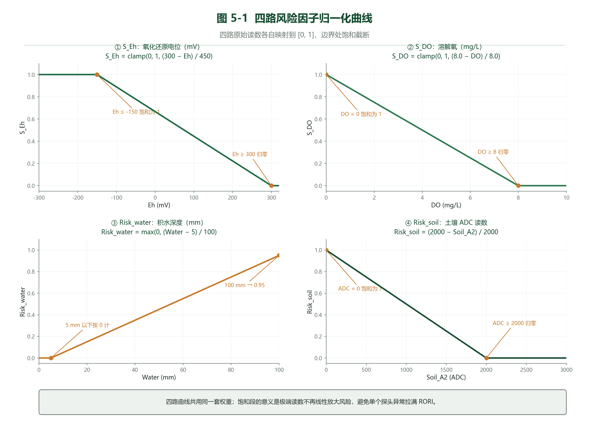

三处需要留意的实现细节。`risk_do`的分子分母都取`DO_SAFE_MGL`而不是`DO_MAX_MGL`：若误改成分母20，DO=6时风险会从0.25掉到0.10，RORI系统性偏低，属高危改动。`risk_water`先判死区再归一，避免0–5 mm区间产生0.01量级噪声；死区之后用`water - 5.0`作分子而非`water`，让5 mm处连续过零。四个因子函数体内直接`float()`，**没有**try兜底：`risk_eh(None)`会抛`TypeError`，所以DO与Eh必须由调用方（遥测解析层）保证是数值，这与量程换算层的宽容策略刻意不同——量程换算面对原始报文，风险因子面对已解析的物理量。

## 5.4 RORI多维融合

```
P = W_EH·S_Eh + W_DO·S_DO + W_WATER_SOIL·max(R_water, R_soil) + GAMMA·R_water·R_soil
RORI = clamp(P, 0.0, 1.0) × 100
```

```python
s_eh, s_do = risk_eh(eh_mv), risk_do(do_mgl)
r_water = risk_water(adc_to_water_mm(water_adc))
r_soil = risk_soil(adc_to_soil_pct(soil_adc))
p_risk = (config.W_EH * s_eh + config.W_DO * s_do
          + config.W_WATER_SOIL * max(r_water, r_soil)
          + config.GAMMA * r_water * r_soil)
return clamp(p_risk, 0.0, 1.0) * 100.0
```

权重实测值：`W_EH = 0.35`、`W_DO = 0.35`、`W_WATER_SOIL = 0.30`、`GAMMA = 0.5`。逐项工程含义：

- `W_EH = 0.35`与`W_DO = 0.35`并列最高：Eh与DO是根区氧化还原状态的直接测量，DO是「当前有没有氧」、Eh是「氧化还原环境偏哪边」，前者快、后者稳，两者同权可以互相校正单路探头的漂移。
- `W_WATER_SOIL = 0.30`配`max(R_water, R_soil)`：渍水与土壤过湿是同一成因的两种表现，取`max`表示「只要其一成立即构成缺氧环境」，不重复计罚。若改成两项相加，同一场雨会因水位与土壤同时上涨而被罚两次。
- `GAMMA = 0.5`的耦合项`R_water·R_soil`是唯一的乘性项：单独渍水或单独湿土都不大，两者同时接近1时才额外贡献接近0.5——「既泡着水、土又饱和」才是真正憋死根系的工况。它是分档结果的实际决定项：算例一去掉耦合项P=0.5275（中度缺氧），计入耦合项P=0.7589（重度厌氧），同一组传感器读数因土壤与水位的叠加关系跨了档。
- 四项系数之和为`0.35 + 0.35 + 0.30 + 0.5 = 1.5`，即P的理论上限是1.5，必然超出`[0,1]`，末位`clamp`是功能性而非装饰性的：全危险工况（`adc=(4095,4095)`、DO=0、Eh=−150）算得P=1.5，无截断则RORI会输出150，分级与前端数值轴全部失效。

**算例一**：`water_adc=1500`、`soil_adc=2200`、`do_mgl=6.0`、`eh_mv=120`。

表 5-3 算例一逐项计算
| 步骤 | 计算式 | 结果 |
|---|---|---|
| 水位换算 | 1500/4095×300 | WaterA0 = 109.89 mm |
| 土壤换算 | (4095−2200)/4095×100 | θ = 46.28 %RH |
| S_Eh | (300−120)/450 | 0.4000 |
| S_DO | (8.0−6.0)/8.0 | 0.2500 |
| R_water | (109.89−5)/100 = 1.0489 → clamp | 1.0000 |
| R_soil | 46.28/100 | 0.4628 |
| EH项 | 0.35×0.4000 | 0.1400 |
| DO项 | 0.35×0.2500 | 0.0875 |
| 水土项 | 0.30×max(1.0, 0.4628) | 0.3000 |
| 耦合项 | 0.5×1.0×0.4628 | 0.2314 |
| 求和 | 0.1400+0.0875+0.3000+0.2314 | P = 0.7589 |
| 输出 | 0.7589×100 | RORI = 75.89 |

## 5.5 RORI三分档

`classify_rori(rori: float) -> dict`返回`{'code', 'name', 'strategy'}`三键。

表 5-4 三分档定义与执行机构动作
| RORI区间 | `code` | `name` | `strategy`（逐字） | 气泵开关 | 决策层附加语义 |
|---|---|---|---|---|---|
| ≥ `RORI_HEAVY`(70) | 2 | 重度厌氧 | 重度厌氧预警，加气机全满载强制增氧 | `ON` | 满载档，策略文案要求强制增氧 |
| 40 ≤ RORI < 70 | 1 | 中度缺氧 | 根区微量缺氧，周期性脉冲加气补氧 | `ON` | 脉冲档，策略文案要求周期加气 |
| < `RORI_MODERATE`(40) | 0 | 安全运行 | 根区有氧环境优良，加气机低耗待机 | `OFF` | 待机档，不动作 |

`strategy`是给人读的中文串，会被AI助手直接拼进对话上下文（`qinghe/ai.py:93`），因此措辞固定、不得随意改写；机器可读判定只有`code`。三档到开关量的映射在`decide_control`里落地：`air_new = 'ON' if effective_code >= 1 else 'OFF'`——**0档与1档之间是唯一的分界**。代码实现中该项为「单一开关量加一段策略文案」：重度与中度都下发`ON`，两者的差别只体现在`strategy`文案与前端呈现上，固件侧尚未按下发值区分全功率与脉冲占空。

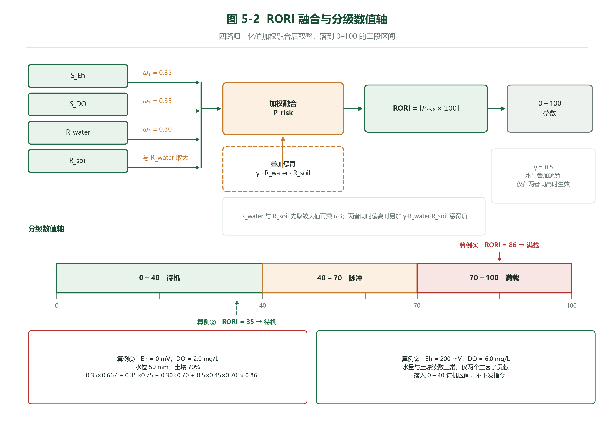

判定用级联`>=`：先比`RORI_HEAVY`、再比`RORI_MODERATE`、最后兜底，因此两个边界值都归**上档**——70.0判重度、40.0判中度。测试用例把`39.99/40/69.99/70/100`五个点钉死，前端`classifyRori()`必须保持同样的比较方向，否则边界值会出现后端判中度、前端判重度的分歧。

## 5.6 降雨前馈与衰减权重

6日降雨按日衰减加权，越近的雨对未来土壤含水量的贡献越大：

```
P6d = Σ(ω_i · P_i),  i = 1..6
ω = [1.0, 0.9, 0.7, 0.5, 0.4, 0.3]        # config.RAIN_WEIGHTS
```

```python
for i, precip in enumerate(daily_precips or []):
    if i >= len(config.RAIN_WEIGHTS):
        break
    try:
        total += config.RAIN_WEIGHTS[i] * (float(precip) or 0.0)
    except (TypeError, ValueError):
        continue
```

三个实现要点：只取前6日，第7日及以后被`break`丢弃（权重表长度即天数上限）；单日脏数据（`None`、`'abc'`）只跳过该项而不让整次计算失败，因为预报接口返回缺值是常态；`float(precip) or 0.0`让`0`与`None`都归零，负值不特殊处理。

α按P6d三档阶梯取值（`alpha_of(p6d)`）：

表 5-5 α分段取值
| 条件 | 常量 | α |
|---|---|---|
| `p6d ≤ ALPHA_LOW_MAX`(10.0) | `ALPHA_LOW` | 0.95 |
| `10.0 < p6d ≤ ALPHA_MID_MAX`(50.0) | `ALPHA_MID` | 0.75 |
| `p6d > 50.0` | `ALPHA_HIGH` | 0.45 |

α随雨量递减的物理含义：雨越大土壤越接近饱和，后续降雨能被作物真正利用的比例越低，多余的只会径流或下渗，因此按0.95→0.75→0.45折减。用阶梯而非连续函数是因为标定数据只支撑这三档，连续插值会造出没有实测依据的中间值。

## 5.7 动态阈值修正

`compute_dynamic_threshold(humi_down, humi_up, daily_precips) -> dict`把用户设定的固定阈值改写为当日的动态阈值。

**动态下限（拦截补灌、保住防枯萎安全线）**：

```
effLower = max(EFF_LOWER_FLOOR, humi_down − (α · P6d / H_ROOT) × 100)
```

`EFF_LOWER_FLOOR = 45.0`、`H_ROOT = 200.0`。`α·P6d`是「预计能被根区有效蓄纳的雨量（mm）」，除以根层深度200 mm再乘100，得到它能把土壤湿度抬升的百分点，从原下限里减掉即得新下限——意思是「马上要下雨了，可以等到更干再灌」。

`max(45.0, ...)`是防枯萎保底：即使预报大雨，也不允许把触发线压到45%RH以下。这是本模块唯一一处「安全优先于节能」的硬约束，实测`compute_dynamic_threshold(40, 80, [100]*6)`时P6d=380 mm、α=0.45，算出的下调幅度足以把下限压到负值，最终仍被锁在45.0。

**动态上限（强降雨前放宽蓄水上限）**：

```
effUpper = min(EFF_UPPER_CAP, humi_up + EFF_UPPER_BONUS)   if P6d ≥ EFF_UPPER_RAIN(15.0)
effUpper = humi_up                                         否则
```

`EFF_UPPER_BONUS = 15.0`、`EFF_UPPER_CAP = 100.0`。降雨量达到15 mm才放宽上限，给即将到来的雨腾出蓄水空间，避免「雨前刚排水、雨后又要灌」；小雨不触发，否则每次毛毛雨都放宽会把土壤长期顶在高湿区。

返回值固定8键：`P6d`、`alpha`、`effLower`、`effUpper`、`baseLower`、`baseUpper`、`hasForecast`、`rainComing`。其中`baseLower`/`baseUpper`原样透传用户设定，便于前端同时画出「原阈值」与「动态阈值」两条线对照。`hasForecast = len(fc) > 0`，`rainComing = p6d > 0`——注意`rainComing`用的是`> 0`而不是`≥ 15`：只要预报有任何降水就进入「可等雨」状态去暂缓补水，而放宽上限只在真正强降雨时才发生，两个判断刻意不同档。

**算例二**：6日降雨`[0, 8, 20, 5, 12, 3]`，`humi_down=40`、`humi_up=80`。

表 5-6 算例二 P6d逐日加权
| 日序 | P_i (mm) | ω_i | 贡献 (mm) |
|---|---|---|---|
| 1 | 0 | 1.0 | 0.00 |
| 2 | 8 | 0.9 | 7.20 |
| 3 | 20 | 0.7 | 14.00 |
| 4 | 5 | 0.5 | 2.50 |
| 5 | 12 | 0.4 | 4.80 |
| 6 | 3 | 0.3 | 0.90 |
| 合计 | 48（未加权） | — | P6d = 29.40 |

α = 0.75（10 < 29.40 ≤ 50）；effLower = max(45, 40 − 0.75×29.40/200×100) = max(45, 40 − 11.025) = **45.00**；effUpper = min(100, 80+15) = **95.00**；`hasForecast`与`rainComing`均为`True`。结论：当日土壤湿度低于45.0%才触发灌溉——原设定40%被保底**抬高**了5个百分点，而不是预期的下调；高于95.0%才判过高。这正是「控水等雨 + 蓄雨」策略在数值上的体现。

## 5.8 自动调控决策

`decide_control(water_mm, soil_pct, rori, thresholds: dict, state: dict = None, dt: dict = None) -> dict`把「风险分级 + 水位 + 降雨前馈」翻译成两个执行机构的动作。

```python
level = classify_rori(rori)
eff_code = level['code']
if bool(dt.get('rainComing')) and eff_code < 2:
    eff_code += 1                                   # 降雨前馈提前一级增氧
air_new = 'ON' if eff_code >= 1 else 'OFF'
wl_down = thresholds.get('waterlevel_down', config.THRESH_DEFAULTS['waterlevel_down'])
wl_up = thresholds.get('waterlevel_up', config.THRESH_DEFAULTS['waterlevel_up'])
water = float(water_mm or 0.0)
if water < wl_down:
    new_state, cmd = ('hold', '') if dt.get('rainComing') else ('on', 'ON')
elif water > wl_up:
    new_state, cmd = ('off', 'OFF')
else:
    new_state, cmd = ('ok', '')
```

气泵判定表（输入=RORI档×是否有雨）：

表 5-7 气泵决策判定表
| `level.code` | `rainComing` | `effective_code` | 气泵 `state` | 语义 |
|---|---|---|---|---|
| 0 | False | 0 | `OFF` | 安全，低耗待机 |
| 0 | True | **1** | `ON` | 未缺氧但雨要来，提前一级增氧 |
| 1 | False | 1 | `ON` | 中度缺氧，脉冲补氧 |
| 1 | True | **2** | `ON` | 抬到重度档，按满载运行 |
| 2 | 任意 | 2 | `ON` | 重度厌氧，不再加级 |

水泵判定表（输入=水位×是否有雨）：

表 5-8 水泵决策判定表
| 水位条件 | `rainComing` | 泵 `state` | `command`（changed 时） | 语义 |
|---|---|---|---|---|
| `water < wl_down` | False | `on` | `ON` | 触发灌溉补水 |
| `water < wl_down` | True | `hold` | `''` | 前馈控水等雨，暂缓补水 |
| `wl_down ≤ water ≤ wl_up` | 任意 | `ok` | `''` | 死区内待命，不动作 |
| `water > wl_up` | 任意 | `off` | `OFF` | 超上限，排水或停灌 |

**滞回去抖**分两层，缺一不可。第一层是区间滞回：`wl_down`与`wl_up`之间构成宽度`wl_up − wl_down`（默认120 mm）的死区，水位落在区间内不产生任何指令，避免「补水→超上限→关机→回落→再补水」的高频振荡。第二层是状态比对去抖：`air_changed = state.get('air') != air_new`、`pump_changed = state.get('pump') != new_state`，只有状态真的变了才填`command`，`changed=False`时`command`被强制置空串——即使同一档位连续成立几十轮，MQTT也不会被刷屏。这个「上一轮状态」由`auto_control.state_json`持久化，进程重启后不会把「已开着的气泵」误判为「需要开」。

返回结构为`{'air': {'state','changed','reason'}, 'pump': {'state','command','changed','reason'}, 'rori', 'level', 'effective_code'}`。`reason`是给人看的中文串，气泵前缀为`'RORI %.2f 分级[%s]'`，被降雨前馈抬级时再拼上「；降雨前馈提前一级增氧」；水泵在下限分支写明比较的水位与阈值，走`hold`时写「水位 20.0mm < 下限 30mm，但预测降雨 P6d=29.4mm，暂缓补水」。

> 实现事实：`decide_control`的形参`soil_pct`在函数体内**未被使用**。土壤湿度只经由`rori`间接参与决策，`thresholds`里的`humi_down`/`humi_up`与`dt`里的`effLower`/`effUpper`也**不参与**水泵分支判定——水泵只看水位上下限与`rainComing`。因此5.7节的动态阈值目前只通过前端展示与界面提示起作用，尚未闭环进服务端决策，属于待推进的口径统一项，不应在文档中假定它已经生效。

## 5.9 边界与异常用例

表 5-9 边界与异常用例总表
| 编号 | 场景 | 输入 | 实际输出 | 行为说明 |
|---|---|---|---|---|
| IR-01 | 全安全 | `(0, 4095, 8.0, 300)` | RORI = 0.00 | 四个因子全为0 |
| IR-02 | 全危险 | `(4095, 4095, 0, −150)` | RORI = 100.00 | P=1.5被clamp截断 |
| IR-03 | 高氧 | `do_mgl=12.0` | S_DO = 0 | 分子为负被clamp吸收 |
| IR-04 | 水位死区 | `water_adc=68`（≈5 mm） | R_water = 0 | 死区内直接返回0 |
| IR-05/06 | 分级边界 | `rori=70.0 / 40.0` | `code=2 / code=1` | 边界归上档 |
| IR-07 | 无预报 | `daily_precips=[]` | P6d=0、α=0.95、effLower=max(45, humi_down)、rainComing=False | 空列表不报错 |
| IR-08 | 单项脏数据 | `[None, 'abc', 10]` | P6d = 0.7×10 = 7.0 | `continue`跳过该项 |
| IR-09 | 超6日 | 8个元素的列表 | 只累加前6项 | `break`截断 |
| IR-10 | 湿度保底 | `humi_down=40`、P6d=380 | effLower = 45.0 | 防枯萎硬下限 |
| IR-11 | 上限封顶 | `humi_up=95`、P6d=40 | effUpper = 100.0 | `EFF_UPPER_CAP` |
| IR-12 | 状态未变 | 水位在死区内、`state={'pump':'ok'}` | `changed=False`、`command=''` | 去抖生效 |
| IR-13 | 缺阈值 | `thresholds={}` | 回退`wl_down=30`、`wl_up=150` | 默认值兜底 |
| IR-14 | ADC为None | `water_adc=None` | WaterA0 = 0.0 | 换算层`except`兜底 |
| IR-15 | ADC超量程 | `water_adc=9999 / −100` | 300.0 / 0.0 | clamp截断 |
| IR-16 | 传感器离线 | `do_mgl=None` 或 `eh_mv=None` | **抛`TypeError`** | 风险因子层不兜底，须由遥测解析层保证数值 |
| IR-17 | 水位为None | `decide_control(None, 50, 0, {})` | `pump.state='on'`、`command='ON'` | `float(water_mm or 0.0)`把None变0.0，落进下限分支 |
| IR-18 | 负水位 | `water_mm=−5` | `pump.state='on'`、理由串含「水位 −5.0mm」 | 取负不做clamp，仅靠比较 |

这张表里IR-16到IR-18是三个「看起来该防但没防」的点，必须如实记录：风险因子函数与`compute_rori`对`None`抛`TypeError`、对非数字串抛`ValueError`，容错责任在调用方；`decide_control`对`None`水位按0处理会导致离线期间误判为「该补水」，负数水位也照判不误。设计上的选择是「不在纯函数里吞异常」——把校验留给遥测解析层，纯函数保持可预测，代价是任何新调用点都必须自己先过滤掉非数值。

**单元测试要点**：因子层用参数化表逐点覆盖满/零/界内/越界四类；融合层至少锚定全安全、全危险与算例一三个确定性数值；分级层必须测`40`与`70`两个边界值的归属；前馈层覆盖空列表、脏数据、超6日；阈值层测保底与封顶两侧饱和；决策层测四行判定表加`changed=False`的去抖路径。所有断言都用`pytest.approx`比较浮点，避免`0.4628`这类四舍五入误差造成假失败。

# 六、认证与安全详细设计

认证链路集中在`qinghe/auth.py`，本章讲三处实现：口令怎么存、暴力破解怎么挡、凭据怎么在两条通道上流转；会话与跨站防护的现状与缺口在6.4如实交代。

## 6.1 口令哈希与透明升级

注册与改密共用`hash_password(password)`，内部直接调`generate_password_hash(password)`且不传`method`。落库串形如`scrypt:32768:8:1$<16字符盐>$<摘要>`：首段自带算法与参数，`$`切出盐与摘要。参数取Werkzeug 3.1.8的默认值，即`hashlib.scrypt`的n=32768（2的15次方）、r=8、p=1；盐每次随机生成，同一口令两次注册得到两个不同哈希。

校验入口是`verify_password(stored, password)`，`is_password_hash(stored)`按前缀`('pbkdf2:', 'scrypt:', 'sha256:')`判断库存值是否为哈希。保留旧前缀是为了兼容更早版本写下的哈希，`check_password_hash`按首段自动选算法，新旧格式共存无需迁移脚本。

透明升级解决的是旧库明文：早期版本直接把口令写进`users.password`，一次性迁移容易在部署时漏跑，系统改为惰性升级，时机在`authenticate()`里：

```python
user = db.get_user_by_username(username)
stored = user['password']
ok = verify_password(stored, password)
if ok and not is_password_hash(stored):
    upgrade_plaintext_password(user['id'], password)
```

触发点是「校验通过之后、返回之前」，所以只有真正登录成功的用户才会被改写，不存在猜中一半就把库写乱的路径；升级后下次登录即走`check_password_hash`分支。写库异常会冒泡到路由层，本次登录以500结束而库内原值不变，不会出现盐写入而摘要未写的半升级状态，重试即可——升级是附带动作，静默吞异常会掩盖真实的写库故障。遗留一处：明文比对用`==`而非`compare_digest`，理论上有时序侧信道，仅在未升级的过渡期生效。

## 6.2 登录限流

表 6-1 登录限流的实现
| 项 | 实现 |
|---|---|
| 限流键 | `'%s:%s' % (username, _client_ip())`，用户名加来源IP |
| 来源IP | 默认`request.remote_addr or 'unknown'` |
| 失败上限 | `LOGIN_MAX_FAIL = 5` |
| 窗口长度 | `LOGIN_LOCK_SECONDS = 600`秒 |
| 状态结构 | `_login_fail = {key: (count, last_ts)}`，进程内字典 |
| 并发保护 | `_login_lock`，读判、记失败、清理全部持锁 |

取IP默认不信`X-Forwarded-For`：直连部署时该头由客户端完全控制，换一个头就能重置计数、无限爆破，只有确认在反向代理之后才打开`FARM_TRUST_PROXY`。键选「用户名+IP」而非纯IP或纯用户名——纯IP会让同一校园网NAT出口的用户互相拖累，纯用户名则给了攻击者锁死他人账号的开关。

窗口是滑动的，滑动点在`_record_login_fail`：失败落在窗口内则计数加一并把`last_ts`刷为当前时刻，落在窗口外则重置为1。因此持续攻击永远不会自动解锁，而正常用户打满5次后停手10分钟，计数自然过期。解锁没有后台任务，只有惰性判断：`_login_locked`先比`time.time() - ts > LOGIN_LOCK_SECONDS`，过期即`pop`该键并放行，未过期才判`count >= 5`；登录成功则`clear_login_failures(username)`立即删计数。三个公开入口`login_throttle` / `record_login_failure` / `clear_login_failures`就是路由层能碰的全部。

注册另有一套按来源IP的限流，结构`_register_attempts = {ip: (count, last_ts)}`，上限`REGISTER_MAX_ATTEMPTS = 10`次，窗口同为600秒，独立一把`_register_lock`，超限返回429`'注册过于频繁，请 10 分钟后再试'`。两张表都在进程内存里，正确性因此依赖单进程部署：本项目用waitress单进程多线程（见14.2节）满足该前提，改成多进程则实际允许次数变成进程数的倍数；表也没有容量上限，键里含用户名，长期运行会被随机用户名撑大。

## 6.3 JWT

表 6-2 JWT的签发与校验
| 项 | 取值 |
|---|---|
| 算法 | `HS256`，签发传`algorithm='HS256'`，解码用`algorithms=['HS256']`白名单 |
| 密钥 | `current_app.secret_key`，即`config.get_secret_key()` |
| 有效期 | 7天，`issue_token(uid, days=7)`写`exp = utcnow() + timedelta(days=7)` |
| 载荷 | `{'user_id': uid, 'exp': ...}`，仅此两项 |
| 传递方式 | 只认`Authorization: Bearer <token>` |
| 失败返回 | 缺头或非Bearer前缀→401`未授权访问`；解码异常→401`Token无效或过期` |

签名错误与过期都落在同一个`except Exception`里，对外返回同一句`Token无效或过期`——前端无法区分「该重登」与「令牌被篡改」，只能一律重登。这是有意的：把差异暴露给未认证方，等于送一个探测签名是否正确的信号。校验通过后装饰器把`uid`作为被装饰函数首个位置参数注入，即`f(uid, *args, **kwargs)`。

密钥处理值得单独说明。`get_secret_key()`优先读环境变量`FARM_SECRET_KEY`；未配置时不是回落到硬编码常量，而是用`secrets.token_urlsafe(48)`生成约64字符的进程级随机密钥在内存复用。旧实现回落到公开常量，任何人拿它自签一个`user_id`就能冒充他人调用`/api/app_send_command`真实下发设备指令，属fail-open；改为随机密钥后属fail-closed，代价是未配置时重启会让既有登录态与JWT全部失效。

载荷里只有`user_id`与`exp`，**不含地块字段**。地块是可变状态，用户随时可切换，写进令牌等于每切一次地就要重新登录；地块由服务端按uid实时从`configs.active_farm_id`解析（见4.4节），令牌只证明「你是谁」，不证明「你在哪块地」。

表 6-3 Web端与App端的凭据分工
| 通道 | 凭据 | 写入 | 读取 |
|---|---|---|---|
| Web端 | Flask会话Cookie | 登录成功写`session['user_id']`、`session['username']` | `session.get('user_id')`或`auth.current_uid()` |
| App端与小程序 | JWT | `POST /api/app_login`返回`token` | `@auth.require_token`装饰的接口 |

两边互不复用：网页接口不读`Authorization`，App接口不读session。不足有两条：`jwt.decode`没有校验audience与issuer；令牌无法吊销——改密与登出只清服务端会话，已发出的JWT仍会用满7天。

## 6.4 会话与CSRF现状

表 6-4 会话与跨站防护的现状
| 项 | 现状 |
|---|---|
| 会话载体 | Flask默认签名Cookie，内容base64可读，签名只防篡改不防窥视 |
| HttpOnly | 显式置`SESSION_COOKIE_HTTPONLY = True` |
| SameSite | 显式置`SESSION_COOKIE_SAMESITE = 'Lax'` |
| Secure | 默认不设，仅`FARM_COOKIE_SECURE=1`时开启 |
| CSRF Token | **没有**。未引入Flask-WTF，代码里不存在token签发与校验 |
| 请求体上限 | `MAX_CONTENT_LENGTH = 512 * 1024`字节，超限返回413 |

没有CSRF Token的前提下，防线落在两处。一是`SameSite=Lax`，跨站发起的POST不带会话Cookie，服务端认不出人。二是全部写接口统一经`validators.get_json_object(request)`取参，它走`request.get_json()`，只有`Content-Type: application/json`才会被解析；跨站HTML表单只能发`application/x-www-form-urlencoded`与`multipart/form-data`，构造不出合法的JSON写请求。

必须强调这只是浏览器行为兜底，不是协议层防护：服务端不校验`Origin`与`Referer`，一旦前端改成接受表单提交或SameSite被降级，防线立刻失守。取舍背景是部署形态为单机与校园网，未引入Flask-WTF整包依赖；对外开放到公网必须补CSRF Token并同时设`SameSite=Lax; Secure`。其余缺口按影响排序：`GET /api/logout`执行`session.clear()`，状态变更挂在GET上，可被跨站的``或链接触发；`Secure`默认关闭，http部署下会话Cookie明文传输；没有服务端会话表，改密只清当前浏览器会话，其它设备的Cookie与已签发JWT仍有效。

## 6.5 安全响应头与CSP

四个头由`qinghe/__init__.py`通过`@app.after_request`统一注入，取值在`config.SECURITY_HEADERS`，写入用`resp.headers.setdefault(key, value)`而非赋值，视图函数仍可覆盖单个头（如CSV导出单独设`Content-Disposition`）。

表 6-5 四项安全响应头
| 响应头 | 取值 | 作用 |
|---|---|---|
| `X-Content-Type-Options` | `nosniff` | 禁止猜MIME，压住上传文本被当HTML执行 |
| `X-Frame-Options` | `SAMEORIGIN` | 只允许同源frame嵌入，防点击劫持 |
| `Referrer-Policy` | `no-referrer` | 跳转不带Referer，不外泄带参URL |
| `Content-Security-Policy` | 见下 | 资源白名单 |

表 6-6 CSP八条指令
| 指令 | 取值 | 含义 |
|---|---|---|
| `default-src` | `'self'` | 未单列的指令一律只允许同源 |
| `script-src` | `'self' 'unsafe-inline'` | 脚本仅同源，放行内联以兼容模板`onclick` |
| `style-src` | `'self' 'unsafe-inline'` | 样式同源加内联 |
| `img-src` | `'self' data: https:` | 图标用`data:`内联，地图瓦片走https |
| `connect-src` | `'self' https:` | XHR与WebSocket只连同源或https上游 |
| `font-src` | `'self' data:` | 字体只取同源与内联 |
| `object-src` | `'none'` | 禁用`object`/`embed`插件入口 |
| `base-uri` | `'self'` | 禁止`<base>`改写相对路径解析，防base劫持 |

socket.io、Chart.js与Leaflet已本地化到`static/vendor`，所以`script-src`与`style-src`里没有任何外网CDN域名。不足也要写明：没有`Strict-Transport-Security`（http部署下无意义，上https应补），也没有`Permissions-Policy`；`'unsafe-inline'`使CSP对内联脚本注入无抵抗力，它挡的是外链脚本注入与`object`/`base`劫持，主防线仍是13.6节的输出转义。

# 七、设备接入层详细设计

设备接入层由 `qinghe/iot.py`（648 行）承担，是全系统唯一与外部物联网平台对话的模块。它的设计目标可以用一句话概括：**让不可靠的外网、不可控的设备时钟、不可预期的报文格式，都不影响网页的可响应性**。

## 7.1 连接管理

每个登录用户持有独立的 MQTT 客户端，注册在一个模块级字典里，用 `RLock` 保护：

```python
mqtt_clients = {}          # uid -> {'client', 'connected', 'ts', 'cmd_topic', 'device_id', 'target_device'}
mqtt_lock = threading.RLock()
```

对外暴露四个薄函数：`get_client(uid)` 取条目、`is_connected(uid)` 读连接标志（**只认 broker 真的握手成功**，不看线程是否存活）、`set_connected(uid, connected)` 由回调更新标志、`_stop_client(uid)` 停掉旧连接并从字典摘除。`clear_clients()` 供测试在用例之间重置全局状态。

`connect_huawei_iot(uid)` 是连接入口，接入参数来自 `db.load_iot_config(uid)`——**按地块独立**：地块记录上填了的 `iot_*` 字段优先，留空则回落到账号级配置，因此切换地块就等于切换到该地块的接入信息。参数不全（host / client_id / user / pass / device_id 任一为空）直接返回 False，不去尝试必然失败的连接。

```python
cfg = db.load_iot_config(uid)
if not cfg:
    return False
host = cfg['iot_host'] or ''
port = _safe_iot_port(cfg['iot_port'])
...
if not host or not client_id or not user or not pw or not device_id:
    return False
_stop_client(uid)          # 同一用户重连前先停旧连接
cli = mqtt.Client(mqtt.CallbackAPIVersion.VERSION2, client_id=client_id)
```

`mqtt.Client(mqtt.CallbackAPIVersion.VERSION2, ...)` 外面套了 `try/except AttributeError`，回退到旧版构造方式——paho-mqtt 2.x 才引入 `CallbackAPIVersion`，这样同一份代码在 1.x 与 2.x 上都能跑。`_safe_iot_port(raw)` 把端口收敛到 `1..65535`，非法值回退 `IOT_PORT_DEFAULT = 1883`，避免 `int()` 在连接阶段抛异常。

连接建立后 `cli.connect(host, port, 60)` 的第三个参数是 60 秒的 keepalive。这个数字直接决定了**为什么重连必须异步**：`connect()` 在目标不可达时可能阻塞到 60 秒，若同步执行，保存配置的 HTTP 请求会被一起卡住。因此保存配置后调用的是 `reconnect_async(uid)`：

```python
thread = threading.Thread(target=connect_huawei_iot, args=(uid,),
                          name='iot-reconnect-%s' % uid, daemon=True)
thread.start()
```

守护线程 + `try/except` 包住线程创建，保证"线程起不来也不能影响调用方结果"。连接结果不通过返回值回传给前端，而是由 SocketIO 的 `device_status` 事件推过去，前端看到状态点变化即知成败。

## 7.2 报文解析

现场设备可能来自三种上报形态，`parse_mqtt_payload(topic, content)` 用一次 `json.loads` 做分流，返回 `(topic_leaf, values, messages)`：

```python
topic_leaf = topic.split('/')[-1]
try:
    parsed = json.loads(content)
except Exception:
    pass
if parsed and isinstance(parsed, dict) and 'services' in parsed:
    for svc in parsed['services']:            # ① 华为云物模型上报
        props = svc.get('properties') or {}
        for k, v in props.items():
            values[k] = v
            messages.append({'type': 'data', 'topic': k, 'payload': str(v)})
elif isinstance(parsed, dict) and parsed:
    for k, v in parsed.items():               # ② 自定义 Topic 直接是 JSON 对象
        if isinstance(v, (int, float, str, bool)):
            ...
else:
    messages.append({'type': 'data', 'topic': topic_leaf, 'payload': content})  # ③ 纯文本
```

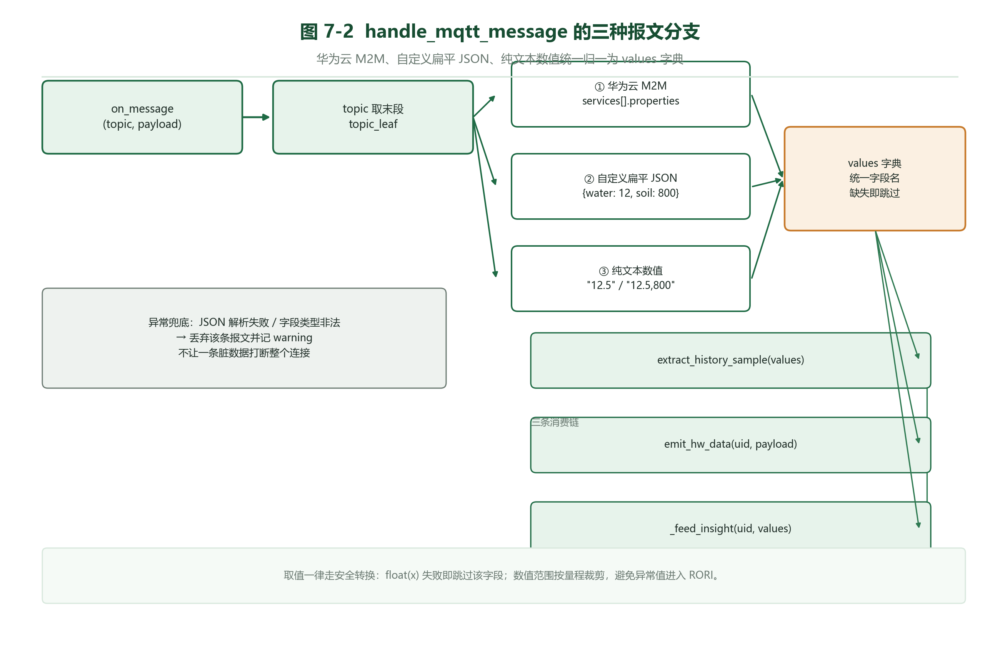

三个分支的取舍都指向同一个目标——**尽量把能读出来的数据留下来**：

- 分支 ① 兼容华为云物模型。平台转发的是 `{"services":[{"properties":{...}}]}` 这种带外壳的结构，真实读数埋在 `services[].properties` 里，且可能一次带多个 service，因此用 `for svc in parsed['services']` 全部摊平。
- 分支 ② 兼容直连 MQTT 或自建转发规则。此时 Topic 已经区分了测量项，报文本身就是扁平的键值对象。只收标量（`int/float/str/bool`），遇到嵌套结构直接跳过——嵌套值无法安全地 str 化后给前端渲染。
- 分支 ③ 兜底纯文本。有些固件只发一个裸数字，此时把这个数字记在 **Topic 末段** 名下（`topic_leaf`），这样前端不用改任何解析逻辑。

`topic_leaf = topic.split('/')[-1]` 是分支 ③ 能工作的关键：Topic 可能是 `/esp32e/waterlevel`、`$oc/devices/x/sys/properties/report` 这类多级路径，末段才是测量项名字。

解析失败不抛异常——`json.loads` 的失败被吞掉后 `parsed` 保持 None，自然落入分支 ③，把原文当数值处理；`_to_float` 失败返回 None，`extract_history_sample` 在必需项缺失时返回 None，调用方据此跳过落库。**整条链路没有任何一处会因畸形报文抛出异常**，这是 MQTT 回调线程能长期存活的前提。

## 7.3 遥测写入与背压

历史数据写入是接入层性能上最敏感的一段，用 `HistoryWriter` 类实现"队列 + 单后台线程批量落库"：

```python
class HistoryWriter:
    """模块级写入队列 + 单后台线程批量落库。

    - MQTT 回调线程只做 `enqueue()`（非阻塞，O(1)）；
    - 后台线程每 flush_interval 秒或攒够 batch 条 flush 一次；
    - 队列满时**丢弃最旧**数据，绝不阻塞回调线程。
    """

    def __init__(self, maxsize=config.HISTORY_QUEUE_MAX,
                 flush_interval=config.HISTORY_FLUSH_INTERVAL,
                 batch=config.HISTORY_FLUSH_BATCH):
        self.queue = queue.Queue(maxsize=maxsize)
        ...
        self.dropped = 0
```

三个常量都集中在 `config.py`：`HISTORY_QUEUE_MAX = 2000`、`HISTORY_FLUSH_INTERVAL = 1.0` 秒、`HISTORY_FLUSH_BATCH = 200` 条。

`enqueue()` 的背压策略是这段代码最值得说清的地方：

```python
try:
    self.queue.put_nowait(item)
    return True
except queue.Full:
    pass
# 丢弃最旧一条，为最新数据让位（不阻塞 MQTT 回调线程）
try:
    self.queue.get_nowait()
    self.dropped += 1
except queue.Empty:
    pass
try:
    self.queue.put_nowait(item)
except queue.Full:
    self.dropped += 1
    return False
return True
```

**为什么丢弃最旧而不是阻塞？** 因为调用 `enqueue()` 的线程是 MQTT 的网络回调线程。paho-mqtt 的回调线程同时负责收发心跳包，一旦它被 `put()` 阻塞，broker 的心跳就会超时，结果是"为了不丢一条历史数据，把整条连接弄断了"——代价明显不对等。农业场景下历史数据是秒级采样，丢几条最旧的采样点对趋势判断几乎无影响，而连接断开会让整个页面失去实时性。因此这里用"丢数据换连接稳定"，并且把丢弃条数记在 `self.dropped` 里，可观测、可告警。

`flush_once()` 在后台线程里执行，除了批量写入还多做一件事——**在落库前解析每行的 `farm_id`**：

```python
farm_ids = {}
for row in rows:
    uid = row[0]
    if uid not in farm_ids:
        try:
            farm_ids[uid] = db.get_active_farm_id(uid)
        except Exception:  # noqa: BLE001 - 地块查询失败退化为账号级
            farm_ids[uid] = 0
```

把地块解析放在后台线程而不是回调线程，是为了让回调线程保持"纯入队"的最短路径；先按 uid 缓存再分组（`grouped.setdefault(row[0], []).append(row)`）则避免了同一批里 200 行做 200 次地块查询。查询失败退化为 `farm_id = 0` 而不是抛异常，因为 `0` 在查询侧是"账号级旧数据"的兼容值（`AND (farm_id = ? OR farm_id = 0)`），旧数据仍可见，不会因为一次数据库抖动而丢样本。

`extract_history_sample(values, now_ms)` 负责从解析结果里挑出可入库的行：

```python
water_adc = values.get('waterlevel')
soil_adc = values.get('humidity')
if water_adc is None or soil_adc is None:
    return None
return (int(float(water_adc)), int(float(soil_adc)), ts,
        _to_float(values.get('do')), _to_float(values.get('eh')))
```

必需项只有 `waterlevel` 与 `humidity` 两个 ADC 值——这两个是水位与土壤湿度的原始读数，缺一个就无法构成一条有意义的采样。`do`（溶解氧）与 `eh`（氧化还原电位）是**可选感知量**，缺失时存 `NULL`，这样老设备（只上报两路 ADC）与新设备（四路齐全）可以共用同一张表。

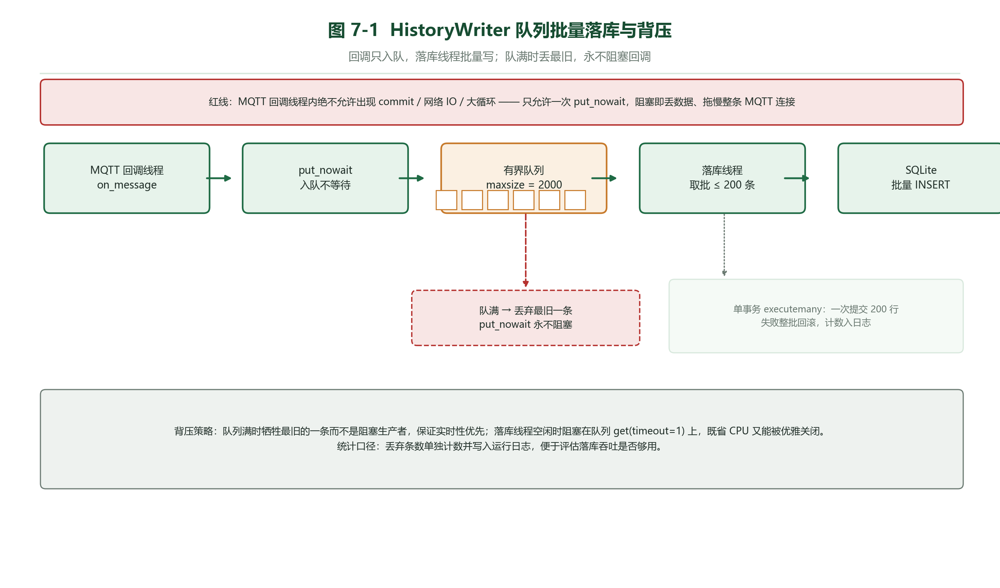

## 7.4 上行指令

`send_property_command(uid, props)` 只做三件事：取连接、序列化、发布。

```python
device, action = next(iter(props.items()))
entry = get_client(uid)
if not entry or not entry.get('connected'):
    return False
cli = entry['client']
cmd_topic = entry.get('cmd_topic') or config.DEFAULT_CMD_TOPIC
message = json.dumps({'device': device, 'action': action}, ensure_ascii=False)
cli.publish(cmd_topic, message)
return True
```

Topic 默认 `config.DEFAULT_CMD_TOPIC = '/esp32e/cmd'`。这里有一个平台相关的硬约束值得记录：**必须用非 `$oc` 的自定义 Topic**。`$oc/devices/.../user/...` 下的 Topic 必须先在华为云产品里定义过，未定义会返回 `IOTDA.017004 Invalid topic`；而自定义 Topic 由平台的【数据转发规则】转发到设备，更灵活。同时 App 侧用的是 **client 设备身份**而不是 ESP32-E 的身份，这样网页下发指令不会抢占设备自身的连接。

`props` 的键来自 `PROP_MAP` 白名单：

```python
PROP_MAP = {'water_pump': 'water_pump', 'air_pump': 'air_pump'}
```

这个看似"键值相同、多此一举"的字典，实际作用是把"前端可指定任意属性名"变成"前端只能指定这两个属性"。如果直接把前端传来的键拼进下发载荷，调用方就能构造出设备不认识的属性，甚至覆盖预期之外的字段。白名单使得可下发的属性集合在设计上是封闭的。

返回 `False` 的两种情形（无连接、未握手）由调用方转成用户可读的提示——WebSocket 通道静默丢弃，HTTP 通道返回 `{'status': 'error', 'message': '设备未连接'}`。

## 7.5 回调分派

三个 paho 回调各自职责单一：

表 7-1 MQTT 回调职责
| 回调 | 职责 | 关键动作 |
|---|---|---|
| `on_mqtt_connect` | 连接建立 | `set_connected(uid, True)`；订阅数据转发 Topic 与自身命令反馈 Topic；推送 `device_status=online` |
| `on_mqtt_disconnect` | 连接断开 | `set_connected(uid, False)`；推送 `device_status=offline`；失败原因写入日志 |
| `on_mqtt_message` | 收到报文 | 转交 `handle_mqtt_message(uid, topic, content, emit, writer)` |

`handle_mqtt_message()` 是分派中枢，按固定顺序处理一条报文：解析 → 提取历史采样并入队 → 推送前端 → 驱动洞察侧逻辑。把 `emit` 与 `writer` 作为参数传入而不是在函数内部直接引用 SocketIO 与全局 writer，是为了让这段逻辑可以在单元测试里用假的 `emit` 与假的 writer 跑，不必真的连 MQTT。

`_feed_insight(uid, values, now_ms)` 是回调里唯一"顺带做别的业务"的地方，它惰性导入并依次驱动五个下游模块：告警判定（`alert_center.evaluate_and_push`）、设备心跳登记（`heartbeat.mark_seen`）、泵运行时长统计（`metrics.note_pump_state`）、自动调控（`autocontrol.tick`）、决策预案上下文刷新（`planner`）。这里的三个设计决定都有明确理由：

1. **惰性导入**。`iot.py` 在导入期不 import 这些模块，避免形成"iot ← alert_center ← iot"这类循环依赖，也让接入层可以单独测试。
2. **节流**。告警判定不是每条报文都跑，而是由 `_ALERT_EVAL_INTERVAL = 10.0` 秒控制——阈值判定本身很便宜，但每条报文都判定会让告警日志与推送频率失控。
3. **独立 try/except**。五个下游各自兜底，任一模块异常（比如日志表还没建）都不影响其余四个，更不会让 MQTT 回调线程崩掉。

## 7.6 设计与权衡

**回调线程必须轻。** 整条接入链路只允许回调线程做三件事：解析（纯 CPU、微秒级）、入队（O(1) 非阻塞）、推送（SocketIO 的内存写入）。任何可能阻塞的操作——数据库写、网络请求、地块查询——全部挪到后台线程或异步触发。这条纪律换来的是连接稳定性。

**历史写入必须批量。** 逐条 INSERT 在 WAL 模式下每次都要一次事务提交与一次 fsync，200 条采样会产生 200 次磁盘同步；批量化后同一批只同步一次，吞吐提升一个数量级。代价是断电时会丢掉最多一个 flush 周期的数据，对农业监测完全可以接受。

**接入配置必须按地块独立。** 一个账号可能同时管着几块田，每块田挂不同的 ESP32-E、走不同的华为云设备。如果把接入参数放在账号级，切换地块就只是换了个显示名字，遥测还是从同一台设备来。按地块独立后，切换地块会同时切换 MQTT 连接，数据来源与显示对象始终一致。回落规则（地块留空则跟随账号）则保证只配一份参数也能正常使用，老账号无需任何迁移。

**没有实体设备时不做任何模拟回执。** 网页上的设备状态只反映真实 MQTT 消息，不会为了"界面好看"而在本地伪造一个"已启动"。这条约束避免了最危险的一类误判——用户以为水泵已经在抽水，实际现场毫无动作。演示场景需要假数据时，走独立的 `qinghe/simulate.py` 与 `tools/simulate_device.py`，与真实链路物理隔离。

# 八、告警与推送详细设计

告警链路由两个模块分工完成：`qinghe/alerts.py`（74 行）只做**判定与推送**，是纯逻辑；`qinghe/alert_center.py`（304 行）负责**落库、查询、确认与保留期清理**。这样拆分的理由是判定每秒都在跑，而落库只在新告警出现时才发生——把两者混在一起会让高频判定反复触碰数据库。

## 8.1 判定规则

`evaluate_alerts()` 是一个不碰数据库、不发网络请求的纯函数：

```python
def evaluate_alerts(soil_pct, water_mm, humi_lower, humi_upper,
                    water_upper, rori=None) -> list:
```

输入六个数，输出一个列表，每条告警带三个字段：`level`（`warn` 或 `danger`）、`code`（稳定类型码）、`msg`（中文文案）。五条规则如下：

表 8-1 告警判定规则
| 序号 | 条件 | 级别 | 类型码 | 文案模板 |
|---|---|---|---|---|
| 1 | 土壤湿润度 < 动态下限 | warn | `soil_low` | 土壤湿度过低 X% < 下限 Y%，建议补灌 |
| 2 | 土壤湿润度 > 动态上限 | warn | `soil_high` | 土壤湿度过高 X% > 上限 Y%，注意排湿 |
| 3 | 渠道水位 > 水位上限 | warn | `water_high` | 水位过高 X mm > 上限 Y mm，注意排水 |
| 4 | RORI ≥ 70 | danger | `rori_high` | RORI X 重度厌氧，强制增氧 |
| 5 | 40 ≤ RORI < 70 | warn | `rori_medium` | RORI X 中度缺氧，脉冲加气 |

四处设计细节值得单独说明。

**规则 1 与规则 2 用 `elif` 串联，规则 3 用独立的 `if`。** 土壤湿度不可能同时低于下限又高于上限，所以规则 1、2 互斥，用 `elif` 表达"二选一"的语义；而水位与土壤湿度是两个独立的物理量，可能同时越界（暴雨后既积水又板结），因此规则 3 必须独立判定，不能被前两条的 `elif` 链吞掉。这个 `if` / `elif` 的选择不是风格问题，而是漏告警与不报错的边界。

**`rori is not None` 是必要的前置判断。** RORI 需要四路读数齐备才能计算，设备只报两路 ADC 时 RORI 不可用，此时传 `None` 而不是传 0。如果传 0，规则 4、5 都不会命中（看似无害），但语义上"未知"被伪装成了"安全"，日后若有人改用 `rori < 40` 做别的判断就会出错。

**类型码 `code` 与中文文案分离。** 函数文档明确写道：`code` 是稳定类型码（`soil_low` / `soil_high` / `water_high` / `rori_medium` / `rori_high`），供 `alert_center` 直接落库，**不依赖中文文案**，因此调整文案不会改变告警分类。这一分离让后续的"按类型筛选告警""统计某类告警频次"成为可能，也让文案可以自由迭代而不破坏历史数据的分类。

**低水位告警走了一条旁路。** `evaluate_alerts()` 本身不产出 `water_low`——水位偏低时灌溉决策会直接补水，属于"系统自己会处理"的事。但为了让告警类型覆盖完整（`ALERT_CODES` 里保留着 `water_low`，`alert_center._code_for_message` 也有对应映射），遥测旁路 `iot._feed_insight` 在判定之后单独补了一条：

```python
# 低水位告警：既有 alerts.evaluate_alerts() 不产出 water_low，这里补一条
raw_low = thresh.get('waterlevel_down')
low_mm = 30.0 if raw_low is None else float(raw_low)
if water_mm < low_mm:
    alert_center.push_alert(
        uid, 'warning', 'water_low',
        '渠道水位偏低（%.1f mm，低于下限 %.0f mm）' % (water_mm, low_mm),
    )
```

这条旁路的设计意图是**把"自动处理"与"告知用户"两件事分开**：水位低仍会自动补水，但同时也告诉用户"渠道可能快见底了"，因为那意味着水源或管路可能有问题，值得人工确认一次。

## 8.2 去重与冷却

`AlertDeduper` 解决的是高频采集下的重复轰炸问题。传感器秒级上报，一次持续缺水会连续几百个采样点都满足"低于下限"，若每条都发告警，钉钉群会被刷屏，用户很快就会关掉通知。

```python
class AlertDeduper:
    """按告警内容去重的冷却器（线程安全）。

    与前端 alertCoolDown 行为一致：同一 key 在 cooldown 秒内只放行一次。
    """

    def __init__(self, cooldown: float = config.ALERT_COOLDOWN_SECONDS):
        self.cooldown = cooldown
        self._last = {}
        self._lock = threading.Lock()

    def should_emit(self, key: str, now: float = None) -> bool:
        """是否应当发出该告警；返回 True 时同时刷新时间戳。"""
        now = time.time() if now is None else now
        with self._lock:
            last = self._last.get(key)
            if last is not None and now - last < self.cooldown:
                return False
            self._last[key] = now
            return True
```

冷却时长 `config.ALERT_COOLDOWN_SECONDS = 60` 秒。语义是"同一 key 在 60 秒内只放行一次，放行时刷新时间戳"——注意这个语义是**滑动窗口**而不是固定窗口：如果告警一直持续，则每 60 秒会再放行一次，用户可以持续收到提醒，不会因为第一次提醒之后就被永久静默。这一点与"只报一次"的幂等去重不同，是农业场景下的正确选择。

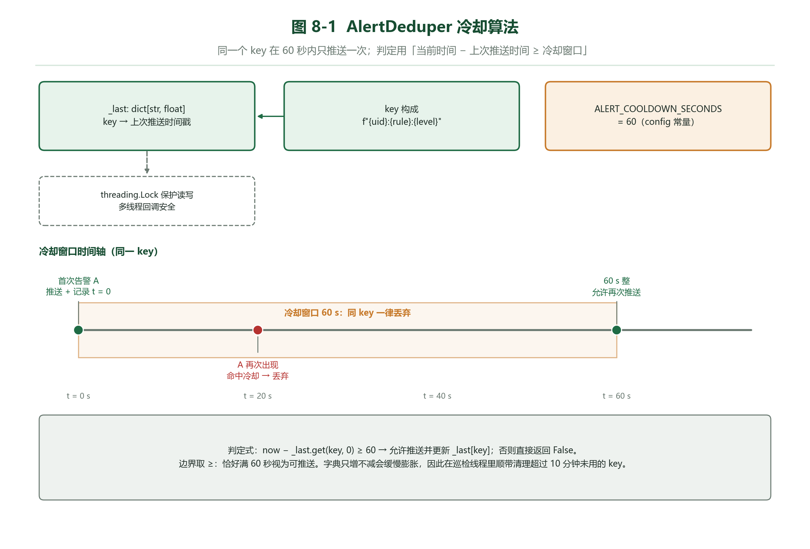

`_lock` 保护 `_last` 字典是必需的：MQTT 回调线程、自动调控线程、HTTP 请求线程都可能同时触发告警判定，无锁的字典读写在高并发下会出现"两个线程同时判定为可发"或"字典迭代时被修改"的问题。`reset()` 清空状态供测试使用——冷却器是模块级全局状态，测试之间不清理会导致用例顺序一换就随机失败。

**为什么去重状态放内存而不放数据库？** 60 秒的窗口极短，不需要持久化；每次告警都写一次数据库，反而会把这个"防刷屏"机制本身变成数据库压力源。进程重启后冷却状态丢失，最多导致重启瞬间多发一次告警，这个代价远小于每次判定都查库的成本。

## 8.3 站内告警中心

`alert_center.py` 把通过的告警落库并对外提供查询能力。

表 8-2 告警中心常量
| 常量 | 取值 | 作用 |
|---|---|---|
| `ALERT_LEVELS` | `('info', 'warning', 'danger')` | 合法的告警级别集合 |
| `ALERT_CODES` | 9 个稳定类型码 | 合法的告警类型集合 |
| `CONTENT_MAX_LEN` | 500 | 单条告警内容长度上限 |
| `MAX_LIMIT` | 500 | 列表查询一次返回条数上限 |
| `PUSH_RETRY_DELAYS` | `(0.0, 0.5, 1.0)` | 推送重试的三次延迟（秒） |

数据表为 `alerts(id, user_id, ts, level, code, content, acked)`，配 `idx_alerts_user_ts` 索引支撑"按用户倒序取最近 N 条"这一唯一高频查询。

`push_alert(uid, level, code, content)` 返回 `{'id', 'deduped', 'pushed'}` 三个字段，依次表示落库后的行 ID、是否被冷却器拦下、webhook 是否推送成功。去重键的构造是：

```python
key = '%d|%s|%s' % (uid, code, content)
```

三段分别是用户、类型码、文案。带上 `uid` 是必须的——不同用户的同类告警必须各自独立计时，否则 A 用户收到告警会导致 B 用户的同类告警被吞掉。带上完整 `content` 而非只用 `code`，则让"湿度 39% 低于下限 40%"与"湿度 25% 低于下限 40%"能被当作两条不同告警分别推送，避免只报第一条而掩盖恶化趋势。

`list_alerts(uid, limit, since_ts)` 的过滤条件是**严格大于** `ts > ?`，排序为 `ORDER BY ts DESC, id DESC`。加 `id` 作次级排序键的作用是让同一毫秒内产生的多条告警也有稳定顺序——`ts` 是毫秒时间戳，一批批量告警常常同毫秒，若只按 `ts` 排序，数据库返回的顺序不确定，分页时会出现重复项或漏项。`ack_alert(uid, alert_id)` 用 `rowcount` 判断是否真的改动了行，据此区分"成功确认"与"无权操作/不存在"，而不是先查再改（那样有竞态）。`prune_alerts(keep_days=7)` 定期清理过期告警，与历史数据保留期 `config.HISTORY_KEEP_DAYS = 7` 保持一致。

`evaluate_and_push(uid, soil_pct, water_mm, rori, humi_lower, humi_upper, water_lower, water_upper)` 是把判定与落库串起来的门面函数，由 `iot._feed_insight` 以 10 秒节流调用。

## 8.4 Webhook 推送与重试

`notify_webhook(uid, title, content)` 负责把告警推到用户配置的群机器人。它的校验链有四道：

```python
cfg = db.load_config(uid)
if not cfg or not cfg['webhook_url']:
    return False
url = (cfg['webhook_url'] or '').strip()
if not (url.startswith('http://') or url.startswith('https://')):
    return False
# 防 SSRF：webhook 由用户配置，不能用来让服务端访问本机 / 内网 / 云元数据
from qinghe.ai import is_public_http_url
if not is_public_http_url(url):
    return False
text = '%s%s\n%s' % (ALERT_KEYWORD, title, content)
payload = {'msgtype': 'text', 'text': {'content': text}}
try:
    r = requests.post(url, json=payload, timeout=config.TIMEOUT_WEBHOOK)
    return r.status_code in (200, 201)
except Exception:
    return False
```

**协议前缀校验与 SSRF 校验是两道独立的关。** 前者挡掉 `javascript:`、`file:` 这类伪协议；后者挡掉 `http://127.0.0.1:8080/`、`http://169.254.169.254/` 这类指向本机、内网或云元数据服务的地址。webhook URL 是用户在设置页自由填写的，如果不拦，这个接口就是一个现成的 SSRF 出口——攻击者可以让服务器替自己访问内网管理面板。复用 `ai.is_public_http_url` 而不是另写一份，是为了让"什么算内网地址"只有一处定义。

**固定关键字前缀是钉钉的硬要求。** `config.ALERT_KEY_PREFIX = '【青禾智灌系统】'` 被无条件拼在消息最前面。钉钉机器人的"自定义关键词"安全设置要求消息内容必须包含指定关键词，否则消息会被平台直接拒绝（返回 errcode 310000）。把这个前缀写成常量而不是让用户自己填，是因为它一旦缺失就是"推送全部静默失败"，而失败原因（平台侧拒绝）在应用侧只表现为一个非 200 状态码，很难排查。

**载荷格式取三家通用子集。** `{'msgtype': 'text', 'text': {'content': ...}}` 是钉钉、企业微信、飞书都接受的文本消息形状，因此一份实现可以适配三种群机器人。

**超时取 `config.TIMEOUT_WEBHOOK = 3` 秒。** 群机器人是尽力而为的通道，3 秒不成功就没必要再等——用户已经在网页上看到站内告警了。

重试不在 `alerts.py` 里，而在 `alert_center._push_with_retry`：

表 8-3 推送重试策略
| 尝试 | 延迟 | 说明 |
|---|---|---|
| 第 1 次 | 0 秒 | 立即发送，绝大多数情况一次成功 |
| 第 2 次 | 0.5 秒 | 网络瞬时抖动 |
| 第 3 次 | 1.0 秒 | 最后一次机会 |

`PUSH_RETRY_DELAYS = (0.0, 0.5, 1.0)`。三次尝试总耗时上限约 3×3 + 1.5 = 10.5 秒，且**整个重试块跑在后台**，不占用 MQTT 回调线程。延迟取递增而非固定，是为了应对"短时拥塞"这种典型抖动形态。

**推送失败不影响站内闭环。** `/api/notify_alert` 在推送失败时返回 `{'status': 'skipped', 'sent': false}` 且 HTTP 状态码仍为 200。这一取舍的理由是：webhook 是外部通道，它的可用性不应影响站内功能——用户已经在页面上看到了告警弹窗，钉钉群没收到不该让页面再弹一个失败框。同理，`push_alert` 返回的 `pushed=false` 只是信息性字段，不构成失败。

## 8.5 设计与权衡

**判定与落库分离。** 判定是高频纯计算，落库是低频有状态操作。分开后判定函数可以被单元测试用任意参数组合覆盖（不需要数据库），落库逻辑也可以独立测试（不需要构造传感器数据）。

**去重放内存。** 60 秒窗口不需要持久化，放内存避免了"防刷屏机制本身变成数据库压力"的反讽。代价是进程重启丢状态，最多导致重启瞬间多发一次。

**冷却时间取 60 秒。** 这个值与告警判定的 10 秒节流配合：判定每 10 秒跑一次，冷却 60 秒意味着持续异常时每 6 次判定放行一次。太快会刷屏，太慢会让用户以为告警坏了。60 秒也是前端 `alertCoolDown` 使用的同一数值，前后端行为一致。

**重试放在中心而不是推送函数里。** `notify_webhook` 保持"发一次、成或不成"的简单语义，重试策略作为策略层单独存在。这样调整重试次数或退避曲线不需要动推送实现，也让 `notify_webhook` 可以被手动触发场景（`/api/notify_alert`）直接复用而不引入额外延迟。

# 九、实时通道详细设计

实时通道由 `qinghe/realtime.py` 实现，是「传感器上报 → 浏览器即时刷新」这条链路的最后一跳。它不持有任何业务状态，只做三件事：把数据推到正确的房间、把上行指令翻译成设备属性、定期巡检设备离线。

## 9.1 房间模型

SocketIO 采用**按登录用户分房**的模型，房间名就是 `str(uid)`：

| 环节 | 实现 | 说明 |
|---|---|---|
| 建连鉴权 | `on_ws_connect` 读 `session.get('user_id')` | 取不到 uid 时直接 `return False` 拒绝握手，未登录的连接不进入任何房间 |
| 入房 | `join_room(str(uid))` | 握手成功后加入自己的房间，此后只收本房间的推送 |
| 建连副作用 | 调用 `iot.connect_huawei_iot(uid)` | 用户一打开页面就尝试建立该用户的华为云 MQTT 连接 |
| 状态回推 | `emit_hw_data(uid, {'type': 'device_status', 'status': status})` | 只有 broker 真正握手成功（`iot.is_connected(uid)` 为真）才发 `online`，否则一律 `offline` |

房间模型的直接收益是**多地块不串台**：每个账号持有自己的地块与物联网配置（`farms` 表按 uid 隔离），推送只落在 `str(uid)` 房间内，别的账号即使同时在线也收不到本账号的读数。`emit_hw_data(uid, payload)` 是唯一的推送出口，内部固定 `socketio.emit('hw_data', payload, room=str(uid))`。

`status` 的判定刻意不依赖 SocketIO 自身的连接状态：前端页面能收到 `hw_data` 只说明 WebSocket 通了，不代表华为云 broker 通。若以 WebSocket 状态冒充设备状态，未配置物联网参数的账号会一直显示「已连接」，与事实相反。因此这里以 `iot.is_connected(uid)` 为准，宁可显示 `offline`。

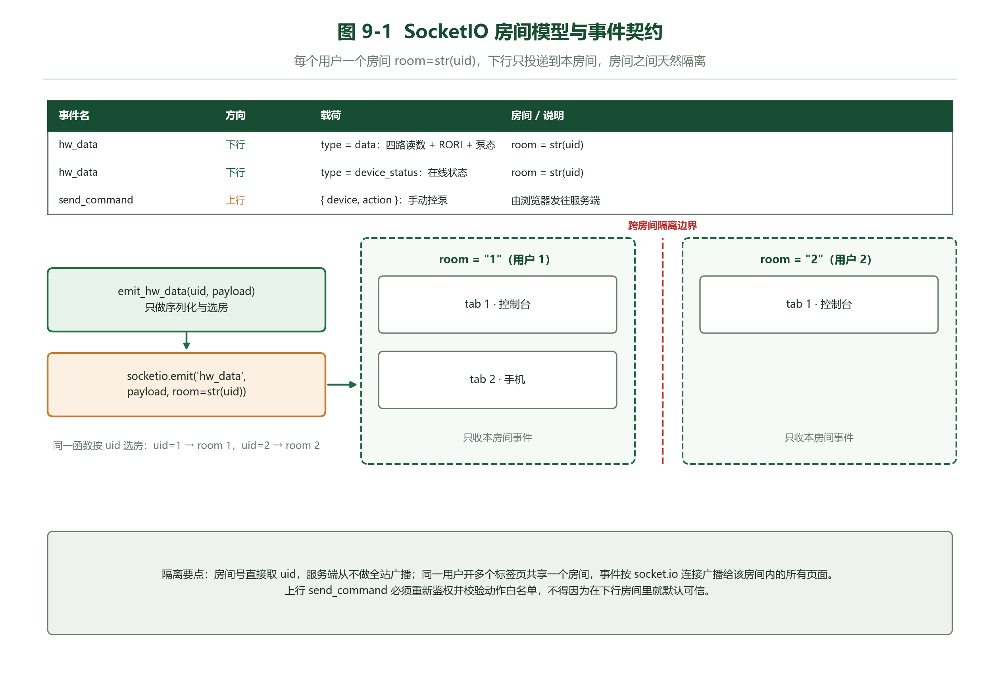

## 9.2 事件注册与处理

`register_events(sock)` 把事件挂到给定 SocketIO 实例（由应用工厂调用），模块导入时再通过 `_register_default()` 在包单例上注册一次，并用 `socketio._qinghe_registered` 标志位保证幂等——重复导入不会重复注册。

```python
def register_events(sock) -> None:
    @sock.on('connect')
    def on_ws_connect():
        uid = session.get('user_id')
        if not uid:
            return False
        join_room(str(uid))
        iot.connect_huawei_iot(uid)
        status = 'online' if iot.is_connected(uid) else 'offline'
        emit_hw_data(uid, {'type': 'device_status', 'status': status})
```

上行只有 `send_command` 一个事件，载荷为 `{'device': ..., 'action': ...}`：

```python
@sock.on('send_command')
def on_ws_command(data):
    uid = session.get('user_id')
    if not uid:
        return
    data = data or {}
    prop = PROP_MAP.get(data.get('device'))
    if not prop:
        return
    action = data.get('action')
    iot.send_property_command(uid, {prop: 'on' if action == 'on' else 'off'})
```

处理顺序是**先鉴权、再白名单、最后下发**：没有 uid 直接返回，设备名不在 `PROP_MAP` 里直接返回，两步都通过才调用 `iot.send_property_command`。前端传来的 `data` 可能是 `None` 或非字典，`data = data or {}` 与 `.get()` 链保证任何畸形载荷都只会静默丢弃，不会抛异常打断 SocketIO 线程。

## 9.3 指令白名单

白名单常量直接复用 `qinghe/iot.py` 的 `PROP_MAP`，在 `realtime.py` 中只做别名（`PROP_MAP = iot.PROP_MAP`），**唯一来源是 `iot.py`**，新增设备只改一处：

```python
PROP_MAP = {
    'water_pump': 'water_pump',
    'air_pump': 'air_pump',
}
```

它的作用是**防止任意属性透传**：如果直接把前端 `data` 里的键值拼进下发属性，调用方就能构造出设备不认识的属性名，或覆盖预期之外的字段。经白名单过滤后，前端可下发的属性只可能是水泵与气泵两项。同时 `action` 被规整为二值——`'on'` 映射为 `'on'`，**其他任何值一律映射为 `'off'`**；HTTP 侧的 `/api/app_send_command` 更严格，`action` 不是 `'on'`/`'off'` 时直接返回 400（见 11.4 节），因为把拼写错误当成成功下发会让用户误以为指令生效。

## 9.4 设备离线巡检与事件契约

离线巡检由 `start_device_watcher(interval=None)` 启动，它把 `realtime` 的两个内部函数注入心跳模块：

```python
def start_device_watcher(interval: float = None):
    from qinghe import heartbeat
    if interval is None:
        return heartbeat.start_watcher(_device_uids, _emit_device_status)
    return heartbeat.start_watcher(_device_uids, _emit_device_status, interval=interval)
```

- `_device_uids()`：从 `device_status` 表读出所有曾上报过心跳的 `user_id`，表未建或库忙时返回空列表而不抛异常；
- `_emit_device_status(uid, event)`：把巡检结果包装成前端认识的 `hw_data` 载荷，`type` 为 `device_status`，`status` 取 `online`/`offline`，并透传 `last_seen_ts`、`silent_seconds`、`ts` 三个字段；推送包在 `try/except` 中，**推送失败不影响巡检线程**。

函数文档明确要求它**只在进程入口（`app.py` / `server.py` 的 `__main__`）调用一次**，不得放进应用工厂——否则每个测试用例都会多起一个守护线程。`heartbeat.start_watcher` 本身是幂等的。

事件契约如下：

表 9-1 前后端事件契约
| 事件名 | 方向 | 载荷 | 触发时机 | 前端处理 |
|---|---|---|---|---|
| `connect` | 前端→服务端 | 无（依赖会话 Cookie） | 页面加载、断线重连成功 | — |
| `hw_data` | 服务端→前端 | `type=data`，附各传感读数键 | MQTT 收到并解析出读数 | 入消息队列，等统一 tick 批量渲染 |
| `hw_data` | 服务端→前端 | `type=device_status`，含 `status`（online / offline）、`last_seen_ts`、`silent_seconds`、`ts` | 建连时、离线巡检判定变化时 | 更新顶部连接状态点与设备状态卡 |
| `send_command` | 前端→服务端 | `device`（water_pump / air_pump）+ `action`（on / off） | 用户点击设备手动调控的「启动 / 停止」 | — |

`hw_data` 同时承载读数与设备状态，靠 `type` 字段区分；`device_status` 类载荷的字段全部按需附加，缺失的字段不会出现在包里，前端据此做存在性判断。

# 十、天气与AI详细设计

外部数据与外部智能是系统的两个"外向"能力：天气模块（`qinghe/weather.py`，111 行）负责取回未来 6 日降雨，AI 模块（`qinghe/ai.py`，272 行）负责把现场数据变成可读结论。两者共享同一条设计纪律——**全部由服务端代理、全部带超时、失败一律降级为可展示的错误文本，绝不向上抛异常**。

## 10.1 天气代理与逆地理

天气能力拆成"逆地理"与"预报"两件事，原因是和风天气的 7 日预报接口只接受经纬度，而界面上要显示的是地名。

逆地理选 Photon（komoot，基于 OpenStreetMap）而非国内厂商接口，理由有两条：免 Key，以及可下探到 suburb/quarter（社区、村）一级。`photon_reverse(lat, lng)` 请求 `https://photon.komoot.io/reverse`：

```python
def photon_reverse(lat, lng):
    """Photon(komoot, 基于 OSM) 逆地理：免 Key、返回简体、可下探 suburb/quarter(社区级)。
    服务端调用、带缓存。失败返回 None。"""
    try:
        r = requests.get(
            'https://photon.komoot.io/reverse',
            params={'lat': lat, 'lon': lng, 'lang': 'zh'},
            timeout=config.TIMEOUT_PHOTON,
        )
        f = (r.json() or {}).get('features', [{}])[0].get('properties', {})
        if not f:
            return None
        name = f.get('name')
        chain = _pick_admin([
            f.get('state'), f.get('city'), f.get('county'),
            f.get('district'), f.get('suburb'), f.get('quarter'),
        ])
        if name and name not in chain:
            chain = chain + [name]
        chain = chain[-4:]
        if chain:
            return ' · '.join(chain)
    except Exception:
        return None
```

关键点是 `_pick_admin` 里的 `return out[-4:]`，**取末 4 级而不是前 4 级**。Photon 返回的行政区链由粗到细为 state/city/county/district/suburb/quarter，如果取前 4 级，中国境内的 state 往往就是"江苏省"这一级，四级拼出来是"中国 · 江苏省 · 南京市 · 玄武区"这种又长又没定位价值的字符串；取末 4 级则落在"南京市 · 玄武区 · 孝陵卫街道 · XX 社区"，才是农业场景下用户真正认得出的位置。同时 `_pick_admin` 会过滤掉"中华人民共和国"和"中国"两串，并做保序去重（Photon 常有 city 与 county 同名的情形），最后把 `name`（POI/村名）补到链尾，再去重后截末 4 级。

缓存键由经纬度四舍五入到 4 位小数得到：

```python
def geo_key(lat, lng) -> str:
    """缓存键：坐标四舍五入到 4 位小数（约 11m 精度）。"""
    return '%s,%s' % (round(lat, 4), round(lng, 4))
```

4 位小数约 11 m 精度，同一点位反复拖动地图不会重复打外部接口。`geo_lookup(lat, lng)` 返回 `(name, cached)` 三元组的二元组：先查 `geo_cache` 表，命中返回 `(name, True)`；未命中则调 Photon，成功才写缓存并返回 `(name, False)`；**失败不写缓存**（`return None, False`），这样下一次请求还会重试，而不是把一次网络抖动永久固化成"此坐标无地名"。调用方在拿不到地名时使用 `geo_fallback_text(lat, lng)` 生成的 `E: %.2f°, N: %.2f°` 纯坐标文本兜底。

预报走服务端代理而不是前端直连。`build_forecast_url(domain, lng, lat, key)` 拼出 `https://<domain>/v7/weather/7d?location=<lng>,<lat>&key=<key>`，由 `fetch_forecast(domain, lng, lat, key)` 带 `timeout=config.TIMEOUT_WEATHER`（8 秒）发出。选择代理而非直连有两个硬理由：一是 `weather_key` 只存在于数据库与配置弹窗里，直连必然要把 Key 下发到浏览器；二是页面 CSP 的 `connect-src` 不允许跨域直连第三方域名，代理天然绕过这一限制。

失败降级成统一形状的错误字典，用 `code='ERR'` 标出：

```python
def fetch_forecast(domain, lng, lat, key) -> dict:
    '''返回和风天气原始 JSON；失败返回 {'code': 'ERR', 'error': 中文原因}。'''
    url = build_forecast_url(domain, lng, lat, key)
    try:
        r = requests.get(url, timeout=config.TIMEOUT_WEATHER)
    except Exception as exc:
        return {'code': 'ERR',
                'error': '天气接口请求失败: %s（网络不可达或超时）' % type(exc).__name__}
    try:
        return r.json()
    except ValueError:
        return {'code': 'ERR', 'error': '天气接口非JSON（HTTP %s）' % r.status_code}
```

这里刻意**不检查 HTTP 状态码**，而是先尝试解析 JSON：和风在配额用尽、Key 失效时也返回 HTTP 200 加一个带 `code` 字段的错误体，只看状态码会把这种情况误判为成功。下游统一用 `forecast_failed(payload)` 判定：`not isinstance(payload, dict) or payload.get('code') == 'ERR'`。

`/api/forecast` 在取数失败时返回 HTTP 502，响应体就是上面的错误字典。前端 `static/js/weather.js` 只读响应体、不读状态码，因此 502 与 200 的降级路径完全一致，仍能显示"暂时无法获取预报"。请求未带坐标时，路由用 `118.78`/`31.90`（南京）作默认值，保证界面不空转。

## 10.2 AI 助手与实时快照

AI 能力的核心不是"能聊天"，而是**模型必须看到现场的实时数字**。`ai.build_snapshot(uid)` 就是这台"数据搬运机"：它把服务端已有的真实数据拼成一段中文快照，作为 system 消息插在用户提问之前。

快照内容按顺序包含：当前地块（名称 + 经纬度）、四路读数（渠道水位、土壤湿润度、溶解氧、氧化还原电位）、RORI 与分级建议、阈值与 6 日降雨前馈（P6d、α、动态湿度上下限）、设备状态（气泵/水泵）、设备连接状态（在线/离线 + 最近心跳秒数）、近 40 条采样趋势、未来 6 日预报降雨，最后附一句行为约束：

> 请结合以上实时数据作答：优先给出可执行结论（是否需要开/关水泵、气泵，阈值是否要调），并在引用数字时与快照保持一致；数据缺失时明确说明缺什么，不要编造读数。

设计上最值得注意的是**每一步都单独 try/except**：

```python
try:
    ctx = planner.build_context(uid)
except Exception:  # noqa: BLE001
    return ''
```

以及无遥测时的处理：

```python
has_telemetry = bool(ctx.get('has_telemetry'))
if has_telemetry:
    lines.append('四路读数：渠道水位 %s，土壤湿润度 %s，溶解氧 %s，氧化还原电位 %s' % ...)
else:
    # 没有遥测时不要拿安全默认值 0 冒充真实读数（会误导模型与用户）
    lines.append('四路读数：暂无（设备尚未上报数据）')
    lines.append('RORI 未知：缺少实时读数，无法判定根区氧环境')
```

两点必须解释清楚。其一，**取数失败不能变成 500**：AI 问答是可选的增强功能，天气接口挂了、心跳表没建、历史查询失败，都只应让快照少一行，而不是让一次提问失败；因此每一段取数都各自兜底，只有 `planner.build_context` 失败（连地块信息都拿不到）才整体返回空串，调用方按"无上下文问答"处理。其二，**没有数据时必须说没有**：`ctx` 里的默认值 `0` 在数值上合法但在语义上是"安全"，直接塞给模型会被当成"水位 0 mm、溶解氧 0 mg/L"这类真实读数，模型会据此断言"严重缺氧，立即增氧"，而现场其实只是设备没上电。因此有遥测标志位 `has_telemetry` 为假时，快照显式写出"暂无/未知"。

快照整体截断到 `SNAPSHOT_MAX_CHARS = 1800` 字符，控制 token 消耗。

## 10.3 请求组装与安全护栏

`ai.chat(ai_domain, ai_key, user_msg, context=None)` 负责出网。域名的规整与校验先做两道：

```python
def normalize_base_url(ai_domain: str) -> str:
    """规整 AI 域名：空值回落默认域名，http 的 deepseek 域名强制升级为 https。"""
```

默认域名取 `config.DEFAULT_AI_DOMAIN = 'https://api.deepseek.com'`，模型固定为 `config.DEFAULT_AI_MODEL = 'deepseek-chat'`，请求地址为 `base_url.rstrip('/') + '/chat/completions'`。把 `http://api.deepseek.com` 强制改写为 https，是为了避免把 Bearer Token 明文发出去——用户手输域名时最常见的错误就是漏掉 `s`。

第二道护栏是 SSRF 防护。`is_public_http_url(url)` 要求：scheme 必须是 http/https 且必须有主机名；主机名不得为 localhost 或 `.local`/`.internal`/`.localhost`/`.lan`/`.home` 结尾；主机名是 IP 字面量时，必须满足 `is_global` 且不是 private/loopback/link-local/reserved/multicast/unspecified。**刻意不做 DNS 解析**：解析后再比对会引入"解析时"与"连接时"结果不一致的 DNS rebinding 缺口，而且会让单元测试必须联网。命中拦截时返回一句可展示的中文提示，而不是异常：

```python
if not is_public_http_url(url):
    return _wrap('AI 域名不允许指向本机或内网地址，请在设置中填写公开可访问的 https 地址')
```

上下文消息的插入位置是固定的第 1 位（在下标 0 的固定 system 提示之后、用户提问之前）：`messages = [system, context?, user]`。这样固定的行为约束始终排在快照之前，快照的 1800 字不会把它挤掉。

出网调用带 `timeout=config.TIMEOUT_AI`（20 秒），四种失败都映射成同一形状的"假成功"响应：

表 10-1 AI 调用失败分级与对外表现
| 失败情形 | 判定 | 返回内容 |
|---|---|---|
| 域名指向内网 | `is_public_http_url` 为假 | 提示改填公开 https 地址 |
| HTTP 非 200 | `resp.status_code != 200` | `AI 接口返回异常（HTTP %s）：<响应片段前 300 字>` |
| 响应非 JSON | `resp.json()` 抛错 | `AI 接口返回非 JSON 内容（HTTP %s）：<片段>` |
| 网络异常/超时 | `requests` 抛异常 | `请求失败: <异常文本>` |

统一形状指 `_wrap(content)` 产出的 `{'choices': [{'message': {'content': content}}]}`——**与 OpenAI 兼容接口的成功响应同构**。这一设计的目的是把"错误"这一状态从状态码层搬到文本层：前端只需要写一条"读 `choices[0].message.content` 并渲染"的路径，不需要为失败再写一套分支 UI。代价是错误信息会以 AI 的口吻出现在对话框里，因此每条错误文本都写成用户看得懂的中文并带前缀区分。响应片段截断 300 字，避免把上游 HTML 错误页整段灌进聊天窗。

`ai_routes.api_ai_chat` 把这条链路接到 HTTP：

- 未登录 401；
- 提问长度超过 `config.AI_MSG_MAX_LEN = 2000` 直接 400（`'提问过长，请控制在 %d 字以内'`）；
- 未配置 AI Key 时返回 `NO_KEY_TIP = '⚠️ 提示：未检测到 AI Key，请在【设置】中配置。'`，但**仍然携带快照**——这样用户至少能看到系统当前读到了什么；
- 配置齐全时调 `ai.build_snapshot(uid)`（其自身异常已被吞掉，返回 `''`），再调 `ai.chat(ai_domain, ai_key, user_msg, context=snapshot)`。

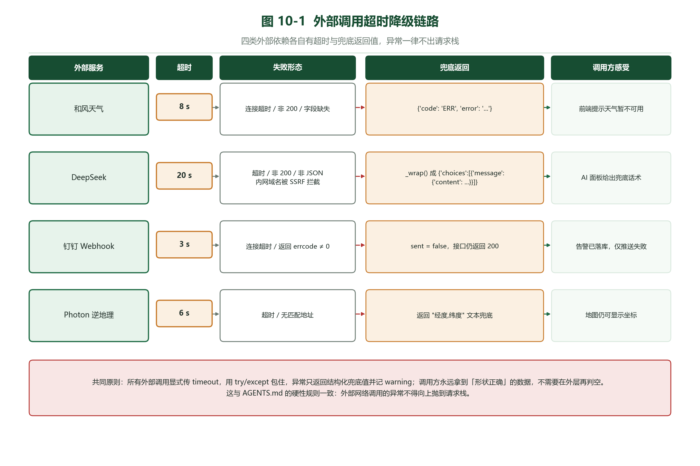

# 十一、HTTP接口详细设计

HTTP 层是前端与 App 访问系统的唯一入口，由 8 个蓝图构成（`app_api` / `auth_api` / `config_api` / `data_api` / `ai_api` / `monitor` / `insight` / `export`），在 `qinghe/__init__.py` 的应用工厂中统一注册。本章给出接口设计约定、完整路由清单与逐接口行为说明。

## 11.1 设计约定

**鉴权分两套，互不替代。**

| 访问方 | 凭据 | 载体 | 校验函数 |
|---|---|---|---|
| 浏览器页面 | Flask Session（Cookie） | 会话 Cookie | `session['user_id']` 是否存在 |
| 移动 App | JWT（HS256，7 天） | `Authorization: Bearer <token>` | `auth.require_token` 装饰器 |

分两套的原因：浏览器要防 CSRF、要能服务端主动失效，Session 天然满足；移动 App 没有 Cookie 容器，反复登录体验差，因此发 7 天有效的 JWT。`auth.issue_token(uid, days=7)` 的 payload **只含 `user_id` 与 `exp`**，不放用户名、权限等可被改写的业务字段；`require_token` 校验通过后把 `user_id` 作为被装饰函数的**首个位置参数**注入（例如 `def api_app_command(uid):`），因此业务函数内部不再重复解析 Token。

**统一响应形状。** 成功返回 `{'status': 'success', ...}` 或直接返回数据体；失败返回 `{'error': '<中文原因>'}` 并配以恰当的 4xx/5xx 状态码。所有面向用户的原因文本都是中文，前端可直接渲染。

**校验前置，非法入参返回 4xx 而非 500。** 所有写接口先用 `qinghe/validators.py` 做类型/范围/长度校验，不合格立即返回，不进入业务逻辑。校验器统一 API 为 `as_str` / `as_stripped` / `as_int` / `as_float` / `as_bool` / `truncated` / `get_json_object`，以及严格版 `parse_int_range(value, lo, hi, name='参数')` / `parse_float_range` / `parse_str_field` / `parse_bool_strict`；失败一律抛 `ValidationError(message, status=400)`，由路由捕获后原样转成响应，避免每个接口各写一套错误格式。

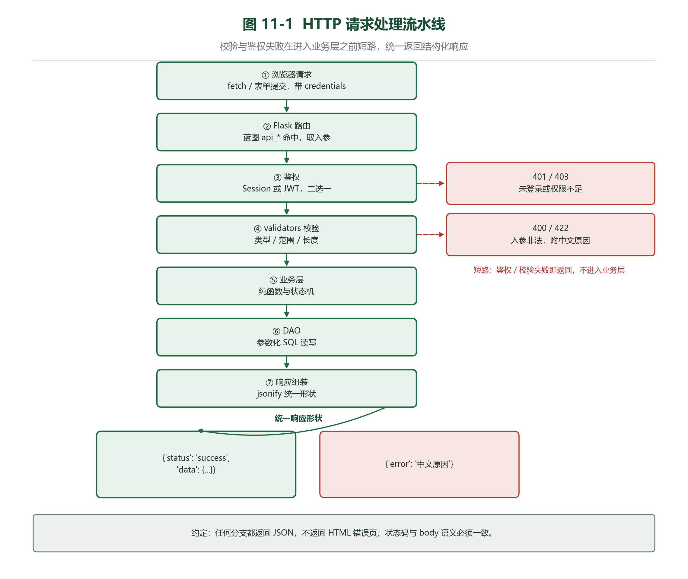

## 11.2 路由总表

表 11-1 完整路由清单
| 方法 | 路径 | 处理函数 | 鉴权 | 说明 |
|---|---|---|---|---|
| GET | `/` | `route_root` | 无 | 未登录跳登录页，已登录渲染主监控台 |
| GET | `/index` | `route_index` | 无 | 主监控台别名入口 |
| GET | `/knowledge` | `route_knowledge` | 无 | 知识库页面（作物-缺氧-调控知识） |
| GET | `/static/<path:filename>` | Flask 静态 | 无 | 静态资源，第三方库全部本地化 |
| POST | `/api/register` | `api_register` | 无 | 注册账号（IP 限流） |
| POST | `/api/login` | `api_login` | 无 | 登录（用户名维度限流） |
| GET | `/api/logout` | `api_logout` | Session | 退出登录 |
| POST | `/api/change_password` | `api_change_password` | Session | 修改密码 |
| POST | `/api/app_login` | `api_app_login` | 无 | App 登录，返回 JWT 并触发 MQTT 建连 |
| POST | `/api/app_send_command` | `api_app_command` | JWT | App 下发控制指令 |
| GET | `/api/get_config` | `api_get_config` | Session | 读配置（敏感字段打码） |
| POST | `/api/save_config` | `api_save_config` | Session | 存配置（掩码即保留原值） |
| POST | `/api/diag/<target>` | `api_diag` | Session | 外部接入连通性自检 |
| GET | `/api/thresh_settings` | `api_get_thresh` | Session | 读阈值 |
| POST | `/api/thresh_settings` | `api_save_thresh` | Session | 存阈值 |
| GET | `/api/history` | `api_history` | Session | 历史采样（按当前地块） |
| GET | `/api/forecast` | `api_forecast` | Session | 7 日天气预报代理 |
| GET | `/api/reverse_geocode` | `api_reverse_geocode` | Session | 逆地理（带缓存） |
| POST | `/api/notify_alert` | `api_notify_alert` | Session | 手动触发告警推送 |
| POST | `/api/ai_chat` | `api_ai_chat` | Session | AI 问答（带实时快照） |
| GET | `/api/alerts` | `list_alerts` | Session | 告警列表 |
| POST | `/api/alerts/ack` | `ack_alert` | Session | 确认单条告警 |
| POST | `/api/alerts/ack_all` | `ack_all_alerts` | Session | 一键全部确认 |
| GET | `/api/logs` | `list_logs` | Session | 运行日志列表 |
| GET | `/api/device_status` | `device_status` | Session | 设备在线状态 |
| GET | `/api/telemetry` | `latest_telemetry` | Session | 最新遥测快照（页面刷新后恢复） |
| POST | `/api/plan/propose` | `plan_propose` | Session | 生成 AI 决策预案 |
| POST | `/api/plan/confirm` | `plan_confirm` | Session | 人工确认并逐条下发 |
| POST | `/api/plan/reject` | `plan_reject` | Session | 人工拒绝预案 |
| GET | `/api/plans` | `plan_list` | Session | 预案列表 |
| GET | `/api/metrics` | `metrics_overview` | Session | 节水减碳指标 |
| GET | `/api/auto_control` | `auto_control_status` | Session | 读自动调控开关 |
| POST | `/api/auto_control` | `auto_control_toggle` | Session | 切换自动调控开关 |
| GET | `/api/advice/calendar` | `api_advice_calendar` | Session | 未来 7 日雨情与灌溉建议 |
| GET | `/api/export/history.csv` | `export_history_csv` | Session | 导出历史采样 CSV |
| GET | `/api/export/alerts.csv` | `export_alerts_csv` | Session | 导出告警 CSV |
| GET | `/api/farms` | `api_list_farms` | Session | 地块列表 |
| POST | `/api/farms` | `api_create_farm` | Session | 新建地块 |
| POST | `/api/farms/switch` | `api_switch_farm` | Session | 切换当前地块 |
| POST | `/api/farms/update` | `api_update_farm` | Session | 更新地块信息 |
| POST | `/api/farms/delete` | `api_delete_farm` | Session | 删除地块 |

路由挂载位置在 `qinghe/routes/` 下按模块分文件：`advice_routes.py:17`、`ai_routes.py:18`、`app_routes.py:15/23/31/39`、`auth_routes.py:37/66/106/113/141`、`config_routes.py:140/156/232/248/259`、`data_routes.py:24/51/73/99`、`farm_routes.py:134/149/180/219/261`、`insight_routes.py:67/86/106/130`、`monitor_routes.py:66/89/107/129/152/173`。

## 11.3 认证与配置类接口

**`POST /api/register`。** 用户名 3–20 字符、密码 6–64 字符，均先 trim。注册本身按来源 IP 限流：`config.REGISTER_MAX_ATTEMPTS = 10` 次以内放行，超出返回 429。注册成功不自动登录，需回到登录页走一次登录流程。

**`POST /api/login`。** 失败计数按**用户名**维度而非 IP 维度统计，采用滑动窗口：`config.LOGIN_MAX_FAIL = 5` 次失败后锁定 `config.LOGIN_LOCK_SECONDS = 600` 秒（10 分钟），期间返回 429 与 `'尝试次数过多，请 10 分钟后再试'`。选用户名维度是因为"同一 IP 下有多个师生账号"是校园网的常态，按 IP 锁会误伤同寝室的其他人；而按用户名锁能精准拦住针对某个账号的暴力破解。登录成功会清空该用户名的失败计数。

登录流程内还有一个**密码哈希自动升级**动作。历史版本用明文存密码，`auth.verify_password` 在比对成功且发现库中存的是明文（`is_password_hash(stored)` 为假）时会调用 `upgrade_plaintext_password(uid, password)` 就地替换为 PBKDF2 哈希——老用户在下一次登录时无感迁移，不需要管理员批量重置。

**`POST /api/app_login`。** 与网页登录同源校验，但返回 JWT，并异步触发该用户的 MQTT 建连（复用 `auth_routes._connect_iot_async`），避免 App 登录时 60 秒的 broker 连接超时阻塞响应。

**`GET /api/get_config` 与 `POST /api/save_config`。** 一对读写接口，通过**掩码占位**实现"只改想改的字段"。读取时 `iot_pass`、`weather_key`、`ai_key` 三个敏感字段一律替换为 `config.MASK = '••••••••'`；写入时的规则是：

```python
def val(key):
    v = data.get(key)
    if v == config.MASK or v is None:
        return old.get(key)
    return v
```

即**值为掩码或 None 时保留数据库原值**，只有提交了新值才覆盖。这样前端不需要维护"哪些字段被改动过"的状态，直接把整张表单回传即可。`db.save_config(uid, values)` 实现的是**整行覆盖**：`values` 由 `{col: val(col) for col in db.CONFIG_COLUMNS}` 生成，覆盖全部 21 个配置列。这一设计有两个必须注意的后果：其一，前端**必须回传完整表单**，漏传的字段会被写为 `None` 而不是保持原值；其二，掩码保护只对上述三个敏感字段生效，别的字段传空串就是真的清空。

`iot_port` 单独处理，不参与整行覆盖的兜底逻辑：

```python
port = _to_int(data.get('iot_port'))
if port is None or not (config.IOT_PORT_MIN <= port <= config.IOT_PORT_MAX):
    port = _to_int(old.get('iot_port'), config.IOT_PORT_DEFAULT)
    if not (config.IOT_PORT_MIN <= port <= config.IOT_PORT_MAX):
        port = config.IOT_PORT_DEFAULT
values['iot_port'] = port
```

即非数字或越界的端口回退到旧值，旧值也非法时再回退到 `IOT_PORT_DEFAULT = 1883`。这道兜底是必要的：`connect_huawei_iot` 内部会做 `int(port)`，若把 `'abc'` 落库，每次重连都会抛异常并静默失败，故障点会离保存动作很远。

保存成功后还有两个副作用同步，都包在独立的 try/except 里，**失败不影响配置保存本身**：把农场名与经纬度同步到当前地块记录（`db.save_active_farm_meta`），以及把本次提交的物联网接入字段同步到当前地块（`db.save_farm_iot`）。坐标同步用 `_COORD_CLEARED` 哨兵区分两种语义——键存在且值为空串表示"真的清空这一维"，键不存在表示"不改动这一维"，避免了只改纬度时把经度一起抹掉。

**`POST /api/save_config` 响应前会调用 `_reconnect_async(uid)`。** 原因是 `connect_huawei_iot` 内部的 broker 连接带 60 秒超时，同步执行会让保存按钮转一分钟；异步重连后接口立刻返回 `{'status': 'success', 'message': '配置已更新'}`。

**`POST /api/diag/<target>`。** 设置页"测试连接"按钮的后端，`target ∈ {'iot', 'weather', 'ai', 'webhook'}`。它做一次**只读**连通性探测：已配置的目标真的发一次请求，未配置的目标直接判定为"未填写"且不发请求。**无论探测结果如何都返回 HTTP 200**，通过响应体里的 `ok` 字段表达成功与否。这一点的理由是：这个接口的语义是"报告状态"，不是"执行操作"，用状态码表达会把"探测失败"误报成"接口调用失败"，前端还得分两种失败路径处理。返回的详情文本截断到 `DETAIL_MAX_LEN = 300` 字符。

## 11.4 数据与监控类接口

**`GET /api/history`。** 参数 `limit` 由 `_parse_limit` 收敛到 `config.HISTORY_MIN_LIMIT = 1` 至 `config.HISTORY_MAX_LIMIT = 5000`，默认 `HISTORY_DEFAULT_LIMIT = 1000`。查询走 `db.query_history(uid, limit, farm_id=db.get_active_farm_id(uid))`，SQL 条件为 `AND (farm_id = ? OR farm_id = 0)`——`farm_id = 0` 那条兼容分支是为了让多地块功能上线前写入的旧数据仍能被看到，否则升级后历史曲线会突然空白。返回结果按时间**反转为升序**后再给前端，直接可画折线。响应行含 `ts`、`water_adc`、`soil_adc`、`do_mgl`、`eh_mv`，其中后两列由迁移 D-01 新增，早期行返回 `None`，前端作图时跳过空点。

**`GET /api/telemetry`。** 返回当前地块的最新一份遥测快照，用于页面刷新或断线重连后**立即恢复界面**。前端 `applySnapshot(data)` 用它一次性填充读数卡、设备状态与 RORI，不必等下一帧 `hw_data` 到来，避免刷新后看到一片 `--`。

**`GET /api/alerts`。** `limit` 范围 1–500（默认 100），`since_ts` 必须为非负数，否则 400 与 `'limit 必须是 1-500 的整数'` 风格的中文提示。底层 `alert_center.list_alerts` 用**严格大于** `ts > ?` 过滤并按 `ORDER BY ts DESC, id DESC` 排序——加 `id` 作次级排序键是为了让同一毫秒内产生的多条告警也有稳定顺序，否则分页会出现重复或漏项。

**`POST /api/alerts/ack` 与 `/api/alerts/ack_all`。** 前者按 `id` 确认单条，用 `rowcount` 判断是否真的改动了行，据此决定返回成功还是"无权操作/不存在"；后者一键确认当前用户的全部未确认告警，供告警中心的"全部确认"按钮使用。

**`GET /api/logs`。** `limit` 范围 1–1000（默认 200），底层 `logbook.query_logs(uid, limit, since_ts)` 从内存写队列落库后的 `logs` 表读取。

**`GET /api/device_status`。** 返回 `heartbeat.get_status(uid)` 的结果：`online` 布尔、`last_seen_ts`、`silent_seconds`、`last_reason`。离线判定阈值为 `heartbeat.DEVICE_OFFLINE_SECONDS = 30` 秒，即超过 30 秒没有上报即视为离线；与前端 6×5 秒 = 30 秒的看门狗阈值对齐。

**`GET /api/forecast` 与 `GET /api/reverse_geocode`。** 详见第十章：预报失败时返回 502 加错误体；逆地理要求同时提供 `lat` 与 `lng`，缺失返回 400，格式错误返回 `'坐标格式错误'`，取不到地名时用 `weather.geo_fallback_text` 生成坐标文本兜底，绝不返回空。

**`POST /api/notify_alert`。** 手动触发一次告警推送，`msg` 截断到 500 字、`level` 截断到 20 字（对应 `config.ALERT_CONTENT_MAX_LEN` 与 `ALERT_LEVEL_MAX_LEN`），空 `msg` 返回 400。推送失败**不算接口失败**：返回 `{'status': 'skipped', 'sent': false}` 加 HTTP 200。这一取舍的理由是，webhook 是外部通道，其可用性不应影响站内闭环——站内弹窗已经提示过用户，钉钉群没收到不该让页面弹一个失败框。

**`POST /api/ai_chat`。** 详见第十章。

## 11.5 洞察与预案类接口

**`POST /api/plan/propose`。** 请求体字段 `question` 必须是字符串（否则 400），长度不超过 500 字（否则 400 与 `'question 过长（最多 500 字）'`），随后调用 `planner.propose_plan(uid, question.strip())`。预案由 AI 生成失败时自动落到规则预案（见第十二章），接口层不区分两者，只把结果原样返回。

**`POST /api/plan/confirm`。** 这是全系统安全等级最高的接口之一——它真的会让水泵或气泵动作。它的校验链条是：`id` 必须是 1..2³¹-1 的整数（否则 400 `'缺少合法的预案 id'`）→ 预案必须属于当前用户 → 预案状态必须是 `pending` → 且未超过 `planner.PLAN_TTL_SECONDS = 600` 秒的时效窗口。任一条不满足都会失败，其中超时的那条会把预案状态置为 `expired` 再返回。逐条下发前，动作还要再过一遍白名单：`ALLOWED_DEVICES = ('air_pump', 'water_pump')`、`ALLOWED_ACTIONS = ('on', 'off')`。

600 秒 TTL 的设计意图是**防止用陈旧决策指挥现场**：AI 预案是基于某一时刻的土壤湿度、溶解氧与降雨预报生成的，如果用户十分钟后才点确认，而这段时间里已经下过雨，执行预案反而有害。超时作废比静默执行安全。失败时接口返回 400；若底层没给出具体原因，路由补一句 `'预案下发失败（设备可能未连接），请稍后重试'`，避免用户面对一个空错误信息。

**`POST /api/plan/reject`。** `id` 同上，可选 `reason` 必须是字符串且不超过 200 字。失败返回 400 与 `'预案不存在、无权操作或状态不允许'`。拒绝与确认一样落入终态，预案不会被重复处理。

**`GET /api/plans`。** `limit` 默认 20、上限 100，按时间倒序。

**`GET /api/metrics`。** `days` 参数默认 7、上限 90（`insight_routes.DEFAULT_METRIC_DAYS` / `MAX_METRIC_DAYS`），返回近 N 日的灌溉用水（升）、气泵/水泵运行时长（分钟）、折算的甲烷减排量与 CO₂ 当量。

**`GET /api/auto_control` 与 `POST /api/auto_control`。** 读/写服务端自动调控开关。`autocontrol.is_enabled` 的默认值是 **False**——即服务端引擎默认不接管。这是刻意的保守默认：服务端自动调控是"页面关闭时的保底"，一旦默认开启就会和前端页面的 `autoControl()` 同时下发指令，两条控制回路互相打架。最小动作间隔 `autocontrol.AUTO_MIN_INTERVAL_SECONDS = 60` 秒同样是为了抑制抖动。

**`GET /api/advice/calendar`。** 返回未来 7 日的雨情与灌溉建议，由 `qinghe/advice.py` 的 `build_calendar(...)` 生成，建议档位有四档：`wait_rain`（等雨）、`watch`（观察）、`irrigate`（建议灌溉）、`hold`（暂缓）。判定用到三个常量：`RAIN_EFFECTIVE_MM = 5.0`（视为有效降雨的日雨量门槛）、`SOIL_GAP_PCT = 3.0`（土壤湿润度与动态下限的差距容差）、`RAIN_TINY_MM = 1.0`（可忽略的小雨门槛）。

## 11.6 导出与地块类接口

**`GET /api/export/history.csv` 与 `/api/export/alerts.csv`。** 响应带 UTF-8 BOM（`BOM = '\ufeff'`），文件名形如 `qinghe_history_<uid>_<毫秒时间戳>.csv`，并设置 `Cache-Control: no-store`。BOM 是必需的：Excel 打开无 BOM 的 UTF-8 CSV 会把中文表头显示成乱码，这是交付后必然收到的一类"bug 报告"，不如在源头解决。单次导出行数上限 `MAX_EXPORT_ROWS = 50000`。

表头由 `_table_columns` 通过 `PRAGMA table_info` **动态探测**，而不是硬编码列名：

```python
HISTORY_HEADER = ['时间', '时间戳', '水位ADC', '土壤ADC', '溶解氧mg/L', '氧化还原电位mV']
ALERTS_HEADER = ['时间', '时间戳', '级别', '类型', '内容', '已确认']
```

动态探测的必要性在于历史库的列是逐步迁移出来的（`do_mgl`、`eh_mv`、`farm_id` 都是后加的），若按固定列名拼 SQL，旧版数据库文件一上来就会报 `no such column`。

**地块接口族。** `GET /api/farms` 列出本人全部地块；`POST /api/farms` 新建；`POST /api/farms/switch` 切换当前地块；`POST /api/farms/update` 更新；`POST /api/farms/delete` 删除。校验规则集中在 `config.py`：名称 1–20 字符、`lat ∈ [-90, 90]`、`lon ∈ [-180, 180]`、面积 0–1,000,000 m²、圈地边界点数 ≤200 且 JSON 串长 ≤20000、单账号地块数上限 `FARM_MAX_COUNT = 12`。删除受一条硬约束保护：**至少保留一块地，不能删除最后一块**——`active_farm_id` 一旦指向不存在的记录，遥测写入与历史查询会同时失去归属，属于难以自愈的状态，因此从接口层直接拒绝。

切换地块是一个有实际副作用的动作：它会改变 `configs.active_farm_id`，进而改变 `/api/history` 的查询范围、`/api/telemetry` 的返回内容、以及 MQTT 的连接参数（物联网接入按地块独立，见第六章）。因此切换成功后前端会重新拉取配置并重建图表数据，而不是复用旧曲线。

**`POST /api/app_send_command` 与指令下发。** App 端下发走 JWT 鉴权，校验比 SocketIO 通道更严：设备名必须在 `PROP_MAP` 之中（否则 400 `'未知设备'`），`action` 必须**精确等于** `'on'` 或 `'off'`（否则 400 `'action 仅支持 on / off'`），设备未连接时返回 `{'status': 'error', 'message': '设备未连接'}`。与 SocketIO 通道"非 on 一律按 off 处理"的宽松策略相比，HTTP 侧选择严格拒绝，因为 App 调用是程序化调用，把拼写错误当成成功下发会让调用方产生"指令已生效"的错误认知，而 SocketIO 侧面对的是人手点击，宽松处理不会造成误解。

# 十二、新增功能模块详细设计

本章介绍七个在系统增量迭代中加入的功能模块。它们共享一套统一的落地方式：**惰性建表、独立文件、不改动既有模块的代码**。每个模块在首次被调用时才执行 `_ensure_schema()`，用 `_schema_ready` 标志位加 `_schema_lock` 保证只建一次表；外部调用一律带超时；异常一律在模块内部消化，不向请求栈抛出。这套约定使得七个模块可以独立开发、独立测试、独立上线，老代码无需任何改动，也解释了为什么它们能在不改动 12 个既有文件的前提下接入系统。

## 12.1 告警中心

**职责与外部契约。** 告警中心负责把"某条告警"从判定结果变成可查询、可确认、可推送的持久记录。对外提供 `push_alert()`（落库 + 去重 + 推送）、`list_alerts()`（列表）、`ack_alert()`（确认）、`prune_alerts()`（清理）四个入口，以及 `evaluate_and_push()` 这个把判定与落库串起来的门面。判定规则本身不在这里，而在 `qinghe/alerts.py`（见第八章）。

**数据结构与常量。** 单表 `alerts(id, user_id, ts, level, code, content, acked)`，配 `idx_alerts_user_ts` 索引支撑"按用户倒序取最近 N 条"。常量见表 12-1。

表 12-1 告警中心常量
| 常量 | 取值 | 作用 |
|---|---|---|
| `ALERT_LEVELS` | `('info', 'warning', 'danger')` | 合法级别集合 |
| `ALERT_CODES` | 9 个稳定类型码 | 合法类型集合 |
| `CONTENT_MAX_LEN` | 500 | 内容长度上限 |
| `MAX_LIMIT` | 500 | 列表查询条数上限 |
| `PUSH_RETRY_DELAYS` | `(0.0, 0.5, 1.0)` | 推送重试的三次延迟（秒） |

**关键实现。** 去重键 `'%d|%s|%s' % (uid, code, content)` 三段分别是用户、类型码、文案：带 `uid` 保证不同用户的同类告警各自计时，带完整 `content` 让"湿度 39%"与"湿度 25%"被当作两条不同告警分别推送。`list_alerts` 的过滤条件是严格 `ts > ?`，排序 `ORDER BY ts DESC, id DESC`——加 `id` 次级键是因为毫秒时间戳在一批写入中常相同，只按 `ts` 排序会让分页出现重复或漏项。`ack_alert` 用 `rowcount` 判定是否真的改动了行，而不是先查再改，避免竞态。

**设计与权衡。** 去重状态放内存而不放数据库：60 秒窗口不需要持久化，若每次告警都写库，这个"防刷屏"机制本身会变成数据库压力源。重试不写在推送函数里，而由 `_push_with_retry` 在后台线程按退避表重试，保证 HTTP 请求与 MQTT 回调都不会被拖动。

## 12.2 运行日志

**职责与外部契约。** 运行日志记录"系统做了什么"——配置变更、设备状态翻转、自动调控动作、预案下发结果。对外只有三个入口：`add_log()`（写入）、`query_logs()`（查询）、`flush_logs()`（强制落盘，供测试与关停使用）。

**数据结构与常量。** 单表 `logs(id, user_id, ts, level, source, message)`，配 `idx_logs_user_ts`。常量见表 12-2。

表 12-2 运行日志常量
| 常量 | 取值 | 作用 |
|---|---|---|
| `LOG_LEVELS` | `('info', 'warning', 'error')` | 合法级别集合 |
| `LOG_SOURCES` | `('system', 'device', 'auto', 'manual', 'plan', 'config')` | 合法来源集合，用于界面分组筛选 |
| `QUEUE_MAX` | 1000 | 内存队列上限 |
| `BATCH_SIZE` | 20 | 达到该条数立即 flush |
| `FLUSH_INTERVAL` | 1.0 | 定时 flush 周期（秒） |
| `MESSAGE_MAX_LEN` | 500 | 单条消息长度上限 |
| `MAX_LIMIT` | 1000 | 查询条数上限 |

**关键实现。** 写日志与写历史数据面对的是同一个问题——调用方（MQTT 回调、请求线程）不能被磁盘 IO 阻塞——但压力更轻，因此实现更简：一个 `_LogWriter` 类持有 `QUEUE_MAX` 容量的队列与一个守护线程，循环体的逻辑是"队列长度够了就立刻 flush，否则等 1 秒再看"：

```python
while not self._stop.is_set():
    if self.queue.qsize() >= BATCH_SIZE:
        self._flush()
    else:
        self._stop.wait(FLUSH_INTERVAL)
        self._flush()
```

这个写法的要点是 `_stop.wait(FLUSH_INTERVAL)` 既当睡眠又当唤醒条件：`add_log` 时不主动唤醒线程，靠 1 秒周期兜底；但队列攒到 20 条就会在下一次循环立刻落盘，不会为了等周期而多延迟。`_DB_LOCK` 是一个模块级锁，保证多个写入线程（日志线程、测试线程）不会并发写同一张表。`add_log()` 每次调用都会检查写线程是否存活，必要时启动它——这个"自动起线程"的动作是幂等的（`_lock` + `is_alive()` 双重检查），因此调用方不需要关心线程生命周期。

**设计与权衡。** 逐条写库在秒级日志量下会产生大量小事务；批量化把 20 条合成一次提交，写放大显著下降。队列满时的策略是**丢弃最旧**并累加 `dropped_count()`，理由与历史写入完全一致：让调用方继续跑比保住一条日志重要。日志保留期 7 天，由 `prune_logs()` 清理。

## 12.3 设备心跳

**职责与外部契约。** 心跳模块回答一个问题：**这台设备现在还活着吗？** 对外提供 `mark_seen()`（登记上报）、`get_status()`（查状态）、`sweep_offline()`（巡检并推送翻转）、`start_watcher()`（启动巡检线程）。

**数据结构与常量。** 单表 `device_status(user_id PK, last_seen_ts, online, last_reason)`，以 `user_id` 作主键——一个账号对应一台设备，无需额外索引。常量：`DEVICE_OFFLINE_SECONDS = 30`、`WATCH_INTERVAL = 5.0`。

**关键实现。** 离线判定的核心是两行代码，各自对应一个具体的边界问题：

```python
silent_seconds = (gap_ms + 999) // 1000      # 向上取整，避免 29.6 秒被判成离线
online = silent_seconds <= DEVICE_OFFLINE_SECONDS   # 闭区间
```

**向上取整**解决的是采样抖动：设备每 10 秒上报一次，某次因网络抖动晚到 0.3 秒，静默间隔变成 29.6 秒。若用 `gap_ms // 1000` 向下取整得到 29，判在线；但若恰好是 30.4 秒则得 30，判在线——看起来没问题，真正的风险在阈值附近反复横跳。向上取整让"29.6 秒"明确落在 30 这一整数刻度上，与闭区间判定配合，边界不再有歧义。**闭区间**（`<=` 而非 `<`）则保证"恰好 30 秒"被判为在线，与文档表述"超过 30 秒即离线"一致。

`mark_seen()` 里有一行防御性代码：

```python
seen_ts = min(seen_ts, now)   # 防设备时钟超前
```

嵌入式设备没有可靠的 NTP 同步，掉电重启后时钟可能回到初始值或跳到未来。若一台设备的时钟超前 10 分钟，它上报的 `last_seen_ts` 就会是未来时间，此后任何真实上报都不足以把这个时间戳推进，设备会被永久判为在线。截断到"当前时刻"让这种异常无法污染状态。

`sweep_offline(uids)` 由巡检线程每 5 秒执行一次，遍历曾上报过心跳的用户，对静默超阈值的置 `online=0` 并写 `last_reason='silent_timeout'`，且**只在 online→offline 状态翻转时才推送**——如果每 5 秒都推一次"离线"，前端会收到大量重复事件。`start_watcher(get_uids, emit, interval)` 幂等，重复调用不会起第二个线程。

**设计与权衡。** 阈值取 30 秒，与前端看门狗（6 × 5 秒 = 30 秒）对齐，避免"服务端认为在线、前端认为离线"的观感矛盾。巡检周期 5 秒是精度与开销的折中：周期太长会让离线通知延迟，太短则无谓地扫表。

## 12.4 AI 决策预案

这是七个模块中体量最大、也是安全等级最高的一个：它产生的建议最终可能真的让水泵或气泵动作。

**职责与外部契约。** 对外五个入口：`build_context()`（组装上下文）、`propose_plan()`（生成预案）、`confirm_plan()`（人工确认并下发）、`reject_plan()`（人工拒绝）、`list_plans()`。

**数据结构与常量。** 单表 `plans(id, user_id, ts, status, context_json, reasoning, proposal_json, decided_ts, apply_result)`。四个常量构成安全边界：

表 12-3 决策预案常量
| 常量 | 取值 | 作用 |
|---|---|---|
| `PLAN_TTL_SECONDS` | 600 | 预案有效期（秒），超时作废 |
| `ALLOWED_DEVICES` | `('air_pump', 'water_pump')` | 允许动作的设备白名单 |
| `ALLOWED_ACTIONS` | `('on', 'off')` | 允许的动作白名单 |
| `AI_TIMEOUT_SECONDS` | 25 | AI 调用超时（秒） |

状态机有五个状态，`pending` 是唯一非终态：

表 12-4 预案状态机
| 状态 | 含义 | 可否再跃迁 |
|---|---|---|
| `pending` | 已生成，等待人工确认 | 是 |
| `confirmed` | 已确认并逐条下发 | 否 |
| `rejected` | 人工拒绝 | 否 |
| `expired` | 超过 600 秒未处理 | 否 |
| `failed` | 下发失败 | 否 |

**关键实现。** `build_context(uid)` 返回 15 个键，是 AI 与规则引擎共同的输入：`rori`、`rori_level`、`water_mm`、`soil_pct`、`do_mgl`、`eh_mv`、`air_pump`、`water_pump`、`p6d`、`alpha`、`eff_lower`、`eff_upper`、`manual_mode`、`ts`、`has_telemetry`。最后一键 `has_telemetry` 是专门用来区分"0 mm 的真读数"与"没有数据的安全默认值"的——代码注释写得很直接：是否真的收到过遥测，用来区分这两种情况。没有这个标志，AI 会把"设备未上电"误解为"水位为零、需要立即灌溉"。

生成路径是 **AI 优先、规则回退**。`_build_ai_prompt()` 把上下文以 JSON 序列化进提示词（`json.dumps(ctx, ensure_ascii=False, sort_keys=True)`，`sort_keys` 让同样的上下文产生同样的提示词，便于复现问题），并附上阈值约定与输出格式要求。四条触发回退的条件是：未配置 AI Key、调用抛异常、返回内容里没有 JSON、JSON 里没有合法 `actions`。四种情况都落到 `_rule_plan(ctx)`，其决策直接复用 `irrigation.decide_control()`，并把 `ai_used` 置为 False 以便界面区分。

`_extract_json_object()` 专门对付模型的"不守规矩"：它会先剥掉 Markdown 代码块围栏（逐行丢弃以 ``` 开头的行），再用 `raw.find('{')` 与 `raw.rfind('}')` 截出最外层大括号，最后才 `json.loads`。这段代码的存在意味着模型在 JSON 前后多说几句话不会导致解析失败。

`_sanitize_actions()` 是最后一道关：逐条检查动作的设备名是否在 `ALLOWED_DEVICES` 里、动作是否在 `ALLOWED_ACTIONS` 里，不合格的直接丢弃。**白名单在这里出现两次**——提案时过滤一次，确认下发前再过滤一次。两次不是冗余：`proposal_json` 是落库的字符串，理论上可能被其他路径改写，下发前重新过滤才能保证"进入设备层的动作一定合法"。

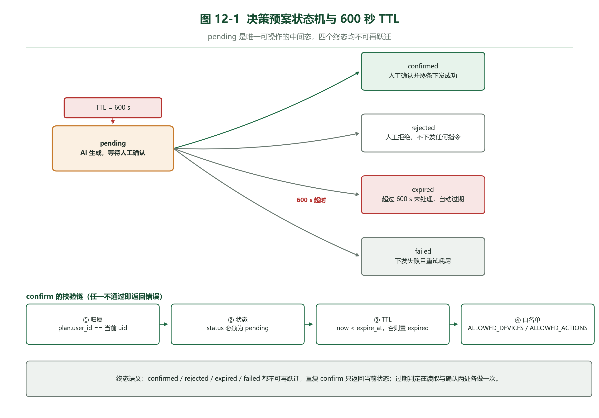

**设计与权衡。** TTL 取 600 秒，是为了**防止用陈旧决策指挥现场**：预案基于某一时刻的土壤湿度、溶解氧与降雨预报生成，若用户十分钟后才点确认，这期间可能已经下过雨，执行预案反而有害。超时作废比静默执行安全。AI 失败必须回退而不是报错，因为**人工确认环节本身就是安全阀**——预案再离谱也要用户点一下才会下发，因此宁可给一个保守的规则预案让用户判断，也不要让整个功能不可用。`AI_TIMEOUT_SECONDS = 25` 比对话场景的 20 秒略长，因为预案要求结构化 JSON 输出，推理链更长。

## 12.5 节水减碳指标

**职责与外部契约。** 把"泵开了多久"折算成用户看得懂的两个数字：灌溉用水量（升）与碳减排量（克 CO₂ 当量）。

**数据结构与常量。** 单表 `pump_runtime(user_id, device, day, seconds)`，主键 `(user_id, device, day)`——三个维度唯一确定一条记录，天然支持按日聚合。常量为 `DEFAULT_CHANNEL_AREA_M2 = 0.5`（可用环境变量 `FARM_CHANNEL_AREA_M2` 覆盖）、`DEFAULT_CH4_SAVED_G_PER_HOUR = 0.8`（`FARM_CH4_SAVED_G_PER_HOUR`）、`GWP100 = 28`、`DEVICES = ('air_pump', 'water_pump')`、`MAX_DAYS = 90`。

**关键实现。** `note_pump_state(uid, device, state)` 每次收到设备状态就调用一次，但**首次调用只记录基线，不结算**——因为不知道设备在这次观测之前已经开了多久，贸然计时会凭空造出时长。只有观测到状态由 `on` 变 `off` 时才结算这一段运行时间。

`_add_seconds()` 处理跨零点：一段运行若跨越本地午夜，会被拆成两段分别计入两天，否则今天的用水量会被算到明天。落库用 UPSERT：

```sql
INSERT INTO pump_runtime (user_id, device, day, seconds) VALUES (?,?,?,?)
ON CONFLICT(user_id, device, day) DO UPDATE SET seconds = seconds + excluded.seconds
```

`_water_mm_by_day()` 只累计**正的**水位增量：水流走、水位下降不代表用水量减少，负增量直接忽略。

量纲推演必须写清，否则很容易多乘一个 1000：

> 水位抬升 20 mm × 渠道面积 0.5 m² = 10 mm·m²。而 1 mm·m² = 10⁻³ m³ = 1 L，所以 10 mm·m² = 10 L。**换算系数就是 1，不需要再乘 1000。**

一组完整算例（气泵运行 1800 秒、水泵运行 360 秒、水位累计抬升 20 mm、面积 0.5 m²、减排率 0.8 g/h、GWP100 = 28）：

表 12-5 节水减碳量算例
| 指标 | 计算式 | 结果 |
|---|---|---|
| 灌溉用水量 | 20 mm × 0.5 m² | 10.0 L |
| 水泵运行时长 | 360 s ÷ 60 | 6.0 min |
| 气泵运行时长 | 1800 s ÷ 60 | 30.0 min |
| 甲烷减排量 | 0.8 g/h × 0.5 h | 0.4 g |
| CO₂ 当量 | 0.4 g × 28 | 11.2 g CO₂e |

**设计与权衡。** 面积与减排率都做成可配置的估算值，因为它们必须根据实测标定：0.5 m² 是典型实验小区渠道面积，0.8 g/h 是文献上的量级估计。把这些数字写死在代码里会让整个指标失去可信度，做成环境变量后，使用者可以用自己田块的实测值替换。GWP100 取 28 是 IPCC AR5 的甲烷百年增温潜势，比 AR4 的 25 更保守也更现行。

## 12.6 服务端自动调控

**职责与外部契约。** 这是一个"页面关闭时的保底引擎"：当浏览器关掉后前端不再下发指令，服务端仍能按阈值维持基本调控。对外提供 `is_enabled()`、`tick()` 与开关读写。

**数据结构与常量。** 单表 `auto_control(user_id PK, enabled, last_action_ts, state_json)`；`AUTO_MIN_INTERVAL_SECONDS = 60`。

**关键实现。** `is_enabled()` 的默认值是 **False**。这是本模块最重要的一个决定：服务端引擎与前端 `autoControl()` 是两条独立的控制回路，两者同时运行会对同一台泵下相反的指令——前端看到湿度够了要停泵，服务端看到水位低了要开泵，几十秒内来回切换，机械与传感器都会受损。默认关闭意味着"要么前端接管，要么显式打开服务端引擎"，不会因为忘记关而打架。

`last_action_ts` 与 `AUTO_MIN_INTERVAL_SECONDS = 60` 共同构成一个最小动作间隔闸门：距上次动作不足 60 秒一律不再下发。这是抑制抖动的第二道保险——即使阈值判定反复要求切换，也不会在短时间内连续动作。

**设计与权衡。** 保底引擎的价值在断网与关页场景，但它与前端控制天然冲突。选择"默认关闭 + 显式开启 + 最小间隔"三点组合，是在"自动化程度"与"可控性"之间的保守取向：宁可少自动一点，也不要出现两条回路互相拆台。

## 12.7 地块管理与导出

**地块管理。** `qinghe/routes/farm_routes.py` 提供五个接口（列表、新建、切换、更新、删除）。校验规则集中在 `config.py`：名称 1–20 字符、纬度 ∈ [-90, 90]、经度 ∈ [-180, 180]、面积 0–1,000,000 m²、圈地边界点数 ≤ 200 且 JSON 串长 ≤ 20,000 字符、单账号地块数上限 12。

删除接口有一条硬约束：**至少保留一块地，不能删除最后一块**。理由是 `configs.active_farm_id` 一旦指向不存在的记录，遥测写入与历史查询会同时失去归属，属于难以自愈的状态——系统不会报错，只会静默地什么都不显示，排查成本很高。因此从接口层直接拒绝，让非法状态根本不可能出现。

**CSV 导出。** `qinghe/routes/export_routes.py` 提供历史采样与告警两个导出接口。三个实现细节值得记录：

- **响应带 UTF-8 BOM**（`BOM = '\ufeff'`）。Excel 打开无 BOM 的 UTF-8 CSV 会把中文表头显示成乱码，这是交付后必然收到的一类"bug 报告"，不如在源头解决。
- **表头由 `PRAGMA table_info` 动态探测**，而不是硬编码列名。历史库的列是逐步迁移出来的（`do_mgl`、`eh_mv`、`farm_id` 都是后加的），若按固定列名拼 SQL，旧库一上来就会报 `no such column`。
- **单次导出行数上限 50000**（`MAX_EXPORT_ROWS`），并设 `Cache-Control: no-store`——导出内容是实时数据，不能被浏览器或代理缓存。

文件名形如 `qinghe_history_<uid>_<毫秒时间戳>.csv`，同一用户多次导出不会互相覆盖。

# 十三、前端详细设计

前端是一套"零构建"的静态资源：没有打包器、没有框架运行时、没有 npm 依赖树，`static/js/` 下 15 个文件按固定顺序用 `<script defer>` 串行加载。这个选择对一个部署在校园网内网、由非专业运维维护的系统来说是决定性的——部署动作就是把目录拷过去，浏览器强刷一次就生效，不必在服务器上装 Node、装依赖、跑构建。

## 13.1 加载顺序与模块职责

`templates/index.html` 中的脚本顺序是**依赖顺序**，不可重排：

```text
vendor/socket.io  →  vendor/chart.umd  →  vendor/leaflet
    →  core.js  →  store.js  →  charts.js  →  irrigation.js
    →  config.js  →  ai.js  →  weather.js  →  realtime.js  →  app.js
```

每个文件都是一个立即执行函数（IIFE），把自己的能力挂在全局命名空间 `QH` 或 `S` 上供后续文件使用。`core.js` 提供基础设施，必须先加载；`store.js` 提供持久化，`charts.js` 直接用 `root.QH_STORE` 并注明"store.js 先于本文件加载"；`app.js` 是装配层，最后加载，负责把各模块的刷新函数注册进统一 tick。

第三方库全部本地化到 `static/vendor/`，这是"内网可用"的硬要求：只要有一个库从 CDN 拉，断网或 CDN 被墙时整页就白屏。Leaflet 只用于地块管理里的气象监测点与边界设置，不在主监控台首屏加载路径上。

`login.html` 只加载 `login.js`，不加载主监控台的任何脚本——登录页不需要知道 RORI 是什么，减少首屏字节数也减少攻击面。

## 13.2 统一 tick 调度

这是前端架构的核心，也是重构收益最大的一处。重写前的做法是各模块自管定时器：时钟一个 `setInterval(1s)`、心跳一个 `setInterval(10s)`、图表一个 `setInterval(2s)` 去抖。多定时器带来三个问题：同一帧内可能连续触发多次布局与重绘；各定时器相位不齐，无法合并 DOM 写入；异常处理分散，一个定时器抛错会静默失效。

现在只有一个主循环：

```javascript
/* 统一 tick 调度器
 * 替代原先分散的 setInterval（时钟 1s、心跳 10s、图表 2s 去抖）。
 * 主循环 500ms 一跳，各任务按自己的分频执行：
 *   时钟 1s / DOM 刷写 500ms / 图表 2s / 心跳 5s / 告警巡检 5s / 趋势落盘 30s
 */
var TICK_MS = 500;

function registerTask(name, everyMs, fn) {
    tasks.push({ name: name, every: everyMs, fn: fn });
}

function startTicker() {
    if (tickTimer) return;
    var last = Date.now();
    var acc = {};
    tickTimer = setInterval(function () {
        var now = Date.now();
        var dt = now - last;
        last = now;
        for (var i = 0; i < tasks.length; i++) {
            var t = tasks[i];
            acc[t.name] = (acc[t.name] || 0) + dt;
            if (acc[t.name] >= t.every) {
                acc[t.name] = 0;
                try { t.fn(); } catch (e) { /* 单个任务异常不拖垮主循环 */ }
            }
        }
    }, TICK_MS);
}
```

三个设计要点：

**累加器而不是取模。** 每个任务维护自己的 `acc[name]`，每次主循环加上实际经过的毫秒数 `dt`，达到自己的 `every` 才执行。用 `Date.now()` 差算 `dt` 而不是假设主循环精确 500 ms——浏览器的定时器在后台标签页会被节流到 1 秒甚至更长，累加器会自动补偿，任务频率不会因为节流而永久漂移。

**分频表。** 各任务的周期与选择理由见表 13-1。

表 13-1 tick 任务分频表
| 任务 | 周期 | 说明 |
|---|---|---|
| `dom` | 500 ms | 批量刷写 DOM |
| `clock` | 1000 ms | 顶栏日期与时间 |
| `chart` | 2000 ms | 图表重绘（仅在脏标记为真时真的重画） |
| `heartbeat` | 5000 ms | 心跳看门狗与告警巡检 |
| `persist` | 30000 ms | 趋势数据落盘 |

**逐任务 try/catch。** 循环体里 `try { t.fn(); } catch (e) {}` 包住单个任务，一个任务抛异常不会中断整轮循环，其他任务照常执行。这一条在真实故障中救过场：图表库在数据异常时抛错，如果它把主循环打断了，时钟会停、DOM 不再刷新，整个页面看起来"卡死"，而实际只是图表一个功能出问题。

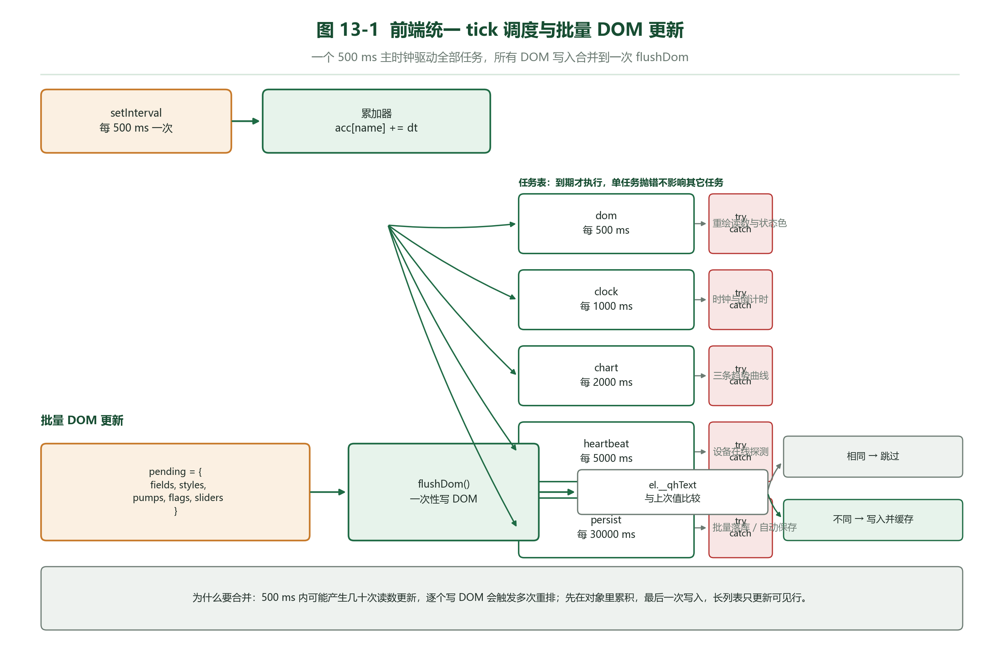

## 13.3 批量 DOM 更新

有了统一 tick，就能把"这一拍要改什么"先攒起来，一次性写下去。`core.js` 维护一个待写入队列：

```javascript
var pending = { fields: {}, pumps: {}, flags: {}, sliders: {} };
```

四类队列分别对应四类更新：`fields` 是文本字段（读数数字）、`pumps` 是设备状态卡、`flags` 是待触发的动作（`refreshStatus` / `rori` / `alerts` / `chart`）、`sliders` 是滑块位置。`enqueueField()` / `enqueuePump()` / `enqueueFlag()` / `enqueueSlider()` 只入队不写 DOM，500 ms 的 `dom` 任务里调用 `flushDom()` 一次性写完，然后重置队列：

```javascript
var flags = pending.flags;
pending = { fields: {}, pumps: {}, flags: {}, sliders: {} };
if (flags.refreshStatus) refreshStatus();
if (flags.rori) updateRori();
if (flags.alerts) checkAlerts();
if (flags.chart) markChartDirty();
```

**写前比较缓存属性是这套机制的关键。** 每个写操作都先看元素上缓存的旧值，值没变就完全跳过：

```javascript
if (el.__qhText === text) return;
el.__qhText = text;
// ... 真正写 el.textContent

var key = '__qhStyle_' + prop;   // 样式同理
var key = '__qhCls_' + cls;      // 类名同理
```

传感器每秒上报一次，但很多字段其实没变化（溶解氧可能连续几次都是 6.0）。没有这层比较，每次都要重新赋 `textContent`，即使值相同浏览器仍会标脏并参与布局；有了比较，绝大多数帧是零写入。更重要的是 `sliders`：用户正在拖动阈值滑块时，如果后台读数刷新把滑块位置写回去，手就会被"抢走"。批量 + 比较两层机制让读数刷新不会打断用户正在进行的操作。

## 13.4 图表节流与降采样

图表是前端最贵的渲染。`charts.js` 用三重手段控制成本：

- **脏标记 + 2 秒 tick**。数据来了只置 `chartDirty = true`，真正重绘发生在 `chart` 任务里且仅在标记为真时执行，2 秒内多次数据到达只画一次。
- **关闭动画与解析**。Chart.js 配置 `animation: false`（避免逐帧补间）与 `parsing: false`（跳过内部数据解析）。这里有一个**真实的历史坑**必须写明：`parsing: false` 要求传入的数据已经是最终数值格式，早期版本直接把字符串或未换算的 ADC 值喂进去，折线画不出来——页面看着在刷新，图却是空的。修复方式是在喂数据前统一做数值转换，并在测试里加锚点断言。
- **降采样 + 尾部裁剪**。`CHART_LIMIT = 300` 是单图最多渲染点数，超出时按 `step = Math.ceil(len / 300)` 抽样；新增点时用 `shift()` 做尾部裁剪，而不是 `splice()`——`shift()` 在 V8 里是 O(1) 的头部裁剪，`splice()` 每次都要搬移整个数组，2000 点规模下差异明显。

## 13.5 本地持久化

`store.js` 管理 `localStorage` 的读写，采用"内存态为准 + 30 秒节流批量落盘 + 硬上限裁剪"的策略。文件头注释写明了拆分前的病根：每次读全量、改、写全量，数据增长后卡顿。

表 13-2 本地持久化配额
| 键 | 用途 | 上限 | 保留期 |
|---|---|---|---|
| `farmTrend` | 趋势数据 | 2000 点 | 3 天 |
| `farmTrendRori` | RORI 趋势 | 2000 点 | 3 天 |
| `farmLogs` | 运行日志 | 500 条 | 24 小时 |
| `farmAlerts` | 告警记录 | 200 条 | 24 小时 |

落盘节流 `FLUSH_MS = 30000`；内存态 `mem` 是唯一数据源，渲染与写盘都读它，不再每次 `JSON.parse` 全量。三个键各有 `dirty` 标记，只有变更过的键才写盘。趋势数据在入库时按**分钟桶去重**——同一分钟内的多个采样只保留一个，避免高频上报把 2000 点配额几分钟就填满。同时过滤"假点"：水位为 0 且土壤为 58 的点对是未上报时的默认值，不能进趋势，否则重启后曲线会突然掉到 0。落盘时机是 `pagehide` 与 `beforeunload` 两个事件——移动端浏览器切后台只触发前者，桌面端关标签页只触发后者，两个都挂才能都覆盖到。

## 13.6 XSS 防护与渲染约束

设备上报的内容是不可信输入：从 MQTT 报文到页面显示之间，任何一个字符串都可能带尖括号。三条约束：

**统一转义函数。** `core.js` 的 `esc(s)` 转义 `&`、`<`、`>`、`"`、`'` 五个字符。任何必须走字符串插值的地方都要经过它。

**优先 `textContent`。** 纯文本一律用 `el.textContent = ...`，浏览器不会把它当 HTML 解析，天然免疫注入。只有需要富结构时才用 `createElement` + `createDocumentFragment` 手工搭节点。

**渲染条数硬上限。** 日志列表最多渲染 60 条、告警列表最多 30 条，超出只保留最近的。这一条同时解决两个问题：一是避免上千个 DOM 节点拖慢页面，二是限制注入内容的可见窗口。

## 13.7 心跳看门狗与断线恢复

前端必须自己判断"数据是不是停了"——WebSocket 连着不代表设备在发数据。看门狗挂在 5 秒的 `heartbeat` 任务上，阈值定义在 `core.js` 的状态表里：

```javascript
heartbeatMissLimit: 6,
```

结合 5 秒周期，即**连续 6 拍没有任何 `hw_data` 就判离线**，合计 30 秒；服务端的离线阈值 `heartbeat.DEVICE_OFFLINE_SECONDS = 30` 秒也是 30 秒，两边对齐，不会出现"前端说离线、服务端说在线"的矛盾观感。判定为离线后，顶栏状态点变色、设备卡显示"无信号"，而不是继续显示上一次的读数——**展示陈旧数据和展示错误数据一样危险**。

页面刷新或断线重连后界面会满屏 `--`，直到下一帧 `hw_data` 到达。`applySnapshot(data)` 解决这一空窗：它拿 `GET /api/telemetry` 返回的最新快照一次性填充读数卡、设备状态与 RORI，因此刷新后界面立刻是完整的，不必等设备下一次上报。

## 13.8 关键 DOM 挂载点

前端通过固定 id 定位每个区块与字段，这张映射表是前后端与测试共同依赖的契约。区块在页面上的相对位置见图 13-2，字段清单见表 13-3。

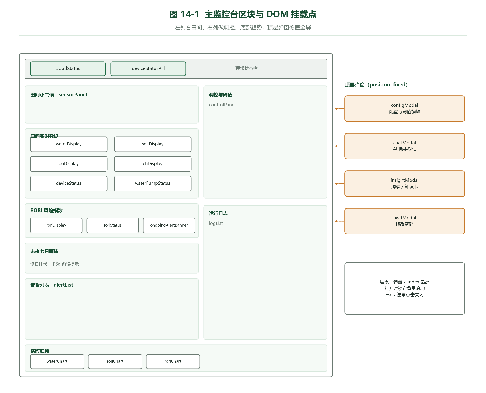

表 13-3 主要区块与 DOM 挂载点
| 区块 | 容器 | 关键子元素 |
|---|---|---|
| 顶部状态 | 顶栏 | `cloudStatus`、`deviceStatusPill`、`clockDisplay` |
| 田间小气候 | `sensorPanel` | 温度与空气湿度字段 |
| 田间实时数据 | 读数卡组 | `waterDisplay`、`soilDisplay`、`doDisplay`、`ehDisplay`、`deviceStatus`、`waterPumpStatus` |
| RORI 风险 | RORI 区块 | `roriDisplay`、`roriStatus`、`ongoingAlertBanner` |
| 调控与阈值 | `controlPanel` | `humiDownInput`、`humiUpInput`、`waterlevelDownInput`、`waterlevelUpInput` |
| 告警记录 | 告警列表 | `alertList` |
| 运行日志 | 日志列表 | `logList` |
| 实时趋势 | 图表区 | `waterChart`、`soilChart`、`roriChart`、`chartTypeBtn` |
| 弹窗 | 弹窗层 | `configModal`、`chatModal`、`insightModal`、`pwdModal`、`qhDialogTitle` |
| 提示条 | 浮层 | `toastContainer` |

## 13.9 设计与权衡

**不用 React / Vue。** 收益是零构建、零运行时依赖、首屏无白屏、交付物就是一组静态文件；代价是手写 DOM 更新代码，必须自己实现批量与比较机制。对这套"十几个区块、数据每秒变化"的界面来说，手写批量的成本远低于引入框架带来的构建与部署复杂度。

**统一 tick 优于各模块自管定时器。** 单一时钟让所有刷新有共同节拍，DOM 写入可以合并成一次；也让"页面是否健康"有一个可以观察的心跳——主循环停了就是全停，容易发现。

**读数刷新必须批量。** 逐条直接写 DOM 在设备高频上报时会产生大量同步样式计算，页面会明显卡顿；批量后每 500 ms 只有一次写入窗口，帧率稳定。

# 十四、部署与运行详细设计

## 14.1 两种启动入口

系统提供两个入口，定位明确不同。

**`app.py`——开发与调试入口。** 启动时调用工厂函数 `create_app()` 装配应用，然后用 SocketIO 的开发服务器跑起来：

```python
port = int(os.environ.get('PORT', 5000))
socketio.run(app, debug=config.is_debug(), host='0.0.0.0', port=port,
             allow_unsafe_werkzeug=True)
```

`host='0.0.0.0'` 让同一局域网内的手机可以直接访问，这是课堂演示与现场联调必需的。`allow_unsafe_werkzeug=True` 是 SocketIO 在新版 Werkzeug 下的兼容开关——不加它会直接拒绝启动。调试开关由 `config.is_debug()` 读取 `FARM_DEBUG` 环境变量决定，默认关闭。

**`server.py`——生产入口。** 用 waitress 承载 WSGI 应用：

```python
serve(app, host=host, port=port, threads=int(os.environ.get("FARM_THREADS", "8")))
```

线程数默认 8，可由 `FARM_THREADS` 覆盖。`server.py:289` 附近的注释写着"threads 默认 4"，这是**陈旧注释**，实际取默认值 8，以代码为准。8 个线程对校园网小规模访问足够，而且 MQTT 回调走独立线程，不受 HTTP 线程池大小限制。

`server.py` 的 `load_app()` 有回退路径：优先调用 `create_app()`，失败则回退到 `from app import app, socketio`。这条回退让"工厂装配失败"不至于让服务完全起不来，也兼容了早期直接暴露全局 `app` 的写法。需要注意 `load_app()` **不调用 `init_db()`**——建表由工厂函数内部完成，避免测试导入 `server` 时意外建库。

## 14.2 SocketIO 运行模式

一段配置决定了整套并发模型：

```python
socketio.init_app(app, async_mode='threading', cors_allowed_origins='*')
```

选择 `threading` 而非 `eventlet` / `gevent`，原因必须说清：MQTT 回调来自 paho-mqtt 自己的网络线程，要在那里调用 `socketio.emit()` 把数据推给浏览器。eventlet 与 gevent 通过 monkey patching 把标准库的 socket 替换成非阻塞版本，而 paho-mqtt 的客户端内部对 socket 行为有假设，monkey patch 后常出现回调不再触发、连接卡死、或 emit 从非协程线程调用直接抛错。线程模式下 `emit` 只是往队列里塞一条消息，任何线程都能安全调用。

代价是并发上限受线程数约束，无法像协程那样支撑上万长连接。但本系统的实际并发是"一个班几十个学生 + 几位老师"，线程模式完全够用，而且排障简单——出问题时看线程栈即可，不必理解协程调度。

`cors_allowed_origins='*'` 是因为部署地址不固定：可能是 `192.168.x.x:5000`、可能是校园网域名、也可能是手机热点的网段。硬编码白名单会让"换一台机器演示就连不上"。真正的访问控制由会话鉴权承担——SocketIO 握手时取不到 `session['user_id']` 就直接拒绝连接，跨域放行不等于越权放行。

## 14.3 局域网地址探测

服务启动时会打印本机所有可用的局域网地址，方便学生用手机扫码或手输访问。这段逻辑分三步：

**取出口 IP。** `_iter_ipv4_candidates()` 先做一次 UDP `connect(('8.8.8.8', 80))`。UDP 是无需连接的协议，这一步**不会真的发出任何数据包**，只是让内核查一次路由表，从而得知"如果要访问外网，本机会用哪个源地址"。这是在不依赖外部服务的前提下拿到本机主 IP 的标准做法。

**补齐全网卡。** 再用 `getaddrinfo` 把本机所有网卡地址补齐——一台机器可能同时有有线、无线、虚拟机网桥、Docker 网桥等多张网卡，只看出口 IP 会漏掉真正可用的那个。

**过滤与排序。** `is_usable_lan_ip()` 过滤回环（127.x）、链路本地（169.254.x）、组播地址——这些地址用户输进浏览器也连不上。`list_lan_ips()` 再按 `10.x → 172.16–31 → 192.168.x → 其他` 的顺序排序，把最可能属于校园网内网的地址排在前面并优先打印。

## 14.4 环境变量清单

所有部署期可变项都从环境变量读取，代码里不出现硬编码的密钥与路径，见表 14-1。

表 14-1 环境变量清单
| 变量 | 默认值 | 说明 |
|---|---|---|
| `FARM_DB_PATH` | `qinghe.db` | SQLite 数据库文件路径 |
| `FARM_SECRET_KEY` | 无（缺失时用回退值并打印警告） | Session 与 JWT 的签名密钥，生产必须显式设置 |
| `FARM_DEBUG` | `0` | 调试开关，生产必须为 0 |
| `PORT` | `5000` | 监听端口 |
| `HOST` | `0.0.0.0` | 监听地址 |
| `FARM_THREADS` | `8` | waitress 工作线程数 |
| `FARM_CHANNEL_AREA_M2` | `0.5` | 渠道面积（m²），用于用水量折算 |
| `FARM_CH4_SAVED_G_PER_HOUR` | `0.8` | 每小时甲烷减排率（g/h），用于减碳折算 |

`FARM_SECRET_KEY` 缺失时会回退到 `config.FALLBACK_SECRET_KEY` 并打印警告。这条回退纯粹是为了"刚克隆下来就能跑"，**生产环境必须设置**——回退密钥写在源码里，拿到源码的人就能伪造会话与 JWT，等同于没有鉴权。

## 14.5 数据库与备份

SQLite 开启 WAL 模式后，磁盘上会有三个文件：

表 14-2 SQLite 相关文件
| 文件 | 作用 |
|---|---|
| `qinghe.db` | 主数据库文件 |
| `qinghe.db-wal` | 预写日志，存放尚未 checkpoint 到主库的事务 |
| `qinghe.db-shm` | 共享内存索引，供 WAL 的读者定位 |

**备份必须停服务后拷贝全部三个文件，或使用 `.backup` 命令**：

```text
sqlite3 qinghe.db ".backup backup.db"
```

这是一个必须写明的运维陷阱：直接拷 `qinghe.db` 一个文件，会漏掉 `-wal` 里尚未 checkpoint 的事务，恢复后表现为"最近几小时的数据凭空消失"。WAL 模式的好处（读写不互相阻塞）与这个备份注意点是同一枚硬币的两面。

历史采样保留 `config.HISTORY_KEEP_DAYS = 7` 天，日志与告警同样 7 天，由各自的 `prune_*` 函数清理。保留 7 天是存储与可用性的折中：单条采样约 60 字节，一台设备每天 8640 条采样约 0.5 MB，7 天不到 4 MB，对校园服务器的小磁盘足够友好。

## 14.6 安全加固与生产约束

安全响应头集中在 `config.SECURITY_HEADERS`，内容安全策略集中在 `config.CSP_POLICY`，请求体上限 `MAX_CONTENT_LENGTH = 512 * 1024` 字节（超限返回 413）。这三项在应用工厂里统一挂到 `after_request` 上，所有响应都带，不存在"某个路由忘了加"的可能。

生产部署的硬性约束：

- `FARM_DEBUG=0`。调试模式会暴露 Werkzeug 调试器，一个错误页就是任意代码执行的入口。
- 用 waitress 或其他 WSGI 服务器，不用 Werkzeug 开发服务器——后者单线程、无超时保护、明确声明不可用于生产。
- 对外开放时经反向代理（Nginx / Caddy），由代理处理 HTTPS 与静态文件缓存。
- `FARM_SECRET_KEY` 显式设置，长度足够随机；可用 `tools/gen_secret.py` 生成。
- 数据库文件与 `.env` 不纳入版本控制（已在 `.gitignore` 中）。

## 14.7 设计与权衡

**为什么选 waitress 而不是 gunicorn。** 目标部署环境是 Windows 校园服务器，waitress 是纯 Python 实现、无 `fcntl` 等 Unix 专有依赖，`pip install` 后即可用；gunicorn 依赖 `fcntl`，在 Windows 上根本跑不起来（需要 WSL 或 Cygwin 这类额外环境）。

**为什么线程模式而非协程。** 如上文所述，MQTT 回调的跨线程 emit 是硬需求，协程模式与之不兼容。放弃协程换来的是"任何线程都能安全推送"这个简单可靠的模型。

**为什么 SQLite 而不是 PostgreSQL / MySQL。** 零运维、单文件备份、无独立进程、无网络端口。这套系统的数据量（单账号 7 天约 4 MB）与并发量（几十人）远低于 SQLite 的能力上限，引入数据库服务器只会增加部署难度与故障点。WAL 模式让读操作不被写操作阻塞，已经覆盖了本项目最需要的并发特性。

# 十五、测试设计

## 15.1 测试分层与目录布局

测试分四层，逐层往上覆盖从"函数算得对不对"到"页面点得动"的不同问题，见图 15-1 与表 15-1。

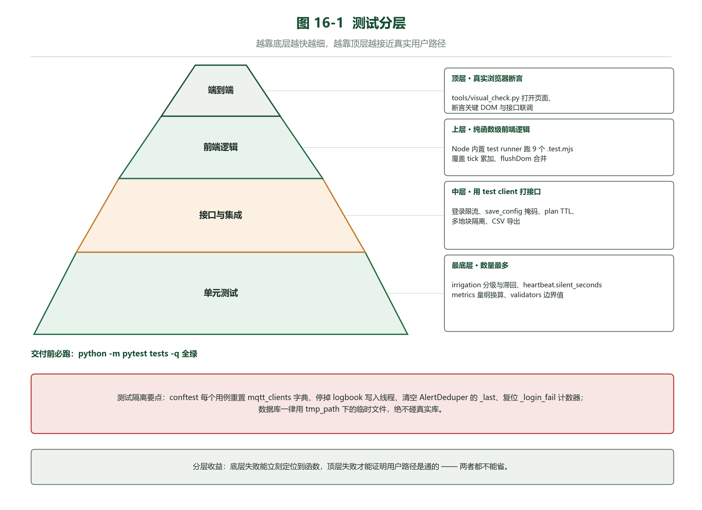

表 15-1 测试分层
| 层次 | 技术手段 | 文件位置 | 关注点 |
|---|---|---|---|
| 单元测试 | pytest | `tests/test_*.py` | 纯函数与状态机的边界值 |
| 接口与集成测试 | pytest + Flask test client | `tests/test_*_routes.py` 等 | 鉴权、校验、状态机、数据隔离 |
| 前端逻辑测试 | Node 内置测试运行器 | `tests/js/*.test.mjs` | 与后端同构的算法、转义、去重、面积公式 |
| 端到端 | 真实浏览器断言 | `tools/visual_check.py` | 页面结构、关键 DOM 是否存在、按钮可点 |

后端测试文件共 37 个（另有 `tests/conftest.py` 与 `tests/helpers.py`），前端逻辑测试 9 个 `.mjs` 文件：`charts`、`config`、`dedupe`、`diag`、`farm`、`features`、`insight`、`irrigation`、`login`。

**测试环境隔离是这套体系能可靠运行的前提。** `tests/conftest.py` 在每个用例前做三件事：

1. 把 `FARM_DB_PATH` 指向 pytest 的 `tmp_path`，每个用例拿到一个全新的空库，用例之间不共享数据；
2. 清空登录限流状态。`auth` 模块用模块级字典 `_login_fail` 记录失败次数，不清理会让"测完限流"之后的用例全部被锁在 429；
3. 清空 MQTT 客户端注册表 `iot.mqtt_clients`，避免上个用例残留的连接条目让"未连接"断言失败。

这三件事覆盖的都是**模块级全局状态**。凡是持有这类状态的模块（`logbook` 的写线程、`alerts.AlertDeduper`、`metrics` 的泵状态基线、`autocontrol` 的开关），新增测试都必须复用 conftest 的隔离钩子，而不是在自己的用例里临时清理——临时清理迟早会漏，漏掉的表现是"单独跑绿、全量跑红"这种最难排查的随机失败。

## 15.2 单元测试重点

算法与纯函数是单测的主战场，因为它们的输入输出都是确定的数值。以下是核心用例的期望值，全部可在本地复现：

表 15-2 核心算法用例
| 用例 | 调用 | 期望值 |
|---|---|---|
| RORI 融合 | `compute_rori(water_adc=1500, soil_adc=2200, do_mgl=6.0, eh_mv=120)` | 75.89（容差 ±0.05） |
| 分级上界 | `classify_rori(70)` | `code = 2`（重度厌氧） |
| 分级下界 | `classify_rori(40)` | `code = 1`（中度缺氧） |
| 6 日加权降雨 | `compute_p6d([0, 8, 20, 5, 12, 3])` | 29.40 |
| 动态阈值 | `compute_dynamic_threshold(40, 80, [0, 8, 20, 5, 12, 3])` | `effLower = 45.0`、`effUpper = 95.0`、`alpha = 0.75` |

动态阈值这一组用例值得展开：`P6d = 29.4` 落在 `10 < P6d ≤ 50` 区间，因此 `alpha = 0.75`；基础下限 40 减去 `α·P6d/H_ROOT×100 = 0.75×29.4/200×100 = 11.025` 得到 28.975，再由保底值 `EFF_LOWER_FLOOR = 45` 抬到 45.0——**"下调"被保底吃掉**，这正是该函数的既有行为，用例把这个行为固定下来，任何人改动阈值公式都会立刻看到断言失败。上限则由 `P6d ≥ 15` 触发蓄雨型控灌上调到 `min(100, 80+15) = 95`。

除算法外，以下单元测试各自盯住一个易错点：

- `heartbeat`：`silent_seconds` 的向上取整（29.6 秒→30）、闭区间判定（恰好 30 秒判在线）、`mark_seen` 对未来时间戳的截断。
- `metrics`：跨本地午夜的时长拆分、UPSERT 累加、以及量纲换算（20 mm × 0.5 m² = 10 L，不得多乘 1000）。
- `planner`：状态机的非法跃迁被拒（`confirmed` 不能再变 `confirmed`）、TTL 过期转 `expired`、动作白名单过滤非法设备名。
- `alert_center`：同一 key 60 秒内只放行一次、到期后再次放行。
- `logbook`：队列满时丢弃最旧且 `dropped_count()` 递增、`flush_logs()` 后数据可查。
- `validators`：严格布尔只接受 `true/false`，拒收 `'yes'` 与 `1`。

## 15.3 接口与集成测试

接口层的测试重点不是"返回 200"，而是"非法输入与越权返回正确的 4xx"。

表 15-3 关键接口用例
| 用例 | 前置 | 期望 |
|---|---|---|
| 登录限流 | 连续 5 次错误密码 | 第 6 次返回 429，提示"请 10 分钟后再试" |
| 注册限流 | 同一来源 IP 连续注册 | 超过 10 次后返回 429 |
| 配置掩码保留 | 提交 `iot_pass` 为 `••••••••` | 数据库中的密码保持原值不变 |
| 端口越界回退 | `iot_port = 99999` | 落库值回退为旧值或 1883 |
| 预案归属校验 | 用 A 用户确认 B 用户的预案 | 失败，预案状态不变 |
| 预案 TTL | 确认一条 601 秒前生成的预案 | 返回失败，状态置 `expired` |
| 导出编码 | 请求 `history.csv` | 响应体以 UTF-8 BOM 开头，表头为中文字段名 |
| 多地块隔离 | A 地块写入历史后在 B 地块查询 | B 地块查不到 A 的记录，但 `farm_id = 0` 的旧数据两者都可见 |
| 快照恢复 | 请求 `/api/telemetry` | 返回当前地块最新遥测，前端可据此填充界面 |

多地块隔离这条用例是增量迭代中最容易回归的一处：查询条件是 `AND (farm_id = ? OR farm_id = 0)`，把 `farm_id = 0` 的兼容分支删掉，升级用户的历史曲线会突然空白；把 `OR` 改成 `AND`，新旧数据都会查不到。用例把这两个方向都钉住。

## 15.4 前端逻辑测试

前端测试只覆盖纯逻辑，不测渲染——因为渲染已经被端到端断言覆盖，而逻辑错误（算法同构、转义遗漏）才是最难靠肉眼发现的那一类。

- **算法同构锚点。** 前端 `static/js/irrigation.js` 的 `computeRori(waterAdc, soilAdc, eh, doVal)` 与后端 `irrigation.compute_rori(water_adc, soil_adc, do_mgl, eh_mv)` 必须给出同一结果。这两个函数的第 3、4 个参数顺序曾经颠倒（前端传 `eh, do`，后端期望 `do, eh`），导致同一组数据前后端算出的 RORI 不一致——后端说"重度厌氧"、前端说"中度缺氧"。修复后加了一条锚点断言：给两边同一组输入，断言输出完全相同。这类"参数顺序错位"是跨语言移植最典型的坑，靠读代码很难发现，只能靠断言锁住。
- **转义。** `esc()` 对 `& < > " '` 五个字符的转义结果逐字符断言。
- **去重。** 分钟桶去重函数：同一分钟内的多条采样归并成一条，跨分钟不归并。
- **降采样。** 图表抽稀的 `step = Math.ceil(len / 300)` 在 300、301、600 三个边界上的取值。
- **面积公式。** `farm.js` 的多边形球面面积 `|Σ dLon·(2 + sin φ₁ + sin φ₂)| · R² / 2`（R = 6371000）对已知多边形（如边长约 100 m 的正方形）给出量级正确的平方米数。

## 15.5 端到端验证与验收标准

`tools/visual_check.py` 用真实浏览器打开页面并按选择器断言：关键区块容器存在、读数卡有值、按钮可点击、弹窗能打开。它覆盖的是"服务起得来、页面渲染得出来"这一层，是纯单元测试无法替代的。

**交付验收的硬性红线：**

- `python -m pytest tests -q` 必须 0 failed、0 error；
- **禁止使用 `pytest.skip`** 让用例"通过"；
- **禁止注释掉断言**让用例"通过"；
- `git status` 必须干净，所有改动已提交；
- 新增或修改任何 API、算法、控制策略、数据表，必须同步新增或更新对应测试。

这条红线必须写进文档而不是只写在开发规范里，因为跳过与注释断言是"看起来绿了"的最快路径，而它把缺陷藏到了验收之后。一条被 skip 的用例与一条不存在的用例，在测试报告上的差别只是多一行黄色的 `s`，但在故障发生时它会让人误以为这块已经被覆盖过。验收报告的价值全部建立在"绿=真的通过"这个前提上。

## 15.6 设计与权衡

**为什么不用 mock 替代数据库。** 数据访问层的很多行为（`PRAGMA table_info` 动态探测列、UPSERT 冲突处理、WAL 并发读写）恰恰是 SQLite 特有的，用 mock 测等于测了个假的东西。改用 `tmp_path` 里的真库，每个用例一份，隔离性与真实性兼得，代价只是几十毫秒的建库开销。

**为什么前端只测纯逻辑。** 渲染测试需要真实浏览器或 DOM 模拟库，前者慢、后者与真实浏览器行为有差异。折中方案是把可测的部分（算法、转义、去重、面积公式）全部抽成纯函数用 Node 测，把"画得对不对"交给端到端与人工看图。

**为什么端到端只做断言不做截图比对。** 截图比对对字体、分辨率、浏览器版本极度敏感，在跨机器环境下维护成本远超收益；断言 DOM 结构与关键文本则稳定得多。

# 十六、待复核假设与缺陷

本章记录设计评审期实测发现的缺陷、修复落点以及仍需复核的设计假设。列出已修复的问题不是自我否定，而是让后续维护者知道"这些地方踩过坑"，避免在同一点上重复犯错。

## 16.1 已修复缺陷台账

表 16-1 已修复缺陷
| 编号 | 位置 | 现象 | 根因 | 修复方式 |
|---|---|---|---|---|
| D-01 | `routes/export_routes.py` 与 `sensor_history` 表 | 导出的 CSV 最后两列（溶解氧、氧化还原电位）恒为空 | 导出选了 `do_mgl`、`eh_mv` 两列，但历史表 DDL 里根本没有这两列，取值恒为 NULL | 历史表扩列 `do_mgl`、`eh_mv` 并加幂等迁移，落库时一并写入 |
| D-02 | `routes/config_routes.py` | 保存配置后页面"保存中"长时间转圈，华为云不可达时请求超时 | 在请求线程内同步调用 `connect_huawei_iot()`，而 `mqtt.Client.connect(host, port, 60)` 最长阻塞 60 秒，并发保存会占满 8 个 waitress 线程 | 改为后台线程重连，接口立即返回"配置已更新" |
| D-03 | 前后端离线阈值 | 同一界面出现"前端说离线、服务端说在线"的矛盾 | 前端原为 20 秒、服务端为 30 秒，两条链路各自独立判定 | 前端 `heartbeatMissLimit` 调到 6，6×5 秒 = 30 秒与服务端对齐；巡检线程接入两个进程入口，使服务端状态真正更新 |
| D-04 | `alert_center._code_for_message` | 修改告警文案后，告警类型静默全部落成默认值 | 用中文文案前缀反推类型码（"土壤湿度过低"→`soil_low`），文案一改映射即失效 | 让 `evaluate_alerts()` 直接产出稳定 `code`，不再依赖中文文案 |
| D-05 | `alerts.evaluate_alerts()` | 告警类型覆盖不全，低水位永远不告警 | 判定函数只产出五类告警，而 `ALERT_CODES` 里保留了 `water_low`，该类型无自动触发路径 | 在遥测旁路 `iot._feed_insight` 补一条低水位告警（保留"自动补水"与"告知用户"并行的语义） |
| D-06 | `routes/app_routes.py` 与 `realtime.py` | 新增设备时 HTTP 能下发、WebSocket 不能（或反之） | `PROP_MAP` 白名单在两处各定义一份，改动易漏 | 收敛到 `qinghe/iot.py` 作为唯一来源，另两处只做别名引用 |
| D-07 | `routes/data_routes.py` | 前端需要特判"未配 Key 的预报失败" | `/api/forecast` 失败时返回 200 + `code:'ERR'`，偏离"非法入参 4xx"约定 | 改为返回 502 并携带同样的错误体，前端只读响应体不读状态码，行为不变 |
| D-08 | `metrics._ensure_schema` | 测试中切换 `FARM_DB_PATH` 后偶发 `no such table: pump_runtime` | 建表标志 `_schema_ready` 只记布尔，不记库路径；换了库仍认为已建表 | 照搬 `alert_center` / `logbook` / `heartbeat` 的写法，按库路径双检 |
| D-09 | `routes/auth_routes.py` | 重命名 `auth.py` 的私有函数即破坏登录限流 | 跨模块直接调用了 `_login_locked` / `_clear_login_fail` / `_record_login_fail` 三个私有函数 | 在 `auth.py` 提供公开包装入口 |
| D-10 | `autocontrol.py` 与 `static/js/realtime.js` | 泵被两条控制回路来回切换 | 前端与服务端各有一套自动调控，同时开启会下发相反指令 | 服务端默认关闭，由 `/api/auto_control` 显式开启；并加 60 秒最小动作间隔 |
| D-11 | `planner` / `metrics` / `autocontrol` | 多 worker 部署时运行态不一致 | 运行态（`_latest`、`_last`、`state_json` 缓存）存进程内存 | 声明约束：仅支持单进程多线程部署，上多进程前必须外移到 DB |
| D-12 | `static/js/irrigation.js` | 同一组数据前后端算出的 RORI 不一致，且不报错 | 前端 `computeRori(waterAdc, soilAdc, eh, doVal)` 的第 3、4 参数与后端 `compute_rori(water_adc, soil_adc, do_mgl, eh_mv)` 顺序相反，把 Eh 当 DO 代入 | 前端参数顺序逐位对齐后端，并加锚点断言锁定（给两边同一组输入，断言输出完全相同） |
| D-13 | `routes/data_routes.py` 与历史趋势图 | 历史 RORI 曲线只有两个维度，严重失真 | `/api/history` 早期不返回 `do_mgl` / `eh_mv`，前端用两维近似算 RORI | 接口放开两列，历史趋势改四维计算，旧数据在界面标注"二维近似值" |

其中三条最值得记住：

**D-12（参数顺序错位）是最隐蔽的一类缺陷。** 前后端各自自洽、都不报错、单测也都能过——因为两边测的都是自己。只有当同一组真实数据在两边分别计算并比对时才会暴露。修复的关键不是改顺序，而是**加了一条跨端锚点断言**，让这种错位不可能再悄悄出现。

**D-02（同步建连阻塞请求）是典型的把 IO 放在错误线程里。** 代码逻辑完全正确，只是执行位置不对，表现为"功能偶尔卡住"。这类问题的修复模板很固定：任何可能阻塞超过百毫秒的操作都从请求线程挪到后台线程或队列。

**D-03（双阈值不一致）源于"两个地方各自定义同一个概念"。** 前端有前端的心跳超时，服务端有服务端的静默阈值，各自看都合理，合起来就矛盾。收敛这类问题的唯一办法是选定单一权威来源，另一侧对齐。

## 16.2 设计假设与复核点

系统里有若干"当前取值合理但需要实测标定"的假设，见表 16-2。

表 16-2 设计假设与复核方式
| 编号 | 假设 | 依据 | 若不成立的影响 | 复核方式 |
|---|---|---|---|---|
| A-01 | ADC 在全量程内线性 | 12 位 ADC + 探针出厂标定 | 水位与土壤湿度的换算出现系统性偏差 | 与实测水尺、烘干法土壤含水率多点比对 |
| A-02 | 水位探针满量程 300 mm | `WATER_FS_MM = 300.0` | 超过 300 mm 的水位被截顶，灌溉量低估 | 现场量取探针有效高度后重新标定 |
| A-03 | 甲烷百年增温潜势取 28 | IPCC AR5 | 减排量口径与其他研究不可比 | 换 AR6 口径需同步更新 `GWP100` |
| A-04 | 渠道面积 0.5 m² | 典型实验小区尺寸 | 用水量按面积等比放大或缩小，误差直接传导 | 实测渠道断面后设 `FARM_CHANNEL_AREA_M2` |
| A-05 | 每小时甲烷减排 0.8 g | 文献量级估计 | 减碳指标绝对数值不可信 | 以通量箱实测标定，或改为只报相对变化 |
| A-06 | 核心活动根系层厚 200 mm | `H_ROOT = 200.0` | 动态阈值中的降雨折算深度失真 | 按实际作物根系分布深度调整 |
| A-07 | 设备时钟基本可信 | 已有 `mark_seen` 的 `min(seen_ts, now)` 兜底 | 时钟大幅漂移会导致历史曲线时间轴错位 | 设备侧加 NTP 或在上报中带序号 |

A-01 与 A-02 是整条数值链路的地基：ADC 换算成物理量靠的是 `adc_to_water_mm()` 与 `adc_to_soil_pct()` 两个纯函数，它们假设探针线性且满量程固定。这两个假设若不成立，后面所有 RORI、阈值、告警都是在错误的地基上做判断。因此现场部署的第一步必须是标定，而不是直接看界面。

## 16.3 已知限制与后续工作

**网关固件中的红线强控尚未实现。** 设计中定义了边端自治的硬红线——氧化还原电位 ≤ −100 mV 或溶解氧 ≤ 1.5 mg/L 时，边端应绕过云端指令直接强制增氧。当前版本这一层仍是设计稿，实际由服务端阈值判定与告警兜底。影响是断网时失去最后一道保护，缓解方式是本地网络与云平台的可用性保障，后续工作是把红线逻辑下放到 ESP32-E 固件。

**微信小程序未开发。** 移动端目前靠响应式布局在浏览器中使用。影响是没有微信生态的入口与消息推送能力，后续可按同一套 HTTP + JWT 接口开发小程序前端，后端无需改动（`/api/app_login` 与 `/api/app_send_command` 已为 App 场景预留）。

**碳减排量缺少 MRV 实测数据。** 减排量按经验系数折算，不满足可测量、可报告、可核查（MRV）要求。影响是该数字只能用于系统内部的趋势比较，不能用于对外交易或履约申报。后续需补通量实测与第三方核查。

**服务端自动调控默认关闭。** 它是"页面关闭时的保底"，与前端控制回路互斥。影响是用户关掉浏览器后系统不再自动动作，除非显式开启。这一取舍是有意的：宁可少自动一点，也不要两条回路互相拆台。

**AI 推理的稳定性依赖上游模型。** 预案生成采用"AI 优先、规则回退"，AI 输出格式不合规时会静默回退到规则预案，用户看到的结果依然可用，但推理质量会下降。影响是体验波动而非功能不可用，这也是把人工确认设为必经环节的原因之一。

# 十七、附录

## 17.1 目录结构

```text
D:\AI\Farm\
├─ app.py                        开发入口：create_app() + SocketIO 启动
├─ server.py                     生产入口：waitress 托管 + 局域网地址探测
├─ requirements.txt              Python 依赖清单
├─ run.bat / start_server.bat    一键启动脚本（GBK + CRLF 编码）
├─ stop_server.bat / firewall_allow.bat  停止与放行脚本
├─ qinghe.db                     SQLite 数据库（含 -wal / -shm）
├─ qinghe\
│   ├─ __init__.py               create_app() 应用工厂 + 蓝图注册
│   ├─ config.py                 全局常量唯一来源（只 import os）
│   ├─ db.py                     连接、建表、幂等迁移、各表 DAO
│   ├─ auth.py                   密码哈希、JWT、登录限流
│   ├─ validators.py             统一入参校验
│   ├─ iot.py                    MQTT 接入、报文解析、遥测落库、指令下发
│   ├─ realtime.py               SocketIO 分房推送与上行指令
│   ├─ irrigation.py             RORI、动态阈值、自动调控（纯函数）
│   ├─ alerts.py                 告警判定、冷却去重、Webhook 推送
│   ├─ alert_center.py           告警落库、查询、确认、清理
│   ├─ logbook.py                有界队列 + 批量落库的异步日志
│   ├─ heartbeat.py              心跳登记与离线巡检
│   ├─ planner.py                AI 决策预案生成与人工确认闭环
│   ├─ metrics.py                节水减碳指标折算
│   ├─ autocontrol.py            服务端自动调控（默认关闭）
│   ├─ weather.py                天气预报代理与逆地理缓存
│   ├─ ai.py                     实时快照、对话代理、SSRF 防护
│   ├─ diag.py                   外部接入连通性自检
│   ├─ simulate.py               四场景设备数据模拟
│   ├─ advice.py                 未来 7 日灌溉建议分档
│   └─ routes\                   10 个 HTTP 蓝图（按业务域拆分）
├─ templates\                    index.html / login.html / knowledge.html
├─ static\
│   ├─ css\                      基础样式 / 监控台 / 弹窗 / 洞察面板
│   ├─ js\                       15 个前端模块（见第十三章）
│   └─ vendor\                   本地化的第三方库（socket.io / Chart.js / Leaflet）
├─ tests\                        37 个 pytest 文件 + 9 个 Node 测试
├─ tools\                        设备模拟器、自检脚本、浏览器断言脚本
└─ docs\                         设计文档、测试报告、部署说明
```

## 17.2 函数索引

表 17-1 主要模块函数索引
| 模块 | 主要函数 | 所在章节 |
|---|---|---|
| `config.py` | 常量表（阈值、超时、限额、量程标定） | 第三章 |
| `db.py` | `get_db()`、`init_db()`、`save_config()`、`query_history()`、`load_iot_config()` | 第四章 |
| `auth.py` | `hash_password()`、`verify_password()`、`issue_token()`、`require_token` | 第六章 |
| `validators.py` | `as_int()`、`get_json_object()`、`parse_int_range()`、`parse_bool_strict()` | 第六章 |
| `irrigation.py` | `compute_rori()`、`classify_rori()`、`compute_p6d()`、`compute_dynamic_threshold()`、`decide_control()` | 第五章 |
| `iot.py` | `connect_huawei_iot()`、`parse_mqtt_payload()`、`ingest_telemetry()`、`send_property_command()`、`HistoryWriter` | 第七章 |
| `realtime.py` | `emit_hw_data()`、`register_events()`、`start_device_watcher()` | 第九章 |
| `alerts.py` | `evaluate_alerts()`、`AlertDeduper.should_emit()`、`notify_webhook()` | 第八章 |
| `alert_center.py` | `push_alert()`、`list_alerts()`、`ack_alert()`、`evaluate_and_push()` | 第八章、第十二章 |
| `logbook.py` | `add_log()`、`query_logs()`、`flush_logs()`、`dropped_count()` | 第十二章 |
| `heartbeat.py` | `mark_seen()`、`get_status()`、`sweep_offline()`、`start_watcher()` | 第十二章 |
| `planner.py` | `build_context()`、`propose_plan()`、`confirm_plan()`、`reject_plan()` | 第十二章 |
| `metrics.py` | `note_pump_state()`、`overview()`、`_add_seconds()` | 第十二章 |
| `autocontrol.py` | `is_enabled()`、`tick()` | 第十二章 |
| `weather.py` | `fetch_forecast()`、`geo_lookup()`、`photon_reverse()` | 第十章 |
| `ai.py` | `build_snapshot()`、`chat()`、`is_public_http_url()` | 第十章 |
| `core.js` | `registerTask()`、`startTicker()`、`flushDom()`、`esc()` | 第十三章 |
| `charts.js` | 图表初始化、降采样、脏标记重绘 | 第十三章 |
| `realtime.js` | SocketIO 连接、心跳看门狗、`applySnapshot()` | 第十三章 |

## 17.3 术语与常量索引

表 17-2 关键常量
| 符号 | 含义 | 取值或出处 |
|---|---|---|
| `ADC_MAX` | 12 位 ADC 满量程 | 4095 |
| `WATER_FS_MM` | 水位探针满量程 | 300 mm |
| `W_EH` / `W_DO` | 氧化还原电位、溶解氧风险权重 | 0.35 / 0.35 |
| `W_WATER_SOIL` | 水位/土壤取大风险权重 | 0.30 |
| `GAMMA` | 水位×土壤耦合惩罚系数 | 0.5 |
| `EH_SAFE_MV` / `EH_SPAN_MV` | SEh 归一化上限与跨度 | 300 mV / 450 mV |
| `DO_SAFE_MGL` | 溶解氧无缺氧风险上限 | 8.0 mg/L |
| `WATER_DEADBAND_MM` | 水位风险死区 | 5.0 mm |
| `RORI_HEAVY` / `RORI_MODERATE` | 重度/中度缺氧分级阈值 | 70 / 40 |
| `RAIN_WEIGHTS` | 6 日降雨时间衰减权重 | [1.0, 0.9, 0.7, 0.5, 0.4, 0.3] |
| `H_ROOT` | 核心活动根系层厚度 | 200 mm |
| `ALPHA_LOW` / `ALPHA_MID` / `ALPHA_HIGH` | 降雨有效利用系数 | 0.95 / 0.75 / 0.45 |
| `EFF_LOWER_FLOOR` | 动态湿度下限保底 | 45% |
| `PLAN_TTL_SECONDS` | 决策预案有效期 | 600 s |
| `DEVICE_OFFLINE_SECONDS` | 设备离线判定阈值 | 30 s |
| `ALERT_COOLDOWN_SECONDS` | 同类告警冷却时间 | 60 s |
| `GWP100` | 甲烷百年增温潜势 | 28 |
| `MAX_EXPORT_ROWS` | 单次 CSV 导出行数上限 | 50000 |
