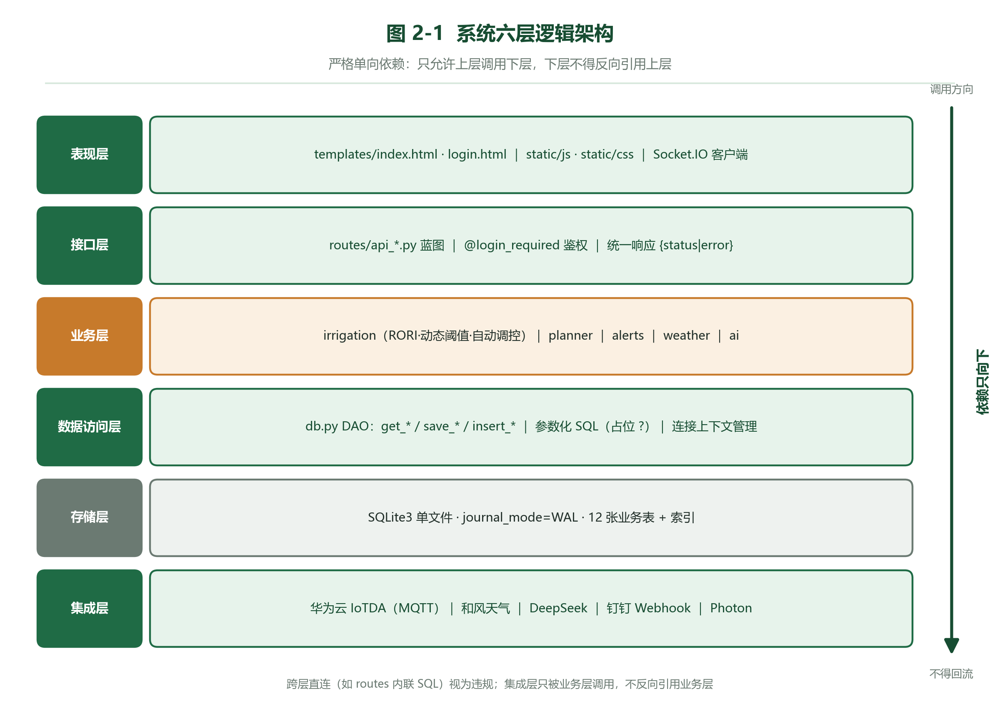

# 契约：Markdown 子集 与 图号表号命名（冻结版）

本文件是 `docs/_gen/` 下所有协作者的**冻结接口**。工具包 `docs/_gen/docx_kit.py` 只认下面这套语法，
写文档的人（`src/概要设计说明书.md`、`src/详细设计说明书.md`）与画图的人（`figs/*.png`）必须严格遵守。

## 一、源文件

| 文件 | 作用 |
|---|---|
| `docs/_gen/docx_kit.py` | Markdown 子集 → Word 渲染器（Lead 维护，勿改） |
| `docs/_gen/build_docs.py` | 组装两份文档并输出到 `文档/`（Lead 维护，勿改） |
| `docs/_gen/src/概要设计说明书.md` | 概要设计说明书正文源 |
| `docs/_gen/src/详细设计说明书.md` | 详细设计说明书正文源 |
| `docs/_gen/figs/*.png` | 全部插图（生成的图 + 界面截图副本），路径统一相对 `docs/_gen/` |

## 二、Markdown 子集（只支持这些，其余原样当段落）

### 1. 文首元信息（必须放在文件最开头）

```
---
title: 青禾智灌智慧灌溉管理平台
subtitle: 概要设计说明书
version: V1.0
date: 2026年10月19日
---
```

### 2. 标题层级

| 写法 | Word 样式 | 用途 |
|---|---|---|
| `# xxx` | Heading 1 | 正文首行文档全名（**全文只允许 1 次**，紧跟元信息之后） |
| `## 一、引言` | Heading 2 | 章（中文数字 + 、） |
| `### 1.1 编写目的` | Heading 3 | 节（阿拉伯 N.M + 空格 + 标题） |
| `#### 1.1.1 xxx` | Heading 4 | 目（尽量少用） |

章序号必须连续：一、二、三……节序号必须与所在章号一致（第三章的节是 `3.1`/`3.2`）。

### 3. 段落与行内

- 普通一行 = 一个段落。**段与段之间必须留一个空行。**
- `**加粗**` → 加粗
- `` `代码` `` → Consolas 等宽
- `- 条目` → 一级项目符号；`  - 条目`（前面两个空格）→ 二级项目符号
- `1. 条目` → 手工编号段落（缩进对齐，不自动编号）
- `> 文字` → 提示框（浅绿底），用于「设计权衡/注意事项」
- `<!-- pagebreak -->` 单独一行 → 分页符

### 4. 表格

```
表 4-1 模块划分总表

| 模块 | 文件 | 职责 |
|---|---|---|
| 配置 | qinghe/config.py | 常量与运行期配置 |
| 数据访问 | qinghe/db.py | 连接、迁移、DAO |
```

规则：
- 表题单独一行、紧贴表格上方，形如 `表 N-M 标题`；**表题行与表格之间不留空行**。
- 分隔行 `|---|---|` 必需，列数一致。
- 表格前一行的 `表 N-M` 会被自动识别为表题（居中、小号、位于表上方）；数字编号由作者按章节手工给出。
- 单元格内支持 `**加粗**` 与 `` `代码` ``；不支持单元格内换行。

### 5. 插图

```

```

- 图片路径**统一相对 `docs/_gen/`**（即写成 `figs/xxx.png`）。
- `![...]` 里的文字就是图题，居中排在图下方，自动加 `图 N-M`（作者手写编号）。
- 建议图宽 16 cm（工具包默认按页面宽度自适应，超过则等比缩到页宽）。

### 6. 代码块

````
```python
def compute_rori(eh, do, level, soil):
    ...
```
````

→ 浅灰底、Consolas 9.5pt、单倍行距。

## 三、图号 / 文件名冻结清单

**画图的人按这张表产出文件名；写文档的人按这张表引用。双方都不得改名。**

### 概要设计说明书（前缀 `g_`）

| 文件名 | 图题 |
|---|---|
| `g_arch.png` | 图 2-1 系统六层逻辑架构 |
| `g_creative.png` | 图 2-2 四阶段闭环协同调控架构 |
| `g_edgecloud.png` | 图 2-3 边云协同与边缘自治保底机制 |
| `g_module_dep.png` | 图 3-1 模块依赖关系 |
| `g_dataflow.png` | 图 5-1 遥测上报到前端展示的数据流转 |
| `g_controlflow.png` | 图 5-2 控制指令下发流程 |
| `g_rori.png` | 图 5-3 RORI 计算与三级分级 |
| `g_p6d.png` | 图 5-4 六日降雨前馈动态阈值修正 |
| `g_autocontrol.png` | 图 5-5 自动调控决策与滞回去抖 |
| `g_hitl.png` | 图 5-6 AI 预案闭环人机协同时序 |
| `g_alert.png` | 图 5-7 告警产生、去重与推送 |
| `g_er.png` | 图 6-1 数据库实体关系 |
| `g_ui_login.png` | 图 12-1 登录页 |
| `g_ui_dashboard.png` | 图 12-2 主监控台 |
| `g_ui_insight.png` | 图 12-3 智能洞察面板 |
| `g_ui_settings.png` | 图 12-4 系统设置弹窗 |
| `g_ui_knowledge.png` | 图 12-5 知识库 |
| `g_ui_narrow.png` | 图 12-6 窄屏自适应 |

### 详细设计说明书（前缀 `x_`）

| 文件名 | 图题 |
|---|---|
| `x_layers.png` | 图 2-1 分层调用与命名约定 |
| `x_thread.png` | 图 2-2 并发线程模型 |
| `x_migration.png` | 图 4-1 幂等迁移流程 |
| `x_rori_norm.png` | 图 5-1 四路风险因子归一化曲线 |
| `x_rori_fuse.png` | 图 5-2 RORI 融合与分级数值轴 |
| `x_histwriter.png` | 图 7-1 HistoryWriter 队列批量落库与背压 |
| `x_mqtt.png` | 图 7-2 handle_mqtt_message 三种报文分支 |
| `x_alertdedup.png` | 图 8-1 AlertDeduper 冷却算法状态 |
| `x_realtime.png` | 图 9-1 SocketIO 房间模型与事件契约 |
| `x_ai_fallback.png` | 图 10-1 外部调用超时降级链路 |
| `x_http_pipeline.png` | 图 11-1 HTTP 请求处理流水线 |
| `x_plan_ttl.png` | 图 12-1 决策预案状态机与 TTL |
| `x_tick.png` | 图 13-1 前端统一 tick 调度与批量 DOM 更新 |
| `x_ui_panel.png` | 图 14-1 主监控台区块与 DOM 挂载点 |
| `x_test_layers.png` | 图 16-1 测试分层 |

## 四、画图规范

- 输出 PNG，宽度 ≥ 1600 px，白底，四周留 20 px 白边。
- 中文字体用 `Microsoft YaHei`（matplotlib：`font.sans-serif = ['Microsoft YaHei']`，`axes.unicode_minus = False`）。
- 配色沿用系统主题：深绿 `#174D32`、主绿 `#1F6B45`、浅绿 `#E7F3EB`、次级灰 `#6B7A72`、强调橙 `#C77A2B`、警示红 `#B5322F`。
- 不要用 `graphviz`（本机无 `dot`）；用 `matplotlib` 画（矩形 + 箭头 + 文本）。
- 生成脚本放在 `docs/_gen/make_figs_gaikuo.py` / `docs/_gen/make_figs_xiangxi.py`，可重复执行、覆盖式产出。
- 界面截图副本从 `docs/_shots/` 复制到 `docs/_gen/figs/`，只允许缩放/裁剪，不允许改内容。
